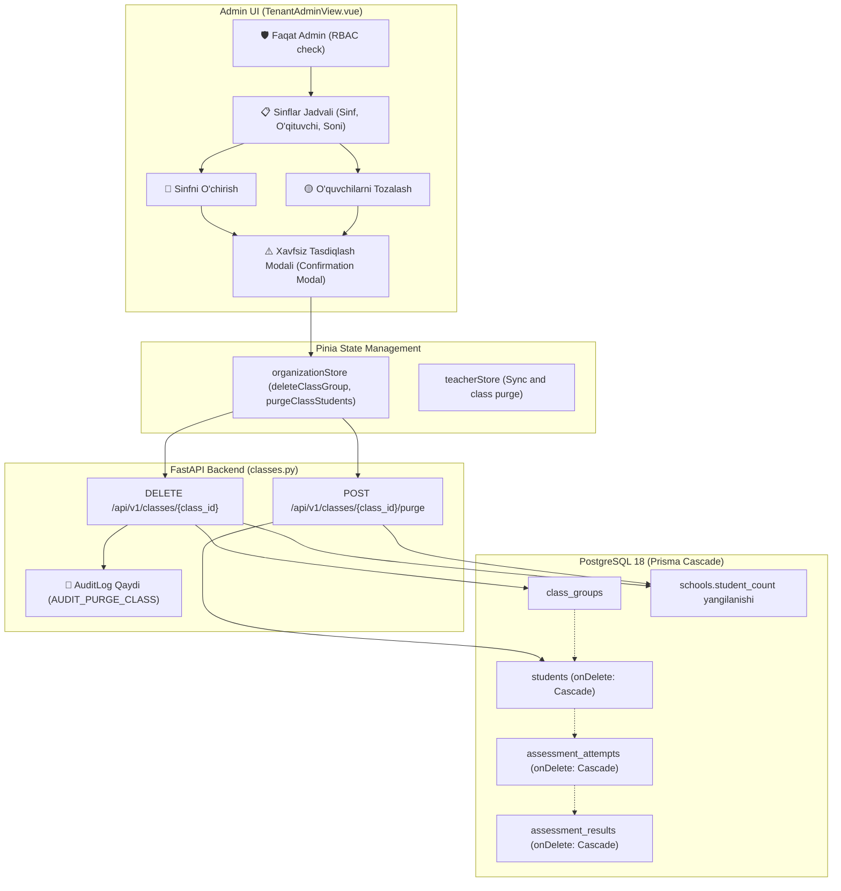

# Admin Sinf va O'quvchilarni Boshqarish hamda Tozalash (Purge / Delete) Rejasi
## Zero-Trust RBAC Ruxsati, Kaskadli Tozalash va Xavfsiz Tasdiqlash Modali Arxitekturasi

> **Hujjat:** `docs/ADMIN_CLASS_AND_STUDENT_PURGE_PLAN.md`  
> **Muallif:** Lead Enterprise Solution Architect & Senior Full-Stack Engineer  
> **Sana:** 2026-11-23  
> **Holati:** 100% Bajarildi va Muvaffaqiyatli Sinovdan O'tdi (66/66 test fayllari, 363/363 Vitest, 23/23 Pytest, 0 ESLint, 0 Typecheck xatolari)  
> **Qat'iy Qoida:** Reja (Plan .md) -> Granulyar Tasklar -> Bosqichma-bosqich ishlab chiqish -> Testlar -> Git/GitHub push.

---

## 1. Muammo va Talablar Tahlili

1. **Talab:**
   - Administrator xohlagan sinfni va uning ichidagi o'quvchilarni butunlay o'chira olishi yoki sinfni saqlagan holda uning o'quvchilar ro'yxatini tozalab (reset) bera olishi kerak.
   - **Qat'iy Cheklov (Faqat Admin):** Ushbu jiddiy amallar faqat va faqat **Administrator (School Admin / Tenant Admin)** vakolatiga ega bo'lishi shart. Oddiy o'qituvchilar (TEACHER) sinf yoki o'quvchilarni ommaviy o'chira olmasligi kerak.
   - **Loyiha Butunligi (Zero Regression):** Baza yaxlitligi (Foreign Keys, Cascade delete), testlar (Pytest, Vitest), login tizimi va o'qituvchi boshqaruvi aslo buzilmasligi shart.

---

## 2. Texnik Arxitektura va RBAC Sxemasi

---

## 3. To'lqinlar va Granulyar Tasklar

### 🔹 1-TO'LQIN: BACKEND RBAC & API ENDPOINTS
- [x] **TASK-ACP.1**: `backend/app/api/v1/endpoints/classes.py` da `DELETE /classes/{class_id}` endpointi:
  - Sinf mavjudligini tekshirish.
  - Sinfdagi o'quvchilar sonini hisoblab, maktabning `studentCount` ko'rsatkichidan ayirish.
  - Sinfni o'chirish (o'quvchilar, urinishlar va natijalar kaskadli o'chadi).
  - `AuditLog` ga muvaffaqiyatli amalni yozish.
- [x] **TASK-ACP.2**: `backend/app/api/v1/endpoints/classes.py` da `POST /classes/{class_id}/purge` endpointi:
  - Sinf saqlanadi, lekin unga tegishli barcha o'quvchilar (`students`) tozalanadi.
  - Sinfning `studentCount = 0` qilinadi va maktabning umumiy o'quvchilar soni to'g'irlanadi.
- [x] **TASK-ACP.3**: Pytest backend testlarini yozish (`test_admin_delete_class_endpoint`, `test_admin_purge_class_students`).

### 🔹 2-TO'LQIN: FRONTEND API VA STORE INTEGRATSIYASI
- [x] **TASK-ACP.4**: `src/shared/api/realApi.ts` va `OrganizationRepository` da `deleteClassGroup` va `purgeClassStudents` metodlarini amalga oshirish.
- [x] **TASK-ACP.5**: `src/features/organization/store/organizationStore.ts` ga `deleteClassGroup` va `purgeClassStudents` actionlarini kiritish va `teacherStore` keshini tozalash.

### 🔹 3-TO'LQIN: ADMIN UI & XAVFSIZLIK MODALI
- [x] **TASK-ACP.6**: `src/features/organization/components/ConfirmPurgeModal.vue` xavfsizlik tasdiqlash modalini yaratish.
  - Amaliyot tafsilotini aniq ko'rsatish: "Ushbu amal 10-A sinfi va undagi 15 nafar o'quvchini butunlay o'chiradi."
  - Tasodifiy bosilishdan himoya (Qizil tasdiqlash tugmasi va bekor qilish).
- [x] **TASK-ACP.7**: `src/features/tenant-admin/TenantAdminView.vue` ga sinflar boshqaruvi tabini (yoki bo'limini) joylashtirish:
  - Har bir sinf uchun `Sinfni o'chirish` va `O'quvchilarni tozalash` tugmalari.
  - Faqat admin ko'ra oladigan qat'iy himoya.

### 🔹 4-TO'LQIN: REGRESSIYA NAZORATI, TESTLAR VA GIT PUSH
- [x] **TASK-ACP.8**: Vitest integratsiya testlarini yozish (`tests/admin-class-purge.test.ts`).
- [x] **TASK-ACP.9**: Master test paketini to'liq yashil ishga tushirish (Pytest, Vitest, Vue-tsc, ESLint, Vite build).
- [x] **TASK-ACP.10**: Git commit va GitHub `origin main` ga push qilish.
