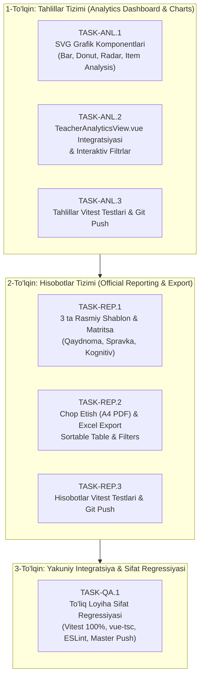

# Tahlillar va Hisobotlar Tizimini Professional Darajaga Olib Chiqish Rejasi
## CHSB Platform — Advanced Pedagogical Analytics & Official Reporting Suite

> **Hujjat:** `docs/ANALYTICS_AND_REPORTS_MASTER_PLAN.md`  
> **Muallif:** Senior Lead UI/UX Engineer & EdTech System Architect  
> **Holati:** Tasdiqlangan va Amalga Oshirishga Tayyor  
> **Qoidaga Muvofiqlik:** Har bir prompt/vazifa uchun qat'iy "Reja -> Tasklar -> Bosqichma-bosqich ishlab chiqish -> Har bir taskdan keyin alohida testlash (100% PASS) -> Git & GitHub ga push" tartibi joriy etildi.  
> **Standartlar:** O'zbekiston Respublikasi Maktabgacha va maktab ta'limi vazirligi, Ixtisoslashtirilgan ta'lim muassasalari agentligi, Baholash agentligi (CHSB) va OECD PISA xalqaro ta'limiy diagnostika mezonlari.

---

## 1. Arxitekturaviy Maqsad va Vizual Talablar

Mavjud tahlillar va hisobotlar sahifalari oddiy progress barlar va sodda jadvaldan iborat edi. Haqiqiy zamonaviy ta'lim muassasalari (Al-Xorazmiy, Prezident maktablari, litseylar) uchun pedagogik qarorlar qabul qilishda quyidagi professional imkoniyatlar talab etiladi:

1. **Zamonaviy Interaktiv Grafiklar (Zero-Dependency SVG Crisp Charts):**
   - Tashqi og'ir kutubxonalarga (Chart.js, ApexCharts) bog'lanib qolmasdan, 100% tezkor, engil, SVG-ga asoslangan, to'liq Dark Mode mos va mobil qurilmalarga moslashuvchan grafiklar.
2. **Kognitiv Ko'nikmalar Tahlili (Bloom Taksonomiyasi):**
   - Bilish (Knowledge), Qo'llash (Application) va Mulohaza (Reasoning) bo'yicha ko'p qirrali vizual tahlil va pedagogik tavsiyalar.
3. **Savollar Bo'yicha Diskriminatsiya (Item Difficulty & Discrimination):**
   - 15 ta savolning qiyinlik koeffitsiyenti ($P$-value) va qaysi savollarda o'quvchilar eng ko'p xato qilganini ko'rsatuvchi xaritalar.
4. **Rasmiy Hujjat Formatidagi Hisobotlar (Official Printable Dossiers):**
   - Chop etishga (A4 / PDF) 100% tayyor rasmiy qaydnoma, ma'muriy tahliliy spravka, gerb, maktab ma'lumotlari va rasmiy imzo joylari.
5. **Qat'iy WCAG 2.1 AA va Dark Mode Uyg'unligi:**
   - Kontrast, semantik teglar, hover tooltip-lar va klaviatura bilan boshqarish.

---

## 2. Bosqichma-bosqich Vazifalar Rejasi (Task Breakdown)

---

## 3. Vazifalarning Batafsil Texnik Tavsifi

### 🔹 1-TO'LQIN: TAHLILLAR TIZIMI (ANALYTICS DASHBOARD & CHARTS)

#### TASK-ANL.1: Professional SVG Grafik Komponentlarini Yaratish
- **Fayllar:**
  - `src/features/teacher/analytics/components/ClassComparisonChart.vue`
    - Sinflararo (11-A vs 11-B vs 11-V) o'rtacha ball, maksimal ball va ishtirok darajasini ko'rsatuvchi guruhlangan ustunli (Column/Bar) SVG diagramma.
    - Hover bo'lganda interaktiv tooltip ko'rsatkichi.
  - `src/features/teacher/analytics/components/ScoreDistributionDonut.vue`
    - Baholar taqsimoti: 5 (A'lo), 4 (Yaxshi), 3 (Qoniqarli), 2 (Qoniqarsiz) nisbatini ko'rsatuvchi interaktiv halqasimon (Donut) SVG diagramma. Markazida umumiy o'quvchilar soni va dominant baho.
  - `src/features/teacher/analytics/components/CognitiveRadarChart.vue`
    - Bilish (B), Qo'llash (Q), Mulohaza (M) kognitiv darajalarini aks ettiruvchi ko'pburchakli (Polygon Radar) diagramma va pedagogik tavsiyalar kartasi.
  - `src/features/teacher/analytics/components/QuestionItemAnalysis.vue`
    - 15 ta test savolining to'g'ri yechilish foizi, qiyinlik darajalari (Oson, O'rtacha, Qiyin, Yuqori) va muammoli mavzular bo'yicha diagnostik ogohlantirish.

#### TASK-ANL.2: `TeacherAnalyticsView.vue` ni Qayta Qurish
- **Fayllar:** `src/features/teacher/analytics/TeacherAnalyticsView.vue`
- **Vazifalar:**
  - Yuqori qismda **Executive KPI Ribbon**: O'rtacha ball (`35.8 / 40.0`), Sifat ko'rsatkichi (`87.5%`), O'zlashtirish (`100%`), Median ball (`36.5`) va Standart chetlanish ($\sigma = 2.1$).
  - Jonli filtrlar: Sinf tanlash (Barcha sinflar, 11-A, 11-B), Imtihon tanlash (1-CHSB).
  - Barcha yangi SVG grafiklarini zamonaviy panellar, to'liq Dark Mode (`dark:bg-slate-800`), A11y va sensorli moslashuvchanlik bilan joylashtirish.

#### TASK-ANL.3: Tahlillar Sinov Testlari & Git Push
- **Fayllar:** `tests/teacher-analytics-advanced.test.ts`
- **Vazifalar:**
  - Sinflar taqqoslama grafigi, Donut diagrammasi, Radar diagrammasi va savollar tahlili komponentlarining to'g'ri render bo'lishi va ma'lumotlar o'zgarishiga reaksiyasini tekshirish.
  - Testlar 100% PASS bo'lgach, atomik Git commit va GitHub-ga yuklash.

---

### 🔹 2-TO'LQIN: HISOBOTLAR GENERATORI (OFFICIAL REPORTING & EXPORT)

#### TASK-REP.1: 3 ta Rasmiy Shablon va Kognitiv Matritsa
- **Fayllar:** `src/features/teacher/reports/TeacherReportsView.vue`
- **Vazifalar:**
  - **1-shablon: CHSB Rasmiy Yig'ma Qaydnomasi (Vazirlik standarti):** O'quvchi F.I.SH., sinf, roster kod, ball (40 max), foiz, 5 ballik baho, kognitiv ballar (B, Q, M), holati.
  - **2-shablon: Maktab Ma'muriyati uchun Tahliliy Spravka (Executive Summary):** Sinf reytingi, eng a'lochi o'quvchilar, qo'shimcha yordamga muhtojlar, sifat ko'rsatkichi, pedagogik tavsiya.
  - **3-shablon: Kognitiv Diagnostika Matritsasi:** Har bir o'quvchining B/Q/M ko'nikmalarini rangli badjlar orqali ko'rsatuvchi matritsa jadvali.
  - Jonli qidiruv (F.I.SH. bo'yicha), ustunlar bo'yicha saralash (Sortable: Ball, Ism, Sana) va baholar bo'yicha tezkor filtrlar.

#### TASK-REP.2: Professional Chop Etish (A4 PDF) & Ko'p Funksiyali Eksport
- **Fayllar:** `src/features/teacher/reports/TeacherReportsView.vue`
- **Vazifalar:**
  - `@media print` stilizatsiyasi: A4 format, pechat va imzo o'rinlari (Fan o'qituvchisi, O'IBDO', Maktab direktori), sahifa uzilishi himoyasi (`page-break-inside: avoid`).
  - Ekranda "Rasmiy Chop Etish Rejimi" (Print Preview Mode) ni yoqish/o'chirish imkoniyati.
  - UTF-8 BOM (`\uFEFF`) CSV/Excel formatida to'liq hisobotni yuklab olish (o'zbekcha harflar buzilmasdan).

#### TASK-REP.3: Hisobotlar Sinov Testlari & Git Push
- **Fayllar:** `tests/teacher-reports-advanced.test.ts`
- **Vazifalar:**
  - 3 ta shablon almashinuvi, saralash, qidiruv, hisob-kitoblar va eksport tugmalarining ishlashini tekshirish.
  - Testlar 100% PASS bo'lgach, atomik Git commit va GitHub-ga yuklash.

---

### 🔹 3-TO'LQIN: YAKUNIY INTEGRATSIYA VA SIFAT KAFOLATI

#### TASK-QA.1: To'liq Loyiha Sifat Regressiyasi & Master Push
- **Vazifalar:**
  - `npm test` -> Barcha 55+ ta test to'plami, 300+ testlar 100% yashil (PASS).
  - `npm run typecheck` (`vue-tsc --noEmit`) -> 0 ta xato.
  - `npm run lint` -> 0 ta ogohlantirish.
  - `npm run build` -> Production build muvaffaqiyatli yig'ilishi.
  - Yakuniy Master Push va hisobot.

---

## 4. Kutilayotgan Natija

Ushbu reja to'liq amalga oshirilgach:
1. Tahlillar sahifasi xalqaro EdTech platformalar (Khan Academy, Edmodo, Canvas) darajasidagi zamonaviy interaktiv SVG diagrammalarga ega bo'ladi.
2. O'qituvchi va maktab ma'muriyati bir tugma bilan davlat attestatsiyasi va vazirlikka taqdim etish mumkin bo'lgan rasmiy A4 spravka va qaydnomalarni chop eta oladi.
3. Loyihada qat'iy "Reja -> Tasklar -> Testlar -> Git" qoidasi to'liq kafolatlanadi.
