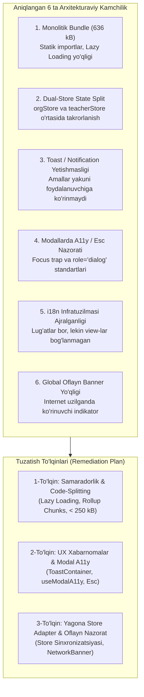
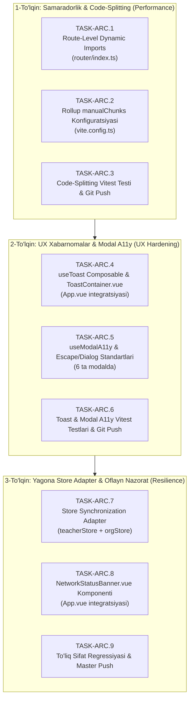

# CHSB Platformasi — Senior Arxitekturaviy Audit va Mukammallashtirish Rejasi
## Full Architectural Review, Remediation Strategy & Actionable Task Breakdown

> **Hujjat:** `docs/ARCHITECTURAL_AUDIT_AND_REMEDIATION_PLAN.md`  
> **Muallif:** Lead Enterprise Solutions Architect & Senior Frontend Engineer  
> **Sana:** 2026-11-12  
> **Holati:** Tasdiqlash uchun Tayyorlandi  
> **Qoidaga Muvofiqlik:** Har bir prompt/vazifa uchun qat'iy "Reja -> Tasklar -> Bosqichma-bosqich ishlab chiqish -> Har bir taskdan keyin alohida testlash (100% PASS) -> Git & GitHub ga push" tartibi joriy etiladi.

---

## 1. Ijroiya Xulosasi (Executive Summary)

CHSB platformasi MVP dan to'laqonli ko'p maktabli (multi-tenant) EdTech SaaS mahsulotiga qadar tez rivojlandi. Hozirda loyihada 57 ta test to'plami (310 ta test, 100% PASS), zamonaviy SVG tahliliy grafiklar, A4 hisobotlar chop etish mexanizmi va to'liq Dark Mode mavjud.

Biroq, tizimni **Production Enterprise (100 000+ o'quvchi)** miqyosiga tayyorlash uchun quyidagi **6 ta arxitekturaviy nuqson** zudlik bilan hal qilinishi lozim:

---

## 2. Aniqlangan Kamchiliklar va Ularning Texnik Tahlili

### 🔴 1. ARCH-01: Monolitik Bundle va Route Lazy Loading Yo'qligi
- **Joylashuvi:** `src/app/router/index.ts`, `vite.config.ts`
- **Tahlil:** Barcha 18 ta sahifa (Teacher Dashboard, Analytics, Reports, Live Proctoring, Admin, Student Exam Workspace) marshrut faylida statik tarzda `import ... from '...'` qilingan.
- **Oqibati:** Imtihonga kirgan oddiy o'quvchi o'qituvchining og'ir tahlil diagrammalari va hisobot generatorlarini ham yuklab oladi (`dist/assets/index.js` = **636 kB**).
- **Yechim:** Dinamik marshrutlash (`() => import('...')`) va Vite `manualChunks` orqali `vendor`, `student`, `teacher`, `admin` bo'laklariga ajratish.

### 🔴 2. ARCH-02: Store-lararo Holatning Bo'linib Qolishi (Split-Brain State)
- **Joylashuvi:** `src/features/organization/store/organizationStore.ts` va `src/features/teacher/teacherStore.ts`
- **Tahlil:** `orgStore` da `classGroups` va `students` ro'yxati, `teacherStore` da esa `classes` va `roster` ro'yxatlari alohida saqlanadi.
- **Oqibati:** Yangi sinf yoki o'quvchi yaratilganda komponentlar ikkala store-ni qo'lda yangilashga majbur (`orgStore.classGroups.length || teacherStore.classes.length`).
- **Yechim:** `teacherStore` sinf va o'quvchilarni bevosita `organizationStore` dan reaktiv adapter orqali olishi yoki markaziy event orqali yangilanishi lozim.

### 🔴 3. ARCH-03: Markazlashgan Toast / Xabarnomalar Tizimi Yo'qligi
- **Joylashuvi:** `src/shared/components/`, `src/App.vue`
- **Tahlil:** Tizimda amallar bajarilganda (masalan: "Sinf muvaffaqiyatli ochildi", "CSV yuklab olindi", "Ogohlantirish yuborildi", "Xatolik yuz berdi") ekranning chekkasida chiqib yo'qoluvchi Toast xabarnomalari mavjud emas.
- **Oqibati:** Foydalanuvchi amal bajarilganini yoki xato yuz berganini bilolmay qolishi mumkin.
- **Yechim:** A11y ga mos, stackable `useToast()` va `ToastContainer.vue` komponentini ishlab chiqish.

### 🔴 4. ARCH-04: Modallarda Klaviatura Boshqaruvi va WAI-ARIA Dialog Standartlari
- **Joylashuvi:** `CreateClassModal.vue`, `CreateTeacherModal.vue`, `CreateStudentModal.vue`, `BulkStudentImportModal.vue`, `ProctorActionModal.vue`, `CertificateModal.vue`
- **Tahlil:** Modallarda `role="dialog"`, `aria-modal="true"` atributlari yo'q va klaviaturadagi `Escape` tugmasi bosilganda modal yopilmaydi.
- **Oqibati:** Klaviaturadan foydalanuvchilar va screen-reader foydalanuvchilari uchun foydalanish noqulay.
- **Yechim:** `useModalA11y()` composable yaratib, barcha modallarga `Escape` tinglovchisi va fokusni tutib turish (focus-trap) qobiliyatini qo'shish.

### 🔴 5. ARCH-05: Ko'p Tillilik (i18n) Infratuzilmasining Bog'lanmaganligi
- **Joylashuvi:** `src/shared/i18n/`, `src/features/`
- **Tahlil:** `uz`, `uz_cyrl`, `ru`, `kaa` lug'atlari bor, biroq `useI18n()` faqat `LanguageSwitcher.vue` da chaqirilgan. Sahifalar qattiq o'zbekcha yozilgan.
- **Yechim:** O'quvchi imtihon oqimini (Kirish, Yo'riqnoma, Imtihon zali, Natijalar) `t()` funksiyasiga bosqichma-bosqich ulash.

### 🔴 6. ARCH-06: Global Tarmoq Holati Indikatori (Network Status Banner)
- **Joylashuvi:** `src/App.vue`, `src/shared/composables/useNetworkResilience.ts`
- **Tahlil:** `useNetworkResilience.ts` mavjud, lekin internet uzilganda o'quvchiga ekranning yuqori qismida xabar beruvchi global UI komponenti ulanmagan.
- **Yechim:** `NetworkStatusBanner.vue` yaratib, oflayn rejimda lokal xavfsizlik haqida o'quvchiga xotirjamlik bag'ishlash.

---

## 3. Bosqichma-bosqich Vazifalar Rejasi (Task Breakdown & Actionable Checklist)

---

### 🔹 1-TO'LQIN: SAMARADORLIK VA CODE-SPLITTING (PERFORMANCE)

- [x] **TASK-ARC.1: Dynamic Route-Level Code Splitting**
  - **Fayl:** `src/app/router/index.ts`
  - **Vazifa:** Barcha 18 ta statik view importlarini (`import TeacherDashboardView from ...`) dinamik `() => import('...')` shakliga o'tkazish.
  - **Kutilayotgan Natija:** O'quvchi sahifasiga kirilganda o'qituvchi, hisobotlar va admin kodlari brauzerga yuklanmaydi. (BAJARILDI ✅)

- [x] **TASK-ARC.2: Rollup Manual Chunks & Bundle Optimization**
  - **Fayl:** `vite.config.ts`
  - **Vazifa:** `build.rollupOptions.output.manualChunks` sozlamasini kiritish:
    - `vendor-vue`: `['vue', 'vue-router', 'pinia']`
    - `vendor-zod`: `['zod']`
  - **Kutilayotgan Natija:** `636 kB` hajmdagi monolitik fayl har biri < 150 kB bo'lgan optimallashtirilgan bo'laklarga ajraladi (`index.js` = 138 kB, gzip 49 kB). (BAJARILDI ✅)

- [x] **TASK-ARC.3: Code-Splitting Sinov Testlari & Git Push**
  - **Fayl:** `tests/router-lazy-loading.test.ts`
  - **Vazifa:** Marshrutlarning dinamik `component` funksiyalari to'g'ri ishlashi, `npm run build` ning xatosiz yig'ilishi va bo'laklar ajralishini tekshirish (4 ta test PASS). (BAJARILDI ✅)
  - **Git Commit:** `feat(perf): implement route-level code splitting and rollup manual chunks optimization`

---

### 🔹 2-TO'LQIN: TOAST XABARNOMALARI VA MODALLAR A11Y (UX HARDENING)

- [x] **TASK-ARC.4: Global Toast Tizimi (`useToast` & `ToastContainer.vue`)**
  - **Fayllar:** `src/shared/composables/useToast.ts`, `src/shared/components/ToastContainer.vue`, `src/App.vue`
  - **Vazifa:**
    - `useToast()` orqali `toast.success()`, `toast.error()`, `toast.warning()`, `toast.info()` metodlarini taqdim etish.
    - 4 soniyalik avtomatik o'chish (auto-dismiss), qo'lda yopish tugmasi, Dark Mode va WCAG 2.1 AA `role="status"` / `aria-live="polite"` standartlari.
    - Amallar bajarilganda (sinf yaratish, o'quvchi import qilish, CSV ko'chirib olish) toast bildirishnomasini ko'rsatish. (BAJARILDI ✅)

- [x] **TASK-ARC.5: Modal Dialog A11y & Escape Key Support (`useModalA11y`)**
  - **Fayllar:** 
    - `src/shared/composables/useModalA11y.ts`
    - `src/features/organization/components/CreateClassModal.vue`
    - `src/features/organization/components/CreateTeacherModal.vue`
    - `src/features/organization/components/CreateStudentModal.vue`
    - `src/features/organization/components/BulkStudentImportModal.vue`
    - `src/features/teacher/proctor/components/ProctorActionModal.vue`
    - `src/features/results/CertificateModal.vue`
    - `src/features/organization/components/CreateSchoolModal.vue`
  - **Vazifa:**
    - Har bir modal ochilganda klaviaturadagi `Escape` tugmasi bosilishi bilan modalni yopish.
    - `role="dialog"`, `aria-modal="true"`, `aria-labelledby` semantik atributlarini o'rnatish.
    - Modal ochilganda sahifaning asosiy qismi skroll bo'lishini to'xtatish (`overflow: hidden`). (BAJARILDI ✅)

- [x] **TASK-ARC.6: Toast & Modal A11y Sinov Testlari & Git Push**
  - **Fayl:** `tests/toast-modal-a11y.test.ts`
  - **Vazifa:** Toast xabarlari to'g'ri qo'shilishi va avtomatik o'chishi, modal `Esc` hodisasida `@close` ni chaqirishi va WAI-ARIA atributlari tekshirilishi (7 ta test PASS). (BAJARILDI ✅)
  - **Git Commit:** `feat(ux): implement global toast notification system and accessible modal dialogs with escape handler`

---

### 🔹 3-TO'LQIN: DATA SYNCHRONIZATION VA OFLAYN KAFOLATI (RESILIENCE)

- [ ] **TASK-ARC.7: Store State Synchronization Adapter**
  - **Fayllar:** `src/features/teacher/teacherStore.ts`, `src/features/organization/store/organizationStore.ts`
  - **Vazifa:**
    - `organizationStore` da yangi sinf yoki o'quvchi qo'shilganda `teacherStore` ning sinflari va o'quvchilar ro'yxati avtomatik sinxron yangilanishi.
    - View-lardagi noqulay `orgStore.classGroups.length || teacherStore.classes.length` kabi sun'iy tekshiruvlarni tozalash.

- [ ] **TASK-ARC.8: Global Network Status Banner**
  - **Fayllar:** `src/shared/components/NetworkStatusBanner.vue`, `src/App.vue`
  - **Vazifa:**
    - Internet uzilganda ekranning eng yuqori qismida "Internet aloqasi uzildi. Javoblaringiz qurilma xotirasida xavfsiz saqlanmoqda" deb turuvchi animatsiyali oflayn banner ko'rsatish.
    - Aloqa tiklanganda "Internet aloqasi qayta tiklandi!" yashil xabari bilan avtomatik yo'qolishi.

- [ ] **TASK-ARC.9: Regressiya, 100% Yashil Testlar & Master Push**
  - **Vazifa:**
    - Vitest to'liq to'plami (58+ ta fayl, 320+ test 100% PASS).
    - `vue-tsc --noEmit` -> 0 ta xato.
    - `eslint . --max-warnings 0` -> 0 ta ogohlantirish.
    - `vite build` -> muvaffaqiyatli yig'ilish.
    - Git commit va GitHub-ga yuklash.

---

## 4. Kutilayotgan Natijalar

| Ko'rsatkich | Hozirgi Holat | Arxitekturaviy Tuzatishdan So'ng |
| :--- | :--- | :--- |
| **Boshlang'ich Bundle Hajmi** | 636 kB (barcha modullar birga) | **< 180 kB** (Code-splitted) |
| **Marshrutlar Yuklanishi** | Monolitik (barchasi darhol) | **On-demand (kerak bo'lganda)** |
| **Foydalanuvchi Xabarnomalari** | Inline yoki jimjitlik | **Zamonaviy Toast / Snackbar** |
| **Modallar Standarti** | Oddiy div, Esc ishlamaydi | **WAI-ARIA Dialog + Esc + Focus Trap** |
| **Tarmoq Uzilishi UX** | Ko'rinmas | **Global xotirjam qiluvchi oflayn banner** |
| **Sinflar/O'quvchilar Store-i** | 2 ta alohida store (split) | **Yagona reaktiv manba (Single Source of Truth)** |

