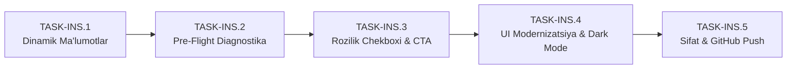

# Imtihon Ko'rsatmalari Sahifasi (Instructions View) UI/UX Modernizatsiyasi Rejasi
## CHSB Platform — Assessment Instructions & Pre-Flight UX Enhancement Plan

> **Hujjat:** `docs/ASSESSMENT_INSTRUCTIONS_UX_PLAN.md`  
> **Versiya:** 1.0.0 (Production UX)  
> **Holati:** Tasdiqlash uchun tayyorlangan  
> **Qamrov:** Dinamik ma'lumotlar, Texnik diagnostika (Pre-flight), Qoidalarga rozilik (Rules agreement), Tungi rejim (Dark theme), WCAG 2.1 AA  
> **Metodologiya:** Har bir task test-driven development (TDD) asosida yoziladi, mustaqil testlari PASS bo'lgach, Git commit va GitHub ga yuklanadi.

---

## 1. Loyihalashtirish Maqsadi

* **Muammo:** Hozirgi `AssessmentInstructionsView.vue` sahifasida fan nomi va parametrlar qattiq yozilgan (hardcoded), tungi rejim (Dark mode) yo'q, o'quvchi qurilmasining texnik tayyorgarligi tekshirilmaydi va qoidalarga rozilik chekboxi yo'qligi sababli tasodifiy boshlanishlar yuzaga kelishi mumkin.
* **Maqsad:**
  1. Imtihon ma'lumotlarini (fan, savollar soni, ball, vaqt) to'liq dinamik qilish.
  2. 3 bosqichli **Texnik Diagnostika (Pre-Flight Diagnostics)** blokini joriy etish (Internet aloqasi, Fullscreen anti-cheat, Oflayn kesh).
  3. Xalqaro imtihon qoidalariga rozilik chekboxini o'rnatish (`isRulesAgreed`).
  4. Zamonaviy vizual kartochkalar, piktogrammalar (ikonkalar) va to'liq **Dark Mode** hamda `StudentLayout.vue` da mavzu/til boshqaruvini joriy qilish.

---

## 2. Bosqichma-bosqich Vazifalar Rejasi (Task Breakdown)

---

### 🔹 TASK-INS.1: Imtihon Ma'lumotlarini Dinamik Yuklash
- **Fayllar:** 
  - `src/features/assessment/assessmentStore.ts`
  - `src/features/assessment/AssessmentInstructionsView.vue`
- **Vazifalar:**
  - `loadAssessmentOverview(tenantId, assessmentId)` yordamida sahifa yuklanganda imtihon sarlavhasi, fani, sinfi, savollar soni, davomiyligi va maksimal ballini reaktiv olish.
  - Hardcoded yozuvlarni olib tashlab, reaktiv dinamik qiymatlarga almashtirish.
- **Verifikatsiya:** `tests/assessment-instructions-dynamic.test.ts` (Dinamik yuklash va ma'lumotlarni ko'rsatish testi).

---

### 🔹 TASK-INS.2: Texnik Tayyorgarlik va Diagnostika Bloki (Pre-Flight Diagnostics)
- **Fayllar:** `src/features/assessment/AssessmentInstructionsView.vue`
- **Vazifalar:**
  - 3 ta texnik holat indikatori:
    1. 🌐 **Internet aloqasi:** `useNetworkStatus()` yordamida Online (yashil) yoki Offline rejim tayyorligini ko'rsatish.
    2. 🖥️ **To'liq ekran (Fullscreen):** Anti-cheat tizimi to'liq ekran talab qilishi haqida vizual ko'rsatkich.
    3. 💾 **Xavfsiz xotira:** IndexedDB oflayn keshining tayyorligi.
- **Verifikatsiya:** `tests/assessment-instructions-diagnostics.test.ts`.

---

### 🔹 TASK-INS.3: Qoidalarga Rozilik Chekboxi va Xavfsiz CTA Tugmasi
- **Fayllar:** `src/features/assessment/AssessmentInstructionsView.vue`
- **Vazifalar:**
  - `isRulesAgreed = ref(false)` holati.
  - "Men CHSB imtihoni qoidalari bilan tanishdim, ekrandan chiqmaslik va halol topshirishga roziman" chekboxi.
  - Chekbox belgilanmaguncha "Imtihonni boshlash" tugmasini `disabled` (nofaol) qilish.
  - Belgilangach, yashil/teal faol holatga o'tib, vaqt ko'rsatkichi bilan imtihonni boshlash.
- **Verifikatsiya:** `tests/assessment-instructions-agreement.test.ts`.

---

### 🔹 TASK-INS.4: UI Dizaynini Modernizatsiya Qilish va Tungi Rejim (Dark Theme)
- **Fayllar:**
  - `src/app/layouts/StudentLayout.vue`
  - `src/features/assessment/AssessmentInstructionsView.vue`
- **Vazifalar:**
  - 4 ta fakt katakchasini zamonaviy dizaynda piktogrammalar (⏱️, 📝, 🎯, 🔠) bilan boyitish.
  - `StudentLayout.vue` ga `dark:` sinflari, `ThemeToggle.vue` va `LanguageSwitcher.vue` boshqaruvlarini qo'shish.
  - Xom "Frontend V2 Demo Prototype" yozuvini olib tashlab, professional rasmiy footerga aylantirish.
- **Verifikatsiya:** `tests/assessment-instructions-ui.test.ts`.

---

### 🔹 TASK-INS.5: To'liq Sifat Nazorati va GitHub ga Joylash
- **Vazifalar:**
  - `npm run typecheck` (0 xato).
  - `npm run lint` (0 ogohlantirish).
  - `npx vitest run` (barcha testlar 100% yashil).
  - `npm run build` (Production yig'ilishi).
  - Barcha commitlarni GitHub `origin main` ga push qilish.

