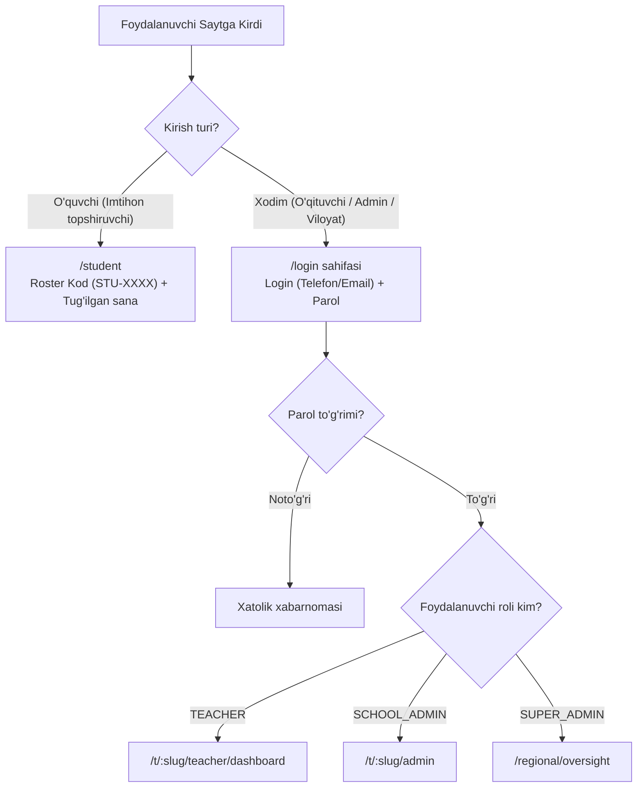
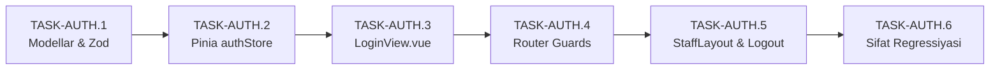

# Autentifikatsiya, Foydalanuvchi Rollari (RBAC) va Xavfsizlikni Kuchaytirish Rejasi
## CHSB Platform — Authentication & Role-Based Access Control Architecture Plan

> **Hujjat:** `docs/AUTH_AND_SECURITY_HARDENING_PLAN.md`  
> **Versiya:** 1.0.0 (Production Architecture)  
> **Holati:** Tasdiqlash uchun tayyorlangan  
> **Qamrov:** Role-Based Access Control (RBAC), Session Persistence, Login UI, Route Guards, Multi-tenant Isolation  
> **Asosiy qoida:** Har bir task test-driven development (TDD) asosida yozilib, 100% sifat darvozalari (`typecheck`, `lint`, `vitest`) yashil o'tgachgina integratsiya qilinadi.

---

## 1. Arxitekturaviy Muammo va Biznes Talablar

### 1.1. Mavjud Muammo
Loyihaning frontend qismi funksional jihatdan to'liq ishlab turgan bo'lsa-da, tizimda foydalanuvchilar (o'qituvchi, maktab administratori, viloyat xodimi) uchun **Login/Parol orqali kirish himoyasi mavjud emas**:
1. Istalgan tashqi shaxs to'g'ridan-to'g'ri URL orqali `/t/:tenantSlug/admin` (Maktab admin portali), `/t/:tenantSlug/teacher/dashboard` (O'qituvchi xonasi) yoki `/regional/oversight` (Viloyat boshqarmasi) sahifalariga ruxsatsiz kira oladi.
2. O'quvchi tasodifan yoki qasddan URLni o'zgartirib, o'qituvchining imtihon nazorati (jonli xona) yoki administrator konsoliga kirib ketishi xavfi mavjud.
3. Foydalanuvchilar kimligi (F.I.SH, Maktabi, Roli) tizimda reaktiv sessiya sifatida saqlanmaydi.

### 1.2. Kutilayotgan Natija
* Tizimga xavfsiz `/login` kirish eshigi o'rnatiladi.
* Rollarga asoslangan ruxsatlar nazorati (**Role-Based Access Control - RBAC**) yo'lga qo'yiladi.
* `router.beforeEach` yordamida ruxsatsiz kirishlar to'xtatilib, foydalanuvchi avtomatik ravishda `/login` ga yo'naltiriladi.
* Ko'rgazma va hakamlar hay'ati sinovlari uchun **1-bosish bilan kiruvchi Demo Pills (Quick Login)** taqdim etiladi.

---

## 2. Foydalanuvchi Rollari va Ruxsatlar Matritsasi (RBAC)

| Rol (`UserRole`) | Tavsif | Ruxsat etilgan hududlar | Boshlang'ich sahifa |
| :--- | :--- | :--- | :--- |
| **`SUPER_ADMIN`** | Viloyat Ta'lim Boshqarmasi vakili | Barcha hududlar (`/regional/oversight`, `/schools`, barcha maktablar admini va o'qituvchi xonalari) | `/regional/oversight` |
| **`SCHOOL_ADMIN`** | Maktab Direktori / O'RINBOSAR | Faqat o'z maktabining `/t/:slug/admin`, sinflar, o'qituvchilar, loglar va eMaktab moduli | `/t/:slug/admin` |
| **`TEACHER`** | Fan o'qituvchisi | Faqat o'z maktabining `/t/:slug/teacher/...` (jonli xona, natijalar, sinflar, o'quvchilar) | `/t/:slug/teacher/dashboard` |
| **`STUDENT`** | O'quvchi (Imtihonchi) | Faqat `/t/:slug/student` va `/t/:slug/assessments/:id/attempt` (Roster kod orqali) | `/t/:slug/student` |

---

## 3. Bosqichma-bosqich Vazifalar Rejasi (Task Breakdown)

### 🔹 TASK-AUTH.1: Autentifikatsiya Modellari va Zod Sxemalari
- **Fayl:** `src/features/auth/types.ts`
- **Vazifalar:**
  - `UserRole` enumi: `'SUPER_ADMIN' | 'SCHOOL_ADMIN' | 'TEACHER' | 'STUDENT'`
  - `AuthUser` interfeysi: `id`, `username`, `fullName`, `email`, `phone`, `role`, `tenantSlug`, `schoolName`, `token`
  - `LoginCredentials` va Zod validatsiya sxemasi (`username` min 3 belgi, `password` min 4 belgi).
- **Verifikatsiya:** `tests/auth-schemas.test.ts` (Zod validation testlari).

---

### 🔹 TASK-AUTH.2: Pinia `authStore` va Sessiya Boshqaruvi
- **Fayl:** `src/features/auth/store/authStore.ts`
- **Vazifalar:**
  - Reaktiv holat: `currentUser`, `isAuthenticated`, `isLoading`, `errorMessage`, `token`.
  - Demo hisoblar bazasi (Instant Demo Credentials):
    - 👨‍🏫 O'qituvchi: `teacher@xorazm.uz` / `teacher123` (Al-Xorazmiy IT maktabi)
    - 🏫 Maktab Admini: `admin@xorazm.uz` / `admin123` (Al-Xorazmiy IT maktabi)
    - 🏛️ Viloyat Rahbari: `regional@xorazm.uz` / `regional123` (Urganch shahri)
  - Metodlar: `login(credentials)`, `logout()`, `restoreSession()`, `hasRole(role)`.
  - Sessiyani `sessionStorage`/`localStorage` ga yozish va sahifa yangilanganda avtomatik tiklash.
- **Verifikatsiya:** `tests/auth-store.test.ts` (Login, xato parol, sessiyani tiklash va logout).

---

### 🔹 TASK-AUTH.3: Zamonaviy `LoginView.vue` Foydalanuvchi Interfeysi
- **Fayl:** `src/features/auth/views/LoginView.vue` (marshrut: `/login`)
- **Vazifalar:**
  - Anti-purple, Dark theme va WCAG 2.1 AA `aria-label`lar bilan ta'minlangan qulay login oynasi.
  - Login (foydalanuvchi nomi yoki email) va Parol maydonlari.
  - Parolni ko'rsatish/yashirish tugmasi (ko'zcha belgisi).
  - "Meni eslab qol" (Remember me) chekboksi.
  - **Tezkor Demo Tugmalari (Quick Demo Access):** Bir marta bosish bilan o'qituvchi, admin yoki viloyat vakili sifatida formani avtomatik to'ldirib tizimga kirish.
  - O'quvchilar uchun pastda eslatma va havola: *"O'quvchimisiz? Roster kod orqali imtihonga kiring →"*.
- **Verifikatsiya:** `tests/login-view.test.ts` (Form render, demo tugmalarini bosish, validatsiya xatolari).

---

### 🔹 TASK-AUTH.4: Global Router Navigation Guard va Marshrutlar Himoyasi
- **Fayl:** `src/app/router/index.ts`
- **Vazifalar:**
  - Himoyalangan marshrutlarga `meta: { requiresAuth: true, roles?: UserRole[] }` qo'shish:
    - `/t/:tenantSlug/teacher/...` -> `roles: ['TEACHER', 'SCHOOL_ADMIN', 'SUPER_ADMIN']`
    - `/t/:tenantSlug/admin` -> `roles: ['SCHOOL_ADMIN', 'SUPER_ADMIN']`
    - `/regional/oversight` -> `roles: ['SUPER_ADMIN']`
    - `/schools` -> `roles: ['SUPER_ADMIN', 'SCHOOL_ADMIN']`
  - `router.beforeEach`:
    - Tizimga kirmagan bo'lsa -> `/login?redirect=...` ga yo'naltirish.
    - Rol yetarli bo'lmasa -> foydalanuvchini o'z ruxsat etilgan asosiy sahifasiga burish.
    - Tizimga kirgan foydalanuvchi `/login` ga kelsa -> o'z profiliga o'tkazish.
- **Verifikatsiya:** `tests/auth-router-guard.test.ts` (Himoyalangan yo'llar va rollar bo'yicha yo'naltirish).

---

### 🔹 TASK-AUTH.5: `StaffLayout.vue` da Foydalanuvchi Profili va "Chiqish" (Logout)
- **Fayl:** `src/app/layouts/StaffLayout.vue`
- **Vazifalar:**
  - Sidebar va tepa panelda joriy foydalanuvchining F.I.SH, Roli (Badge) va Maktab nomini ko'rsatish.
  - Qizil "Chiqish" (Logout) tugmasi — bosilganda sessiyani tozalash va `/login` ga yo'naltirish.
- **Verifikatsiya:** `tests/staff-layout-auth.test.ts`.

---

### 🔹 TASK-AUTH.6: Yakuniy Integratsiya va Sifat Regressiyasi (100% Yashil)
- Barcha sifat darvozalari tekshiruvi:
  - `npm run typecheck` (`vue-tsc --noEmit`) -> 0 ta xato
  - `npm run lint` (`eslint . --max-warnings 0`) -> 0 ta ogohlantirish
  - `npx vitest run` -> Barcha 40+ ta test fayllari 100% yashil (PASS).
  - `npm run build` -> Production build muvaffaqiyatli yig'ilishi.

