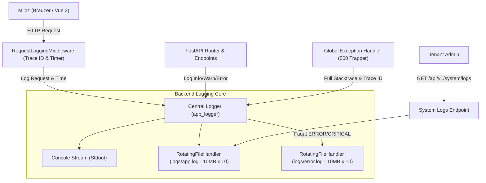

# Backend Professional Logging & Error Tracking Arxitekturasi Rejasi
## FastAPI, RotatingFileHandler, Request Tracing va Xatoliklar Jurnali

> **Hujjat:** `docs/BACKEND_PROFESSIONAL_LOGGING_PLAN.md`  
> **Muallif:** Lead Enterprise Solution Architect & Backend Specialist  
> **Sana:** 2026-11-23  
> **Holati:** Tasdiqlash uchun Rejalashtirildi  
> **Qat'iy Qoida:** Reja (Plan .md) -> Granulyar Tasklar -> Bosqichma-bosqich ishlab chiqish -> Testlar -> Git/GitHub push.

---

## 1. Muammo Tavsifi va Maqsad

Hozirgi backendda:
1. So'rovlar va xatolar faqat terminal konsoliga (`stdout`) oddiy `print()` yoki uvicorn standart satri ko'rinishida chiqmoqda.
2. Server to'xtatilsa yoki qayta ishga tushirilsa, barcha xatoliklar tarixi yo'qoladi.
3. Diskka aylanuvchi (rotating file) log yozilmagani sababli, ishlab chiqarish (production) muhitida qaysi foydalanuvchida qachon qanday 500 yoki 400 xatosi yuz berganini aniqlash imkoni yo'q.
4. Har bir so'rovga unikal `trace_id` biriktirilmagan, bu esa xatolikni foydalanuvchi so'rovi bilan bog'lashni qiyinlashtiradi.

**Maqsad:**
Python va FastAPI standartlariga to'liq mos keladigan, har bir so'rovni `trace_id` bilan kuzatuvchi, xatolarni `backend/logs/app.log` va `backend/logs/error.log` fayllariga avtomatik aylanuvchi (rotating) hajm bilan muhrlab boruvchi professional logging arxitekturasini yaratish.

---

## 2. Arxitektura Yechimi

1. **Jurnal Fayllari va Rotatsiya:**
   - `backend/logs/app.log`: Barcha `INFO`, `WARNING`, `ERROR` darajasidagi so'rovlar, Prisma ulanishlari va tizim voqealari (Maksimal 10MB, 10 tagacha arxiv zaxirasi saqlanadi).
   - `backend/logs/error.log`: Faqat `ERROR` va `CRITICAL` xatoliklar, to'liq stacktrace bilan (Maksimal 10MB, 10 tagacha arxiv zaxirasi).
   - `backend/logs/.gitkeep` saqlanib, `.gitignore` da `*.log` fayllarining Git-ga tushishi cheklanadi.

2. **So'rovlarni Kuzatish (Distributed Request Tracing):**
   - Har bir kiruvchi so'rov uchun `UUID4` asosida unikal `trace_id` yaratiladi.
   - So'rov bajarilish vaqti millisekundlarda o'lchanadi (`process_time_ms`).
   - Mijozga `X-Trace-ID` va `X-Process-Time` javob sarlavhalari (headers) qaytariladi.

3. **Global Xatoliklar Tutuvchisi (Unhandled Exception Handler):**
   - Kutilmagan dasturiy xatolar (500 xatolar) to'liq stacktrace, so'rov yo'li, metod va parametrlari bilan `error.log` ga yoziladi.
   - Mijozga maxfiy ichki kod oshkor qilinmasdan, unikal `traceId` ko'rsatilgan xavfsiz JSON qaytariladi.

4. **Tizim Loglarini O'qish Endpointi (`GET /api/v1/system/logs`):**
   - Administratorlar uchun server loglarini bevosita ko'rish va yuklab olish imkoniyati.

---

## 3. To'lqinlar va Granulyar Tasklar

### 🔹 1-TO'LQIN: LOGGING CORE & ROTATING FILE HANDLERS
- [x] **TASK-LOG.1**: `backend/app/core/logging.py` modulini yaratish:
  - `backend/logs/` papkasini avtomatik yaratish.
  - `RotatingFileHandler` orqali `app.log` (10MB, 10 zaxira) va `error.log` (10MB, 10 zaxira) sozlash.
  - Rangli konsol formaterini sozlash.
- [x] **TASK-LOG.2**: `.gitignore` ga `backend/logs/*.log` ni qo'shish va `backend/logs/.gitkeep` yaratish.

### 🔹 2-TO'LQIN: REQUEST LOGGING MIDDLEWARE & EXCEPTION TRAPPER
- [x] **TASK-LOG.3**: `backend/app/core/middleware.py` modulini yaratish:
  - `RequestLoggingMiddleware`: `trace_id` yaratish, so'rov vaqti va holatini loglash.
  - Global `Exception` handler: 500 xatolik stacktrace-ni `error.log` ga yozish.
- [x] **TASK-LOG.4**: `backend/app/main.py` ga middleware va logging konfiguratsiyasini ulash.

### 🔹 3-TO'LQIN: SYSTEM LOGS REST API & PYTEST SINOVLARI
- [x] **TASK-LOG.5**: `backend/app/api/v1/endpoints/system.py` endpointini yaratish:
  - `GET /api/v1/system/logs`: server loglarini qidirish, filtrlash va yuklab olish.
- [x] **TASK-LOG.6**: `backend/tests/test_logging.py` sinovlarini yozish:
  - `trace_id` va response headerlarini tekshirish.
  - `app.log` va `error.log` fayllariga yozilishini tekshirish.
  - 500 xatolik tutuvchisini tekshirish.

### 🔹 4-TO'LQIN: INTEGRATSIYA, TO'LIQ SIFAT NAZORATI & GIT PUSH
- [x] **TASK-LOG.7**: Master sifat nazorati (Pytest 100% PASS, Vitest 100% PASS, Typecheck 0 xato, ESLint 0 ogohlantirish, Build).
- [x] **TASK-LOG.8**: Git commit va GitHub `origin main` ga push qilish.
