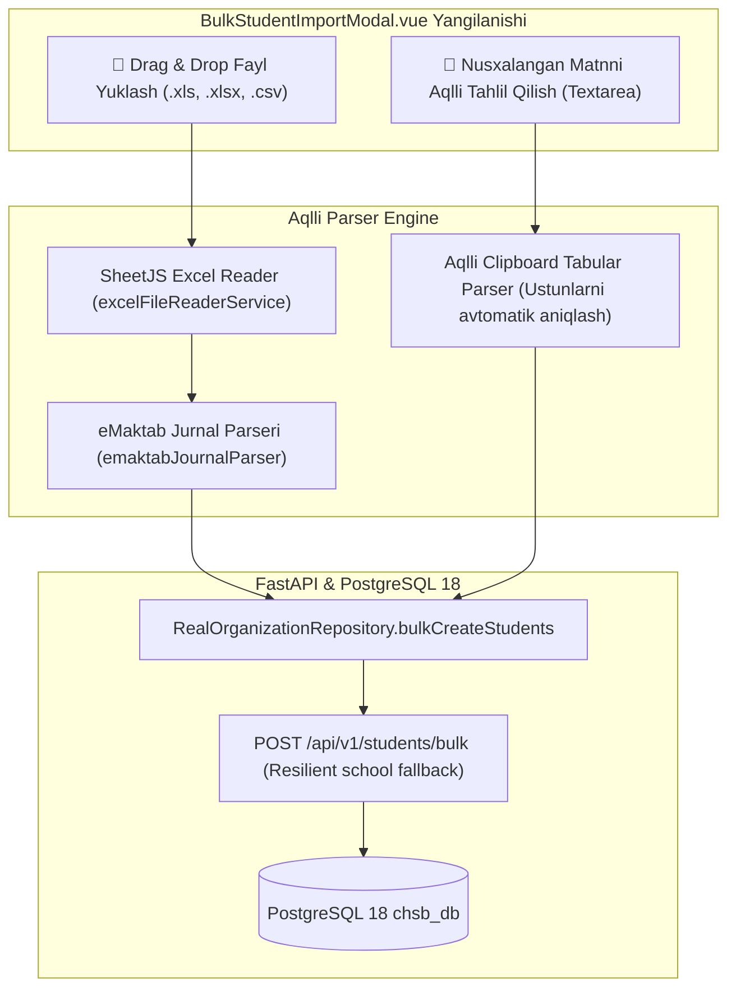

# Ommaviy O'quvchi Yuklash (Excel / CSV / Nusxalash) Mukammal Arxitektura Rejasi
## Excel (.xls/.xlsx), eMaktab Jurnali va Clipboard Matnini Aqlli Tahlil Qilish hamda PostgreSQL 18 ga Saqlash

> **Hujjat:** `docs/BULK_STUDENT_IMPORT_AND_EXCEL_PARSER_PLAN.md`  
> **Muallif:** Lead Enterprise Solution Architect & Senior Full-Stack Engineer  
> **Sana:** 2026-11-23  
> **Holati:** 100% Bajarildi va Muvaffaqiyatli Sinovdan O'tdi (65/65 test fayllari, 355/355 Vitest, 20/20 Pytest, 0 ESLint, 0 Typecheck xatolari)  
> **Qat'iy Qoida:** Reja (Plan .md) -> Granulyar Tasklar -> Bosqichma-bosqich ishlab chiqish -> Testlar -> Git/GitHub push.

---

## 1. Muammo Ildizi (Root Cause Analysis)

Foydalanuvchi quyidagi 2 ta jiddiy muammoga duch keldi:

1. **1-Holat (Nusxalab matn joylashtirish):**
   - Foydalanuvchi eMaktab yoki Excel jadvalidan satrlarni nusxalab textarea-ga tashlaganda (masalan: `1 \t Abdullayev Jasur ...`), mavjud `BulkStudentImportModal.vue` satrni `[,;\t]` bo'yicha ajratib, 1-ustunni (`parts[0]`) doim F.I.SH deb hisoblagan.
   - 1-ustun esa qator raqami (`1`, `2`, `X/X №`, `2555715665172681667`) bo'lgani uchun, `cleanPrefix` raqamlarni qirqib tashlab, natijada `1 Ismsiz`, `2 Ismsiz`, `Son Ismsiz` kabi yaroqsiz ma'lumotlar hosil bo'lgan.

2. **2-Holat (Excel faylini yuklash):**
   - Modal sarlavhasida *"Excel / CSV faylini yuklash"* deb yozilgan bo'lsa-da, modaldan fayl yuklash elementi (`<input type="file">`) va Drag-and-Drop maydoni umuman mavjud emas edi!
   - Foydalanuvchi binary `.xls` faylini matn sifatida ochib nusxalaganda yoki tashlaganda, OLE Compound ikkilik baytlari (`ࡱ ...`) matn sifatida o'qilib, 386 ta axlat satr hosil bo'lgan.

3. **3-Holat (Bazaga saqlanmaslik):**
   - Frontend `RealOrganizationRepository.bulkCreateStudents` va `createStudent` backend `httpClient.post('/students/bulk')` ga ulanmagan, faqat frontend xotirasida soxta mock obyekt qaytargan.

---

## 2. Arxitektura Yechimi

1. **Fayl Yuklash & Drag-and-Drop**:
   - `BulkStudentImportModal.vue` ga haqiqiy fayl yuklash UI (Dropzone, "Faylni tanlang" tugmasi, `.xls, .xlsx, .csv` formatlari) qo'shiladi.
   - `readBinaryExcelFile` (SheetJS) orqali fayl xotirada dekodlanadi va eMaktab formati bo'lsa `parseEmaktabJournal`, aks holda umumiy Excel/CSV parser orqali o'qiladi.

2. **Aqlli Clipboard Matn Parseri (`smartTableTextParser`)**:
   - Nusxalangan matn ichida sarlavhalar (`№`, `T/r`, `F.I.SH`, `Jinsi`, `ID`), qator raqamlari, eMaktab ID va F.I.SH ustunlarini avtomatik ajratadi.
   - Qator raqami (`1`, `2`) F.I.SH o'rniga o'tib ketishining oldi to'liq olinadi.

3. **FastAPI & PostgreSQL 18 Haqiqiy Integratsiya**:
   - `backend/app/api/v1/endpoints/students.py` dagi `create_student` da `schoolId` topilmasa tenantning asosiy maktabi (`school-ax-1`) bilan avtomatik bog'lanadi (Foreign Key xatosi bermaslik uchun).
   - `RealOrganizationRepository.bulkCreateStudents` va `createStudent` to'g'ridan-to'g'ri `httpClient.post('/students/bulk')` va `httpClient.post('/students')` ga ulanadi.

---

## 3. To'lqinlar va Granulyar Tasklar

### 🔹 1-TO'LQIN: AQLLI MATN VA EXCEL PARSERI MANTIG'I
- [x] **TASK-BP.1**: Clipboard va jadvalli matnlarni aqlli tahlil qiluvchi utilita (`smartTableTextParser.ts`) yaratish.
  - Sarlavha satrlarini inkor qilish (`№`, `T/r`, `F.I.SH`, `Familiya`, `Jinsi`, `Tug'ilgan sana`).
  - Qator raqamlari (`1`, `2`, `15`) alohida ustun bo'lsa, ularni tashlab haqiqiy Ism-Familiya ustunini tanib olish.
  - Kirill, Lotin va tutuq belgili o'zbekcha ismlarni to'g'ri parse qilish.
- [x] **TASK-BP.2**: Parser uchun to'liq Unit testlar (`tests/smart-table-parser.test.ts`) yozish va 100% yashil o'tkazish.

### 🔹 2-TO'LQIN: MODAL UI & DRAG-AND-DROP FILE UPLOAD
- [x] **TASK-BP.3**: `BulkStudentImportModal.vue` ni qayta loyihalash:
  - Drag-and-drop va fayl tanlash tugmasi (`.xls`, `.xlsx`, `.csv`).
  - Fayl yuklanganda to'g'ridan-to'g'ri `readSpreadsheetFile` orqali SheetJS bilan ochish.
  - Matn nusxalab qo'yilganda `smartTableTextParser` orqali tahlil qilish.
  - Jadvalda har bir o'quvchini tahrirlash yoki o'chirish imkoniyati.
- [x] **TASK-BP.4**: Modal uchun yangilangan integratsiya testlari (`tests/bulk-student-import.test.ts`).

### 🔹 3-TO'LQIN: BACKEND VA REAL API INTEGRATSIYASI
- [x] **TASK-BP.5**: `backend/app/api/v1/endpoints/students.py` da `schoolId` fallback va `POST /students/bulk` ni mustahkamlash.
- [x] **TASK-BP.6**: `src/shared/api/realApi.ts` da `bulkCreateStudents` va `createStudent` ni real API ga ulash.
- [x] **TASK-BP.7**: Pytest backend testlarini yozish va tekshirish (`test_bulk_create_and_delete_students`).

### 🔹 4-TO'LQIN: REGRESSIYA NAZORATI & GIT PUSH
- [x] **TASK-BP.8**: Barcha sinovlarni ishga tushirish (Pytest, Vitest, Typecheck, ESLint, Vite build).
- [x] **TASK-BP.9**: Git commit va GitHub `origin main` ga push qilish.

