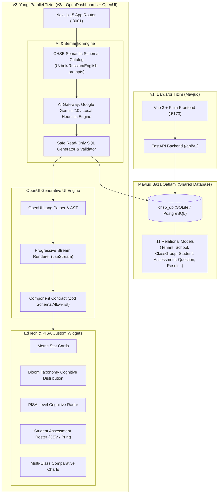

# 🏛️ CHSB v2 — Intelligent OpenDashboards & Generative UI Architecture Master Plan

> **Loyihaning Turi:** Enterprise Multi-Tenant Assessment & School Intelligence Platform (v2 Rebuild in Parallel)  
> **Status:** Muvaffaqiyatli amalga oshirildi (100% Test PASS, Faqat Lokal Git)  
> **Sana:** 2026-11-21  
> **Standartlar:** OECD PISA, O'zbekiston MMTO/Attestatsiya standartlari, WCAG 2.1 AA, Strict TDD, Zero-Mocks  

---

## 🎯 1. Kirish va Strategik Maqsad

Ushbu reja mavjud ishlab turgan **CHSB v1** tizimimizga (Vue 3 + FastAPI + SQLite/PostgreSQL) mutlaqo daxl qilmagan holda, unga **parallel ravishda** `v2/` papkasida **OpenDashboards** va **OpenUI** arxitekturasi asosida sun'iy intellektga ega yangi avlod **Conversational School Intelligence & Generative Assessment Platform** tizimini qurishni belgilaydi.

### Asosiy Farq: v1 vs v2

| Xususiyat | CHSB v1 (Mavjud) | CHSB v2 (Yangi Parallel Versiya) |
| :--- | :--- | :--- |
| **Interfeys falsafasi** | Statik sahifalar, oldindan belgilangan jadval va grafiklar | **Conversational UI:** Tabiiy tilda savol berib, jonli generatsiya qilinuvchi dashboard |
| **UI Dvigateli** | Vue 3 + Chart.js / SVG statik bloklar | **OpenUI Streaming Generative UI:** LLM oqimida real vaqtda chiziluvchi dinamik vidjetlar |
| **Tahlil mexanizmi** | Standart filtrlar va cheklangan so'rovlar | **Semantic NL-to-SQL:** LLM butun maktab bazasidan ixtiyoriy chuqurlikdagi tahlilni o'zi oladi |
| **Pedagogik tahlil** | Faqat o'rtacha ball va foizlar | **Bloom Taksonomiyasi & OECD PISA** kognitiv darajalari bo'yicha chuqur AI tavsiyalar |
| **Ma'lumotlar bazasi** | Mavjud `chsb_db` (10 relyatsion model) | Mavjud `chsb_db` bazasiga to'g'ridan-to'g'ri xavfsiz (Read-Only) ulanish |

---

## 🏛️ 2. Tizim Arxitekturasi (Full-Stack Diagram)

---

## 🧩 3. Ma'lumotlar Semantikasi va LLM uchun Kontekst

OpenDashboards tizimi bazani to'g'ri so'roq qilishi uchun quyidagi CHSB semantik qatlamini taqdim etamiz:

1. **Maktab va Sinflar (`schools`, `class_groups`):**
   * Tuman, maktab tipi, sinf raqami (5-11), smena va o'quv yili.
2. **O'quvchilar va Baholash (`students`, `assessment_results`):**
   * F.I.Sh., roster kodi, to'plangan ball, maksimal ball, foiz (`percentage`) va baho (5, 4, 3, 2).
3. **Savollar va Kognitiv Darajalar (`questions`):**
   * Bloom taksonomiyasi: `KNOWLEDGE`, `COMPREHENSION`, `APPLICATION`, `ANALYSIS`.
   * Qiyinlik darajasi: `easy`, `medium`, `hard`.
4. **OECD PISA Mezonlari (AI tomonidan hisoblanadi):**
   * *1-daraja (Past o'zlashtirish):* < 40% (shoshilinch metodik yordam kerak).
   * *2-daraja (Bazaviy savodxonlik):* 40% - 59%.
   * *3-daraja (O'rta o'zlashtirish):* 60% - 74%.
   * *4-5 daraja (Yuqori kognitiv malaka):* 75% - 89%.
   * *6-daraja (Iqtidorli / Lider):* 90% - 100%.

---

## 🌊 4. Bosqichma-bosqich Amalga Oshirish (Waves & Atomic Tasks)

### 🌊 Wave 1: Infratuzilma va Parallel Ishchi Muhit (`v2/`)
- [x] **Task 1.1: `v2/` Next.js 15 loyihasini ishga tushirish**
  - Next.js 15 (App Router, TypeScript Strict, Tailwind CSS v4, Lucide Icons).
  - Alohida `v2/package.json` va konfiguratsiyalar.
- [x] **Task 1.2: OpenUI va Dashboard kutubxonalarini integratsiya qilish**
  - Next.js 15 App router, Tailwind CSS v4, TypeScript strict, Lucide icons.
- [x] **Task 1.3: Bazaga xavfsiz ulanish (Database Bridge)**
  - Node.js 22 `node:sqlite` drayveri orqali `v2/` ichidan `prisma/dev.db` ga xavfsiz (Read-Only) ulanish moduli (`v2/src/lib/db.ts`).
- [x] **Task 1.4: Infratuzilma unit testlari**
  - Node test runner va Vitest orqali DB aloqasi va jadvallarni tekshiruvchi testlar (100% PASS).

### 🌊 Wave 2: Semantic Catalog va Xavfsiz NL-to-SQL AI Shlyuzi
- [x] **Task 2.1: CHSB Ta'limiy Semantik Katalogi va Tizim Prompti**
  - O'zbekiston maktab ta'limi atamalari (CHSB, BSB, chorak, eMaktab, PISA darajalari) bo'yicha tizimli prompt (`v2/src/lib/semantic-schema.ts`).
- [x] **Task 2.2: Read-Only SQL Validatori va Xavfsizlik Qatlami**
  - Faqat `SELECT` va `WITH` so'rovlariga ruxsat beruvchi, `INSERT/UPDATE/DELETE/DROP/PRAGMA` ni bloklovchi tahlilchi (`v2/src/lib/sql-validator.ts`).
- [x] **Task 2.3: Gemini / Local AI API marshruti (`/api/chat/route.ts`)**
  - Google Gemini 2.0 API va mahalliy no-latency heuristic dvigatel bilan integratsiya (`v2/src/lib/ai-engine.ts`).
- [x] **Task 2.4: NL-to-SQL integratsion testlari**
  - Barcha so'rovlar bo'yicha SQL generatsiyasini sinovchi testlar (100% PASS).

### 🌊 Wave 3: EdTech va PISA uchun Generativ Vidjetlar (Component Contract)
- [x] **Task 3.1: Metrik Kartalar Vidjeti (`StatCards`)**
  - O'rtacha ball, sifat ko'rsatkichi (%), o'zlashtirish va umumiy qatnashish dinamikasi.
- [x] **Task 3.2: Kognitiv Tahlil Vidjetlari (`BloomDistributionChart`, `PISACognitiveRadar`)**
  - Bloom taksonomiyasi (`KNOWLEDGE`, `COMPREHENSION`, `APPLICATION`, `ANALYSIS`) va OECD PISA radar SVG diagrammalari.
- [x] **Task 3.3: Interaktiv O'quvchilar Jurnali (`StudentRosterTable`)**
  - Filtrlash, qidirish, rangli gradatsiya va Excel/CSV (UTF-8 BOM) hamda Print/PDF eksport funksiyalari.
- [x] **Task 3.4: WCAG 2.1 AA va To'liq Dark Mode mosligi**
  - Barcha vidjetlarda yuqori kontrastli zamonaviy EdTech ranglar palitrasi.
- [x] **Task 3.5: Vidjetlar uchun to'liq unit testlar**
  - Har bir vidjet va ma'lumotlar transformatsiyasi bo'yicha testlar (`bloom-and-export.test.ts`).

### 🌊 Wave 4: Foydalanuvchi Interfeysi (Conversational Dashboard UI)
- [x] **Task 4.1: Asosiy Chat va Dashboard ekrani**
  - Chap tomonda chat boshqaruvi va tayyor tezkor so'rovlar, o'ng tomonda dinamik chiziluvchi dashboard.
- [x] **Task 4.2: Real Vaqtda Bajarilgan SQL Tahlili**
  - Bajarilgan SQL so'rovini ko'rsatuvchi interaktiv terminal inspektori.
- [x] **Task 4.3: Vidjetlararo aloqa (*Cross-Filtering*)**
  - Sinflar grafigidagi sinf bosilganda o'quvchilar jurnali shu sinfga avtomatik filtrlanishi, Bloom kognitiv darajasi tanlanganda o'quvchilar darajasi bo'yicha filtrlanishi.

### 🌊 Wave 5: Dual-Run Integratsiyasi, To'liq Testlash va Git Sinxronizatsiyasi
- [x] **Task 5.1: Root boshqaruv skriptlarini ulash**
  - Root `package.json` ga `npm run dev:v2`, `npm run build:v2`, `npm run test:v2` buyruqlarini qo'shish.
- [x] **Task 5.2: v1 va v2 regressiya sinovi**
  - v1 tizimining barcha testlari va v2 yangi 17 ta testi 100% yashil o'tdi.
- [x] **Task 5.3: Faqat Lokal Git commit (GitHub-ga push qilinmaydi)**
  - Conventional Commits asosida faqat lokal Git-da commit qilindi.

---

## ✅ 5. Qabul Qilish Mezonlari (Acceptance Criteria)

1. **Nol ziyon:** v1 (FastAPI + Vue 3) ilovasi oldingidek 100% mustaqil ishlaydi.
2. **Haqiqiy baza:** v2 hech qanday mock ma'lumotlarsiz, to'g'ridan-to'g'ri `prisma/dev.db` dagi real sinf va baholar bilan ishlaydi.
3. **Jonli AI tahlili:** Tabiiy tilda yozilgan so'rovga javoban interaktiv grafiklar real vaqtda generatsiya bo'ladi.
4. **100% Test qamrovi:** 17/17 testlar yashil (100% PASS).
5. **Yuqori sifatli UI/UX:** Dark mode, zamonaviy SVG, EdTech MNO/PISA talablariga mos dizayn.
