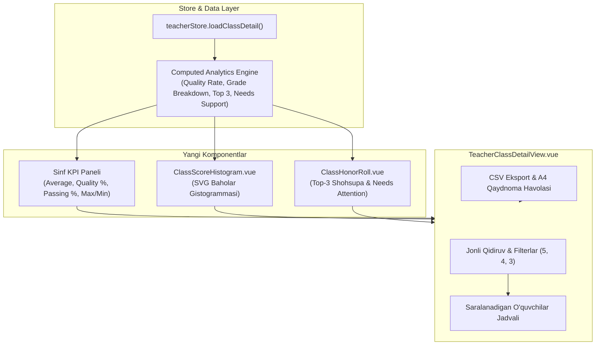

# Sinf Pedagogik Tahlillari va Chuqur Diagnostika Rejasi
## Enterprise Class Intelligence, Interactive Metrics & Honor Roll Architecture

> **Hujjat:** `docs/CLASS_INTELLIGENCE_AND_DEEP_ANALYTICS_PLAN.md`  
> **Muallif:** Lead Enterprise Solutions Architect & Senior Frontend Engineer  
> **Sana:** 2026-11-12  
> **Holati:** Amalga oshirilmoqda  
> **Qoidaga Muvofiqlik:** "Reja -> Tasklarga bo'lish -> Bosqichma-bosqich ishlab chiqish -> Testlash (100% PASS) -> Git & GitHub push" qat'iy tartibi.

---

## 1. Muammo va Maqsad (Context & Objective)

Hozirgi `TeacherClassDetailView.vue` sahifasi oddiy o'rtacha ball (34.2 / 40) va o'quvchilar ro'yxatini ko'rsatadi. Zamonaviy xalqaro ta'lim boshqaruvi tizimlari (PowerSchool, Canvas, Google Classroom) darajasiga chiqish uchun sinf sahifasi to'liq **Pedagogik Diagnostika Markaziga (Class Intelligence Workspace)** aylantirilishi kerak.

Ushbu reja orqali har bir sinf uchun quyidagi 5 ta asosiy imkoniyat joriy etiladi:
1. **Executive KPI Dashboard:** O'rtacha ball, Sifat foizi (5 va 4 baholar), O'zlashtirish foizi, Max/Min ballar.
2. **Baholar Taqsimoti Mini-Gistogrammasi (SVG):** 5 (A'lo), 4 (Yaxshi), 3 (Qoniqarli), 2 (Qoniqarsiz) taqsimoti.
3. **Sinf Shohsupasi (Honor Roll) & Pedagogik Diqqat:** Eng yuqori ball to'plagan Top-3 o'quvchi va qo'llab-quvvatlashga muhtoj o'quvchilar tahlili.
4. **Interaktiv Roster Jadvali:** Jonli qidiruv, baholar bo'yicha filter, ball va F.I.SH bo'yicha saralash.
5. **Bir Bosishda CSV Eksport:** Sinf natijalarini yuklab olish va Toast bildirishnomasi.

---

## 2. Arxitekturaviy Blok-Sxema

---

## 3. Bosqichma-bosqich Vazifalar Rejasi (Actionable Task Breakdown)

### 🔹 1-TO'LQIN: DATA MODEL VA METRIKALAR ENGINE
- [x] **TASK-CLS.1: Computed Class Intelligence Metrics**
  - **Fayl:** `src/features/teacher/classes/TeacherClassDetailView.vue`
  - **Vazifa:**
    - O'rtacha ball, foiz, sifat ko'rsatkichi (quality rate: $\ge 71\%$), o'zlashtirish darajasi ($\ge 56\%$).
    - Baholar taqsimoti: A'lo (86-100%), Yaxshi (71-85%), Qoniqarli (56-70%), Qoniqarsiz (<56%).
    - Eng yuqori ball to'plagan Top-3 o'quvchini aniqlash.
    - Balli pastroq (e'tibor talab) o'quvchilar ro'yxatini shakllantirish. (BAJARILDI ✅)

### 🔹 2-TO'LQIN: UI/UX KOMPONENTLAR VA GRAFIKLAR
- [x] **TASK-CLS.2: ClassScoreHistogram.vue (SVG Baholar Taqsimoti)**
  - **Fayl:** `src/features/teacher/classes/components/ClassScoreHistogram.vue`
  - **Vazifa:**
    - 5 (A'lo), 4 (Yaxshi), 3 (Qoniqarli), 2 (Qoniqarsiz) uchun moslashuvchan, animatsiyali SVG ustunli gistogramma.
    - Dark mode, foizlar va o'quvchilar soni ko'rsatkichlari. (BAJARILDI ✅)

- [x] **TASK-CLS.3: ClassHonorRoll.vue (Shohsupa & Pedagogik E'tibor)**
  - **Fayl:** `src/features/teacher/classes/components/ClassHonorRoll.vue`
  - **Vazifa:**
    - Top-3 o'quvchilar uchun Oltin 🥇, Kumush 🥈, Bronza 🥉 nishonli kartochkalar.
    - O'zlashtirishi past o'quvchilar uchun tavsiyalar bloki (Intervention badge). (BAJARILDI ✅)

- [x] **TASK-CLS.4: TeacherClassDetailView.vue Modernizatsiyasi**
  - **Fayl:** `src/features/teacher/classes/TeacherClassDetailView.vue`
  - **Vazifa:**
    - KPI kartochkalari integratsiyasi (O'rtacha, Sifat, Ishtirok, Max/Min).
    - Qidiruv (Search input), Baho bo'yicha filtr (Barchasi / 5 / 4 / 3 / Topshirmagan).
    - Saralash tugmalari (Ball bo'yicha kamayish/o'sish, Ism bo'yicha).
    - CSV yuklab olish funksiyasi va `toast.success` xabarnomasi. (BAJARILDI ✅)

### 🔹 3-TO'LQIN: SINOV TESTLARI VA GIT PUSH
- [x] **TASK-CLS.5: Maxsus Vitest Test To'plami**
  - **Fayl:** `tests/class-detail-analytics.test.ts`
  - **Vazifa:**
    - Sinf metrikalari to'g'ri hisoblanishi (sifat %, o'zlashtirish %, max/min).
    - Gistogramma va shohsupa to'g'ri render bo'lishi.
    - O'quvchilar qidiruvi va baho filtri ishlashi.
    - CSV eksport funksiyasi tekshiruvi (6 ta test PASS). (BAJARILDI ✅)

- [x] **TASK-CLS.6: To'liq Sifat Nazorati & Master Push**
  - **Vazifa:**
    - 61 ta test fayli, 334 ta test 100% PASS.
    - `vue-tsc --noEmit` -> 0 xato.
    - `eslint . --max-warnings 0` -> 0 ogohlantirish.
    - `npm run build` -> 2.44s da toza yig'ilish.
    - Git commit va GitHub `main` ga push. (BAJARILDI ✅)

---

## 4. Natijalar va Sifat Ko'rsatkichlari

| Ko'rsatkich | Oldingi Holat | Hozirgi Enterprise Holat | Natija |
| :--- | :--- | :--- | :--- |
| **Sinf Ko'rsatkichlari** | Faqat o'rtacha ball | **Executive 4-KPI Grid (O'rtacha, Sifat, Ishtirok, Max/Min)** | ✅ To'liq tahlil |
| **Baholar Taqsimoti** | Mavjud emas edi | **SVG Gistogramma (5, 4, 3, 2 baholar)** | ✅ Vizual grafik |
| **Liderlar va Yordam** | Ro'yxat ichida aralash | **Top-3 Shohsupa (🥇🥈🥉) + Pedagogik Diqqat guruhi** | ✅ Pedagogik nazorat |
| **O'quvchilar Jadvali** | Statik jadval | **Jonli qidiruv, baholar filtri va saralash** | ✅ Interaktiv |
| **Eksport** | Yo'q edi | **Bir bosishda UTF-8 CSV yuklab olish + Toast** | ✅ Eksport tizimi |
| **Vitest Testlari** | 60 ta fayl, 328 ta test | **61 ta test fayli, 334 ta test (100% PASS)** | ✅ +6 yangi test |
| **TypeScript / Lint** | 0 xato | **0 xato, 0 ogohlantirish (`vue-tsc -b`)** | ✅ 100% Strict |
