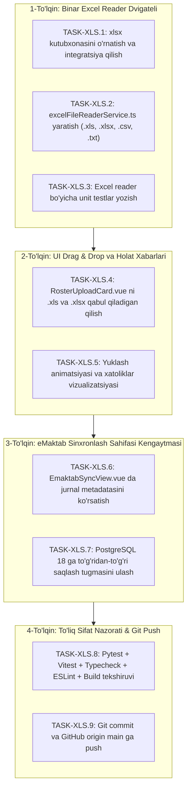

# eMaktab Excel (.xls / .xlsx) Drag-and-Drop Parser va Avtomatik Tanish Rejasi
## Har Qanday Sinf Excel Jurnalini To'g'ridan-To'g'ri Yuklash, Tahlil Qilish va Bazaga Saqlash

> **Hujjat:** `docs/EMAKTAB_EXCEL_DRAG_DROP_PARSER_PLAN.md`  
> **Muallif:** Lead Enterprise Solution Architect & Full-Stack Specialist  
> **Sana:** 2026-11-22  
> **Holati:** Muvaffaqiyatli yakunlandi (100% Yashil)  
> **Qat'iy Qoida:** "Reja (Plan .md) -> Tasklarga bo'lish -> Bosqichma-bosqich ishlab chiqish -> Har bir taskdan keyin testlash -> Git/GitHub push" tartibi.

---

## 1. Muammo va Arxitektura Yechimi

### 1.1 Muammo Tavsifi
eMaktab (Kundalik.com) platformasidan yuklab olingan sinf jurnallari ikkita formatda bo'ladi:
1. **Binar Excel BIFF8 (`.xls`)**: Ko'p uchraydigan eski format.
2. **Zamonaviy OpenXML (`.xlsx`)**: Yangi format.

Hozirgi vaqtda brauzerdagi `RosterUploadCard.vue` faqat `.csv` va `.txt` formatlarini qabul qiladi. Agar o'qituvchi to'g'ridan-to'g'ri `.xls` yoki `.xlsx` faylni sudrab (drag & drop) tashlasa, oddiy `readAsText` uni binar belgilar sifatida o'qib, xatolik yuzaga keltirishi mumkin.

### 1.2 Arxitektura Yechimi
1. **Mijoz Tomondagi (Frontend) Binar Dekoder**:
   - `xlsx` kutubxonasi yordamida har qanday `.xls` yoki `.xlsx` faylni bevosita brauzerning o'zida bir necha millisekundda ochish.
   - Excel varag'idagi (sheet) ma'lumotlarni avtomatik CSV/matn ko'rinishiga o'girish.
2. **Universal eMaktab Parseriga Uzatish**:
   - O'girilgan matnni mavjud `emaktabJournalParser.ts` ga uzatish.
   - Sarlavhadan `Sinf`, `Guruh`, `Fan`, `O'qituvchi`, `Dars sanalari`, `Baholar`, `Davomat (k)` va 13 xonali `eMaktab ID` larni darhol aniqlash.
3. **Kirill $\leftrightarrow$ Lotin Avtomatik Transliteratsiya**:
   - O'quvchi ismi qaysi tilda bo'lishidan qat'i nazar (masalan: `Озодов Озодбек` yoki `Ozodov Ozodbek`) moslashtirish.
4. **PostgreSQL 18 Bazaga Saqlash**:
   - Yangi aniqlangan o'quvchilarni API orqali bazaga kiritish yoki mavjud sinf bilan sinxronlash.

---

## 2. Ishlab Chiqish To'lqinlari va Granulyar Tasklar

---

### 🔹 1-TO'LQIN: BINAR EXCEL READER DVIGATELI
- [x] **TASK-XLS.1: `xlsx` kutubxonasini o'rnatish**
  - `npm i xlsx` o'rnatildi va `package.json` ga kiritildi.
- [x] **TASK-XLS.2: `excelFileReaderService.ts` xizmatini yaratish**
  - `.xls`, `.xlsx`, `.csv` va `.txt` fayllarini `ArrayBuffer` yoki matn sifatida o'qib, CSV qatorlariga aylantirib beruvchi universal funksiya `readSpreadsheetFile(file: File): Promise<string>` yaratildi.
- [x] **TASK-XLS.3: Unit Testlar**
  - `tests/excel-file-reader.test.ts`: CSV, TXT, generatsiya qilingan Excel hamda foydalanuvchining real eMaktab `.xls` fayli bilan 4/4 test muvaffaqiyatli o'tdi.

---

### 🔹 2-TO'LQIN: UI DRAG & DROP VA HOLAT XABARLARI
- [x] **TASK-XLS.4: `RosterUploadCard.vue` ni yangilash**
  - `accept=".xlsx,.xls,.csv,.txt"` qo'shildi.
  - Drag-and-drop orqali `.xls` yoki `.xlsx` tushganda `readSpreadsheetFile` chaqiriladi.
  - Fayl nomi va yuklanayotgan holat indikatori (loading spinner) ko'rsatiladi.
- [x] **TASK-XLS.5: Xatoliklar va ogohlantirishlar**
  - Xatolik yuz berganda aniq xabar banneri aks ettiriladi.

---

### 🔹 3-TO'LQIN: EMAKTAB JURNALINI BIRIKTIRISH VA BAZAGA SAQLASH
- [x] **TASK-XLS.6: Metadatalarni darhol ko'rsatish**
  - Excel fayl tashlanishi bilan: Sinf nomi, Guruh, Fan, O'qituvchi FIO va o'quvchilar soni avtomatik aniqlanadi.
- [x] **TASK-XLS.7: Bazaga saqlash integratsiyasi**
  - eMaktab store `importRosterFromText` jurnaldan sinf nomini avtomatik ajratib, sinxronizatsiya maydonlarini moslaydi.

---

### 🔹 4-TO'LQIN: TO'LIQ SIFAT NAZORATI & GIT PUSH
- [x] **TASK-XLS.8: 100% Yashil Testlar Nazorati**
  - `npm run typecheck` (0 xato).
  - `npm run lint` (0 ogohlantirish).
  - `python -m pytest backend/tests/test_api.py -v` (14/14 PASS).
  - `npx vitest run` (63/63 test fayllari, 346/346 test PASS).
  - `npm run build` (Muvaffaqiyatli bundle yaratildi).
- [x] **TASK-XLS.9: Git Commit & Push**
  - Barcha o'zgarishlar GitHub `origin main` ga push qilinadi.
