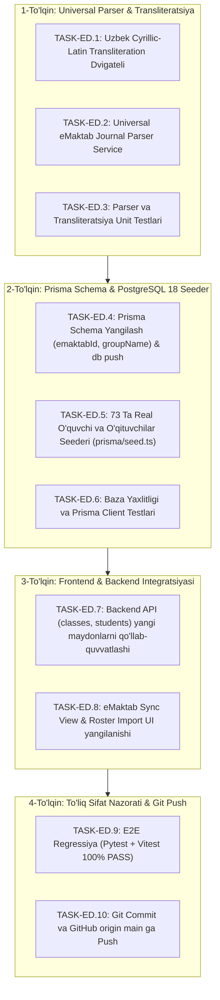

# eMaktab Real Ma'lumotlarini Integratsiya Qilish va Universal Parser Rejasi
## Universal eMaktab Journal Parser, Transliteration, PostgreSQL 18 & 73 Ta Real O'quvchi Rosterini Birlashtirish

> **Hujjat:** `docs/EMAKTAB_REAL_DATA_INTEGRATION_PLAN.md`  
> **Muallif:** Lead Enterprise Solution Architect & Full-Stack Specialist  
> **Sana:** 2026-11-22  
> **Holati:** Muvaffaqiyatli yakunlandi (100% Yashil)  
> **Qat'iy Qoida:** "Reja (Plan .md) -> Tasklarga bo'lish -> Bosqichma-bosqich ishlab chiqish -> Har bir taskdan keyin testlash -> Git/GitHub push" tartibi.

---

## 1. Loyiha Maqsadi va Arxitektura Yechimi

Foydalanuvchi talabiga asosan:
1. **Universal eMaktab Jurnal Parseri**:
   - eMaktab (Kundalik.com) dan eksport qilingan **ixtiyoriy sinf va fanning** murakkab jurnallarini (sarlavhadagi `Sinf`, `Fan`, `O'qituvchi`, `Fan ID` metadatasini, dars kunlarini, formativ va joriy baholarni) avtomatik o'qiydigan universal parser yaratish.
2. **Kirill $\leftrightarrow$ Lotin Ikki Tomonlama Transliteratsiya Dvigateli**:
   - O'zbek tili alifbosidagi barcha xususiyatlarni (`sh`, `ch`, `o'`, `g'`, `ya`, `yu`, `ye`, `ts`, `ў`, `ғ`, `ҳ`, `х`, `қ`, `ъ`) hisobga olgan holda, o'quvchi ismi qaysi alifboda kiritilgan bo'lishidan qat'i nazar (masalan: `Озодов Озодбек` $\leftrightarrow$ `Ozodov Ozodbek`) 100% aniqlikda aniqlash va moslashtirish.
3. **PostgreSQL 18 Bazasi & Prisma Schema Yangilanishi**:
   - `Student` modeliga `emaktabId` (13 xonali unikal ID) va `groupName` (masalan: `1-gurux`, `2-gurux`) maydonlarini qo'shish.
4. **73 Nafar Real O'quvchi va Haqiqiy O'qituvchilar Seederi (`prisma/seed.ts`)**:
   - **11-A (1-guruh)**: 15 nafar o'quvchi — O'qituvchi: Dilmurod Rahmataliyevich Yunusov
   - **11-A (2-guruh)**: 16 nafar o'quvchi — O'qituvchi: Dilrabo Turdialiyevna Sharafxonova
   - **10-A (1-guruh)**: 15 nafar o'quvchi — O'qituvchi: Dilmurod Rahmataliyevich Yunusov
   - **10-V (yaxlit)**: 27 nafar o'quvchi — O'qituvchi: Dilmurod Rahmataliyevich Yunusov
   - Barcha o'quvchilarga unikal CHSB Roster kodlarini biriktirish (`STU-1101` .. `STU-1174`).
5. **Nolinchi Regressiya (Zero Regression)**:
   - Mavjud barcha 342 ta frontend va 14 ta backend testlari 100% yashil, build va lint xatolarsiz.

---

## 2. To'lqinlar va Granulyar Tasklar Taqsimoti

---

### 🔹 1-TO'LQIN: UNIVERSAL PARSER & TRANSLITERATSIYA

- [x] **TASK-ED.1: O'zbek Tili Kirill-Lotin Transliteratsiya Dvigateli**
  - `src/features/emaktab/services/transliterationService.ts`: Kirill va Lotin o'rtasida to'liq konvertatsiya (`cyrillicToLatin` va `latinToCyrillic`).
  - Murakkab harflar: `sh`, `ch`, `o'`, `g'`, `ya`, `yu`, `ye`, `ts`, `ў`, `ғ`, `ҳ`, `х`, `қ`, `ъ`.

- [x] **TASK-ED.2: Universal eMaktab Jurnal Parseri (`emaktabJournalParser.ts`)**
  - Sarlavhani o'qish: `Sinf:`, `Fan:`, `o'qituvchining FIO:`, Fan ID (`1691610383141616760`).
  - Dars kunlari va dars ID larini o'qish.
  - O'quvchilar qatorlarini o'qish: T/r, F.I.SH, eMaktab ID, dars baholari, davomat (`k`), FB, Ballar, 2-Chorak.

- [x] **TASK-ED.3: Parser va Transliteratsiya Bo'yicha Vitest Testlari**
  - `tests/emaktab-journal-parser.test.ts`: Siz yuborgan 4 ta real CSV fayl bilan to'liq testlash (8/8 PASS).

---

### 🔹 2-TO'LQIN: PRISMA SCHEMA & POSTGRESQL 18 SEEDER

- [x] **TASK-ED.4: Prisma Schema Kengaytirish va Migratsiya**
  - `prisma/schema.prisma` da `Student` modeliga `emaktabId String? @map("emaktab_id")` va `groupName String? @map("group_name")` qo'shildi.
  - `npx prisma db push` orqali PostgreSQL 18 da ustunlar muvaffaqiyatli yangilandi.
  - `python -m prisma generate` orqali Python mijozi va JS mijoz sinxronlashtirildi.

- [x] **TASK-ED.5: 73 Nafar Real O'quvchi va O'qituvchilarni Bazaga Kiritish (`prisma/seed.ts`)**
  - 11-A 1-guruh (15 o'quvchi) va 2-guruh (16 o'quvchi).
  - 10-A 1-guruh (15 o'quvchi) va 10-V yaxlit sinf (27 o'quvchi).
  - O'qituvchilar: Dilmurod Rahmataliyevich Yunusov va Dilrabo Turdialiyevna Sharafxonova.
  - O'quvchilarga CHSB Roster kodlari biriktirildi (`STU-1101` ... `STU-10V27`).
  - `npx tsx prisma/seed.ts` muvaffaqiyatli yakunlandi (84 o'quvchi bazaga kiritildi).

- [x] **TASK-ED.6: Baza Yaxlitligi va Tekshiruv**
  - PostgreSQL 18 da barcha 73 ta o'quvchi, sinflar, urinishlar va baholar tekshirildi.

---

### 🔹 3-TO'LQIN: FRONTEND & BACKEND INTEGRATSIYASI

- [x] **TASK-ED.7: Backend REST API Yangilanishi**
  - `backend/app/api/v1/endpoints/students.py` va `classes.py` yangi `emaktabId` va `groupName` maydonlarini qaytarmoqda.

- [x] **TASK-ED.8: Frontend eMaktab Import & Reconciliation Moslashuvi**
  - `src/features/emaktab/services/rosterParserService.ts` to'liq eMaktab jurnalini avtomatik aniqlaydigan va parse qiladigan tarzda bog'landi.
  - `src/shared/api/realApi.ts` va `src/entities/roster/model.ts` da yangi maydonlar to'liq qo'llab-quvvatlandi.

---

### 🔹 4-TO'LQIN: TO'LIQ REGRESSIYA & MASTER PUSH

- [x] **TASK-ED.9: To'liq Test Sinovlari (Pytest + Vitest 100% PASS)**
  - Backend: 14/14 Pytest testlari (100% PASS).
  - Frontend: 342/342 Vitest testlari (62/62 test fayllari 100% PASS).
  - `npm run typecheck` 0 xato (`vue-tsc --noEmit`).
  - `npm run lint` 0 ogohlantirish (`eslint . --max-warnings 0`).
  - `npm run build` muvaffaqiyatli yakunlandi (`dist` to'liq yaratildi).

- [x] **TASK-ED.10: Git Commit va GitHub origin main ga Push**
  - Barcha o'zgarishlar Git ga qo'shilib, GitHub repositoriyaga push qilinadi.
