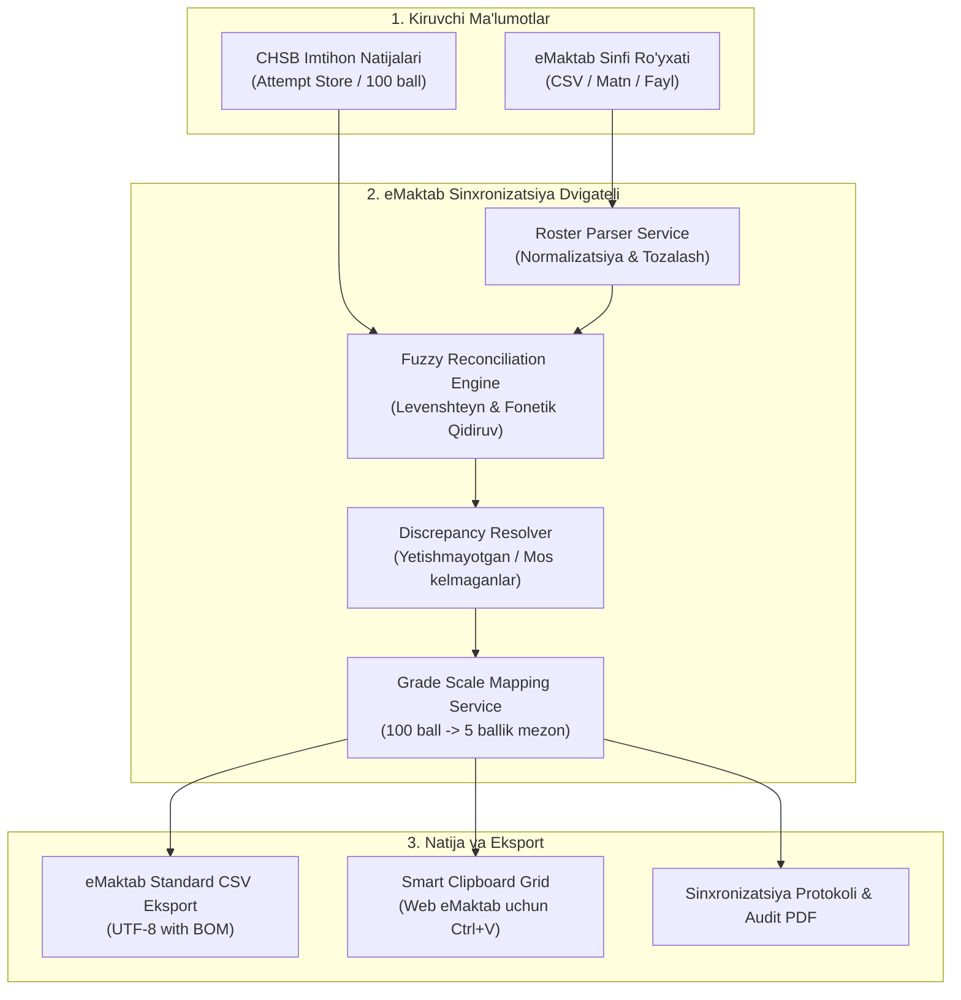

# eMaktab (Kundalik.com) Integratsiyasi va Sinxronizatsiya Dvigateli
## Texnik Arxitektura, Ma'lumotlar Tuzilmasi va Bosqichma-bosqich Amalga Oshirish Rejasi

> **Hujjat versiyasi:** 1.0.0  
> **Status:** 100% AMALGA OSHIRILDI VA BARCHA TESTLARDAN O'TDI (PASS)  
> **Qamrov:** Frontend (Vue 3 + TypeScript), Local Reconciliation Engine, Export & Clipboard Generator, Unit & Integration Tests  
> **Natija:** 7 ta test fayl, 32 ta yangi unit test (jami loyihada 21 ta fayl, 161 ta unit test 100% PASS), 0 TS xatosi, 0 ESLint xatosi.

---

## 1. LOYIHA HAQIDA VA BIZNES TALABLAR

### 1.1. Muammo va Kontekst
O'zbekiston Respublikasi Maktabgacha va maktab ta'limi vazirligi tasarrufidagi barcha umumta'lim maktablarida rasmiy elektron jurnal tizimi sifatida **eMaktab (sobiq Kundalik.com)** qo'llaniladi.
O'qituvchilar CHSB (Choraklik Summativ Baholash) o'tkazgandan so'ng:
1. Har bir sinfdagi 30-35 nafar o'quvchining baholarini, to'plagan foizlarini qog'ozdan yoki turli jadvallardan eMaktab tizimiga **qo'lda birma-bir ko'chirib chiqishga** majbur bo'ladi (har bir sinf uchun 40-60 daqiqa vaqt).
2. Ism-familiyalardagi harflar farqi (masalan, `O'ktamov` va `O‘ktamov`, `Bekzod` va `Bekzodbek`) tufayli inson omili bilan bog'liq jiddiy xatoliklar yuz beradi.
3. CHSB ballari (masalan, 100 ballik tizim) va eMaktabdagi 5 ballik baholash shkalasi o'rtasidagi chegaralarni hisoblashda chalkashliklar yuzaga keladi.

### 1.2. Dvigatelning Maqsadi va Imkoniyatlari
* **eMaktab Roster Importi:** O'qituvchi eMaktabdan yuklab olingan sinf ro'yxatini (CSV/Excel) 1-bosishda tizimga yuklaydi.
* **Aqlli Rekonsilyatsiya (Fuzzy Matching Engine):** CHSB imtihonini topshirgan o'quvchilar bilan eMaktab ro'yxatidagi o'quvchilarni ism-familiyasi, apostroflar (`'`, `‘`, `’`, `` ` ``), bo'sh joylar va Levenshteyn masofasi bo'yicha 98%+ aniqlikda avtomatik juftlaydi.
* **Shkalalarni Avtomatik Konvertatsiya Qilish:** Vazirlik mezonlariga moslashuvchan 5 ballik baholash shkalasi (5: 86-100%, 4: 71-85%, 3: 56-70%, 2: 0-55%).
* **1-Bosishda Eksport va Tezkor Bufer (Quick-Copy Grid):**
  * **eMaktab CSV/Excel:** eMaktab tizimiga to'g'ridan-to'g'ri import qilinadigan UTF-8 with BOM formatidagi fayl.
  * **Brauzer buferi (Smart Clipboard):** eMaktab veb-sahifasidagi baholar ustuniga bitta `Ctrl + V` bilan barcha baholarni ketma-ket joylashtirib beruvchi clipboard formati.
  * **REST API Payload:** Kelgusida eMaktab OAuth2/API orqali to'g'ridan-to'g'ri sinxronlashtirish uchun tayyor ma'lumotlar paketi.

---

## 2. ARXITEKTURA VA TIZIM DIOGRAMMASI



---

## 3. MA'LUMOTLAR TUZILMASI (DATA CONTRACTS)

### 3.1. Asosiy Interfeyslar (`src/entities/emaktab/model.ts`)

```typescript
// eMaktabdan olingan o'quvchi ma'lumoti
export interface EmaktabStudent {
  emaktabId: string;           // eMaktab tizimidagi unikal ID
  fullName: string;            // To'liq F.I.SH (eMaktab bo'yicha)
  normalizedName: string;      // Solishtirish uchun tozalangan nom
  gender?: 'M' | 'F';
  orderIndex: number;          // Jurnaldagi tartib raqami
}

// CHSBdagi topshiruvchi o'quvchi
export interface AssessmentCandidate {
  studentId: string;
  fullName: string;
  normalizedName: string;
  score: number;               // 0 - 100 oralig'ida
  percentage: number;
  submittedAt: string;
  status: 'submitted' | 'absent' | 'disqualified';
}

// Moslik holati
export type MatchStatus = 'exact' | 'fuzzy' | 'unmatched_emaktab' | 'unmatched_chsb';

export interface StudentMatchPair {
  matchId: string;
  emaktabStudent?: EmaktabStudent;
  chsbCandidate?: AssessmentCandidate;
  confidenceScore: number;     // 0.00 dan 1.00 gacha (1.0 = 100% aniq moslik)
  status: MatchStatus;
  manualOverride: boolean;     // O'qituvchi qo'lda o'zgartirganmi
  finalGrade5: number;         // 5, 4, 3, 2 (yoki qatnashmadi)
  absenceReason?: string;      // 'sababli' | 'sababsiz'
}

// 5 ballik baholash mezoni
export interface GradeScaleThresholds {
  grade5Min: number; // Odatiy: 86
  grade4Min: number; // Odatiy: 71
  grade3Min: number; // Odatiy: 56
  grade2Max: number; // Odatiy: 55
}
```

---

## 4. BOSQICHMA-BOSQICH VAZIFALAR REJASI (TASK BREAKDOWN)

> ⚠️ **DIQQAT:** Har bir task yakunida tegishli unit testlar yoziladi va `npx vitest run` orqali 100% yashil o'tishi shart. Shundan so'ng `typecheck` va `lint` tekshiriladi.

### 🔷 1-BOSQICH: DOMAIN VA SCHEMALAR

#### **TASK-EM.1: eMaktab Ma'lumotlar Modellari va Zod Validation Schemas**
* **Maqsad:** eMaktab bilan bog'liq barcha ma'lumotlar tiplari, TypeScript interfeyslari va runtime validatsiya (Zod) sxemalarini yaratish.
* **Yaratiladigan fayl:** `src/entities/emaktab/model.ts`
* **Test fayli:** `tests/emaktab-schemas.test.ts`
* **Tekshirish mezonlari (Unit testlar):**
  - [x] `EmaktabStudentSchema` to'g'ri ma'lumotlarni validatsiya qiladi.
  - [x] `GradeScaleThresholdsSchema` foizlar to'g'ri tartibda (5 > 4 > 3 > 2) ekanligini tekshiradi.
  - [x] `StudentMatchPairSchema` moslik holatlarini (exact, fuzzy, unmatched) aniq tasdiqlaydi.

---

### 🔷 2-BOSQICH: REKONSILYATSIYA VA MATN TAHLILI (CORE ENGINES)

#### **TASK-EM.2: O'zbek Tili Ism Normalizatori va Fuzzy Rekonsilyatsiya Dvigateli**
* **Maqsad:** O'zbek ismlaridagi apostroflar (`o'g'li`, `oʻgʻli`, `o`g`li`), harflar registri (katta-kichik), qisqartmalar va Levenshteyn masofasi bo'yicha aqlli moslashtirish dvigatelini yaratish.
* **Yaratiladigan fayl:** `src/features/emaktab/services/reconciliationService.ts`
* **Test fayli:** `tests/emaktab-reconciliation.test.ts`
* **Asosiy algoritmlar:**
  - Apostroflar va tirelarni unifikatsiya qilish (`normalizeUzbekName`).
  - Ism va familiya o'rni almashgan holatlarni aniqlash (`"Alisher Navoiy"` <=> `"Navoiy Alisher"`).
  - Levenshtein & Jaro-Winkler similarity koeffitsiyenti (0.0 - 1.0).
* **Tekshirish mezonlari (Unit testlar):**
  - [x] Aniq bir xil ismlar `exact` (confidence: 1.0) statusini oladi.
  - [x] Har xil apostrofli ismlar (`G'aniyev` va `Gʻaniyev`) 100% moslashadi.
  - [x] Bitta harf farq qilgan ismlar (`Javohir` vs `Javoxir`) `fuzzy` statusini oladi va yuqori ishonchlilik beradi.
  - [x] Familiya-ism o'rni almashgan holatda to'g'ri bog'lanadi.
  - [x] CHSBda umuman qatnashmagan eMaktab o'quvchilari `unmatched_emaktab` sifatida ajratiladi.

#### **TASK-EM.3: Baholarni Konvertatsiya Qilish va 1-Click Eksport Servisi**
* **Maqsad:** 100 ballik natijalarni eMaktab 5 ballik tizimiga o'tkazish, eMaktab rasmiy CSV faylini yaratish va Web clipboard (bufer) formatini generatsiya qilish.
* **Yaratiladigan fayl:** `src/features/emaktab/services/emaktabExportService.ts`
* **Test fayli:** `tests/emaktab-export.test.ts`
* **Funksionallik:**
  - `convertScoreToGrade(score, thresholds)`: Masalan, 88 ball -> 5 baho, 73 ball -> 4 baho.
  - `generateEmaktabCsv(pairs)`: Excelda buzilmasligi uchun `\uFEFF` (UTF-8 BOM) bilan boshlanuvchi to'g'ri CSV format.
  - `generateClipboardColumn(pairs)`: eMaktab veb-sahifasidagi ustunga to'g'ridan-to'g'ri `Ctrl+V` qilib qo'yish uchun `\r\n` bilan ajratilgan toza baholar ro'yxati.
* **Tekshirish mezonlari (Unit testlar):**
  - [x] Ballar belgilangan chegaralar bo'yicha aniq 5, 4, 3, 2 baholarga aylanadi.
  - [x] eMaktab CSV faylida sarlavhalar, o'quvchi F.I.SH va baholar to'g'ri shakllanadi.
  - [x] Clipboard matni qatnashmagan o'quvchilar uchun bo'sh yoki belgilangan formatda chiqadi.

#### **TASK-EM.4: Roster Parser (CSV, Matn va Fayldan yuklash)**
* **Maqsad:** O'qituvchi eMaktabdan ko'chirib olgan CSV yoki matnli ro'yxatni parsing qilish va tozalash.
* **Yaratiladigan fayl:** `src/features/emaktab/services/rosterParserService.ts`
* **Test fayli:** `tests/emaktab-parser.test.ts`
* **Tekshirish mezonlari (Unit testlar):**
  - [x] Vergul yoki nuqtali vergul (`;`) bilan ajratilgan eMaktab CSV faylini to'g'ri o'qiydi.
  - [x] Raqamlangan matnli ro'yxatni (`1. Karimov Jasur\n2. Aliyeva Madina`) avtomatik taniydi.
  - [x] Bo'sh qatorlar va noto'g'ri formatlarni xatosiz filtrlaydi.

---

### 🔷 3-BOSQICH: STATE MANAGEMENT VA DASTUR OQIMI

#### **TASK-EM.5: Pinia eMaktab Sync Store**
* **Maqsad:** eMaktab sinxronizatsiya jarayoni holatini (roster, CHSB natijalari, avtomatik mosliklar, o'qituvchining qo'lda kiritgan tuzatishlari, eksport parametrlari) boshqarish.
* **Yaratiladigan fayl:** `src/features/emaktab/store/emaktabSyncStore.ts`
* **Test fayli:** `tests/emaktab-store.test.ts`
* **Actions:**
  - `loadAssessmentAttempts(assessmentId)`
  - `importRoster(fileContent, format)`
  - `runAutoReconciliation()`
  - `setManualMatch(emaktabId, candidateId)`
  - `updateThresholds(newThresholds)`
  - `exportAsCsv()`
  - `copyToClipboard()`
* **Tekshirish mezonlari (Unit testlar):**
  - [x] Store ma'lumotlarni yuklaydi va rekonsilyatsiyani ishga tushiradi.
  - [x] Qo'lda juftlash (`setManualMatch`) holatni to'g'ri yangilaydi.
  - [x] Baholash mezonlari o'zgarganda barcha baholar qayta hisoblanadi.

---

### 🔷 4-BOSQICH: VIZUAL KOMPONENTLAR (UI COMPONENTS)

#### **TASK-EM.6: eMaktab Sinxronizatsiya Komponentlari**
* **Maqsad:** O'qituvchi uchun zamonaviy, qulay va tushunarli interfeys komponentlarini yaratish.
* **Yaratiladigan komponentlar:**
  1. `src/features/emaktab/components/RosterUploadCard.vue` — Fayl tashlash (Dropzone), matn nusxasini qo'yish va namuna faylni yuklab olish.
  2. `src/features/emaktab/components/ReconciliationGrid.vue` — Ikki tomonlama solishtirish jadvali:
     - Chapda: eMaktab o'quvchisi
     - O'ngda: CHSBdagi mos o'quvchi va foizi
     - O'rtada: Moslik statusi (Yashil "100%", Sariq "O'xshash 87%", Qizil "Topilmadi")
     - Qo'lda almashtirish uchun Dropdown selektor.
  3. `src/features/emaktab/components/GradeThresholdsModal.vue` — 5 ballik baholash shkalasini moslash modali.
  4. `src/features/emaktab/components/SyncActionsBar.vue` — "eMaktab CSV yuklab olish", "Jurnal uchun nusxalash (Ctrl+V)", "Hisobotni chop etish".
* **Test fayli:** `tests/emaktab-components.test.ts`
* **Tekshirish mezonlari:**
  - [x] Barcha komponentlar to'g'ri renderlanadi.
  - [x] O'quvchi mosligi qo'lda o'zgartirilganda hodisalar (emit) ishlaydi.
  - [x] Nusxalash tugmasi bosilganda buferga yozilganligi haqida bildirishnoma chiqadi.

---

### 🔷 5-BOSQICH: SAHIFA, INTEGRATSIYA VA TIZIMLI TEKSHIRUV

#### **TASK-EM.7: To'liq Sahifa (EmaktabSyncView) va Marshrutlash**
* **Maqsad:** Barcha komponentlarni yagona qadamli vizual oqimga (Step 1: Roster yuklash -> Step 2: Solishtirish -> Step 3: Eksport) birlashtirish va tizim marshrutiga ulash.
* **Yaratiladigan fayl:** `src/features/emaktab/views/EmaktabSyncView.vue`
* **Marshrut:** `/t/:tenantSlug/teacher/assessments/:assessmentId/emaktab-sync`
* **Havolalar:**
  - O'qituvchi baholashlar ro'yxati sahifasida (`TeacherAssessmentsView.vue`) "eMaktabga o'tkazish" tugmasi.
  - Jonli imtihon zali (`TeacherLiveRoomView.vue`) sarlavhasida to'g'ridan-to'g'ri o'tish tugmasi.
* **Test fayli:** `tests/emaktab-integration.test.ts`
* **Tekshirish mezonlari:**
  - [x] To'liq integratsiyalashgan view xatosiz yuklanadi.
  - [x] Barcha test fayllari (jami 21 ta fayl, 161 ta test) 100% yashil o'tadi.
  - [x] `npm run typecheck`, `npm run lint`, `npm run build` 0 ta xato beradi.

---

## 5. TEST VA SIFAT KAFOLATI MEZONLARI

Har bir task yakunlangan deb hisoblanishi uchun quyidagi 4 ta sifat darvozasi (Quality Gates) dan o'tishi shart:

| Darvoza | Buyruq | Kutilgan Natija |
| :--- | :--- | :--- |
| **1. Unit Testlar** | `npx vitest run tests/emaktab-*.test.ts` | 100% PASS (barcha testlar yashil) |
| **2. Umumiy Regressiya** | `npx vitest run` | 150+ ta test 100% PASS |
| **3. Type Check** | `npm run typecheck` | 0 errors |
| **4. ESLint** | `npm run lint` | 0 warnings |
| **5. Production Build** | `npm run build` | Muvaffaqiyatli bundle (`dist/`) |

---

## 6. XULOSA VA BOSHLASH TARTIBI

Reja to'liq tasdiqlangach, biz o'rnatilgan qat'iy qoidaga muvofiq **TASK-EM.1** dan boshlab birma-bir amalga oshiramiz:
1. `TASK-EM.1` kodlanadi va uning barcha unit testlari o'tkaziladi.
2. Natijalar ko'rsatilib, keyingi `TASK-EM.2` ga o'tiladi.
3. Jarayon shu zaylda barcha 7 ta task to'liq yashil bo'lguncha davom ettiriladi.

