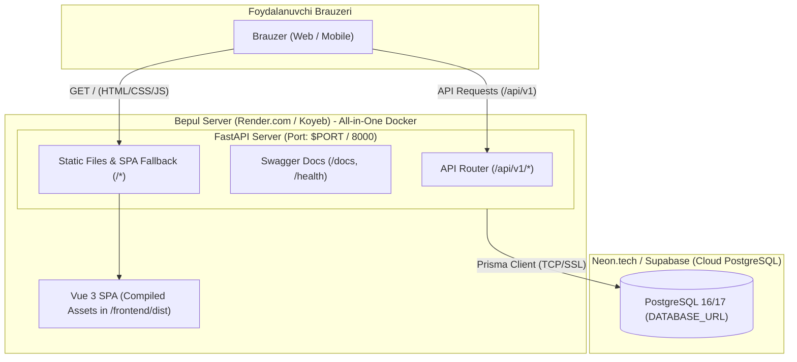

# All-in-One Docker Free Server Deployment Architecture Plan
## Enterprise Full-Stack Deployment: Vue 3 + FastAPI + Prisma + Neon Cloud PostgreSQL on Free Cloud (Render / Koyeb)

> **Hujjat:** `docs/FREE_SERVER_ALL_IN_ONE_DOCKER_DEPLOYMENT_PLAN.md`  
> **Muallif:** Senior DevOps Engineer & Solutions Architect  
> **Sana:** 2026-11-16  
> **Holati:** Tasdiqlangan va Amalga Oshirish Jarayonida  
> **Qoidaga Muvofiqlik:** "Reja (Plan .md) -> Tasklarga bo'lish -> Bosqichma-bosqich ishlab chiqish -> Testlash -> Git/GitHub push" qat'iy tartibi.

---

## 1. Ijroiya Xulosasi va Arxitektura Yechimi (Executive Summary)

Foydalanuvchi tanlagan arxitektura:
- **Deployment Modeli:** **All-in-One Docker Container** (Frontend va Backend yagona konteynerda/servisda, bitta domen va CORS muammolarisiz).
- **Tashqi Ma'lumotlar Bazasi:** **Neon.tech Cloud Serverless PostgreSQL** (100% bepul, 0.5 GB doimiy saqlash, server qayta yuklanganda ham ma'lumotlar xavfsiz saqlanadi).
- **Bepul Hosting Servisi:** **Render.com (Free Web Service - Docker)** yoki **Koyeb (Free Nano Instance - Docker)**.

---

## 2. Rejalashtirilgan Bosqichlar (Waves & Tasks)

### Wave 1: Docker Multi-Stage Build & Konteynerlash
- **Task 1.1:** Ko'p bosqichli `Dockerfile` yaratish:
  - 1-bosqich (Builder): `node:20-alpine` — Frontend dependencies o'rnatish va `npm run build` orqali `/frontend/dist` ni kompilyatsiya qilish.
  - 2-bosqich (Runtime): `python:3.11-slim` — Node.js runtime (Prisma CLI uchun), Python dependencies o'rnatish, Prisma client generation, entrypoint skripti.
- **Task 1.2:** `.dockerignore` yaratish (keraksiz `node_modules`, `.git`, `.venv`, `dev.db` larni chiqarib tashlash).
- **Task 1.3:** `docker-entrypoint.sh` skriptini yaratish (PostgreSQL sxemasini avtomatik `prisma db push` qilish va `uvicorn` ni ishga tushirish).

### Wave 2: Backend SPA Static Serving va Frontend HttpClient Moslashuvi
- **Task 2.1:** `backend/app/main.py` da production rejimida `frontend/dist` statik fayllarini va Vue Router HTML5 History rejimiga mos 404 SPA fallback mexanizmini ulash.
- **Task 2.2:** `prisma/schema.prisma` da PostgreSQL moslashuvini ta'minlash va dinamik provider almashtirish vositasini yaratish (local SQLite vs cloud PostgreSQL).
- **Task 2.3:** `frontend/src/shared/api/httpClient.ts` da nisbiy `/api/v1` yo'nalishini qo'llab-quvvatlash (bitta domenda ishlaganda CORS butunlay yo'qoladi).

### Wave 3: Bepul Server (Render & Koyeb) Avtomatlashtirish Fayllari va Qo'llanma
- **Task 3.1:** `render.yaml` (Render Blueprint) yaratish — GitHub repodan 1-click deploy uchun.
- **Task 3.2:** `docs/DEPLOYMENT_GUIDE.md` tayyorlash — Neon.tech dan bepul baza olish va Render/Koyeb ga ulash bo'yicha qadam-baqadam skrinshotli/batafsil qo'llanma.

### Wave 4: Testlash va Tekshiruv (Comprehensive TDD / Readiness Verification)
- **Task 4.1:** `backend/tests/test_deployment_readiness.py` orqali server sog'lomligi (`/health`), API endpointlar (`/api/v1`), statik fayllar va CORS xatti-harakatini to'liq testlash.
- **Task 4.2:** Barcha testlarni ishga tushirish (100% PASS).

### Wave 5: Git Versiyalash va GitHub Push
- **Task 5.1:** Barcha o'zgarishlarni tekshirish, atomik Conventional Commit qilish va GitHub `main` tarmog'iga push qilish.
