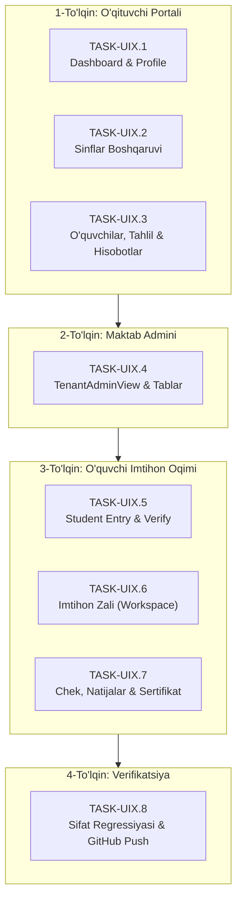

# Butun Tizim UI/UX, Dark Theme va WCAG Inklyuzivligini Mukammallashtirish Rejasi
## CHSB Platform — Full-System UI/UX, Dark Mode & Accessibility Remediation Plan

> **Hujjat:** `docs/FULL_SYSTEM_UI_UX_AND_DARK_MODE_PLAN.md`  
> **Versiya:** 1.0.0 (Master UI/UX Plan)  
> **Muallif:** Senior Lead UI/UX Engineer & Frontend Architect  
> **Holati:** Tasdiqlash uchun tayyorlangan  
> **Qamrov:** Loyihadagi barcha 56 ta Vue komponentida 100% Dark Theme (`dark:`), WCAG 2.1 AA `aria-label`lar, sensorli ekran o'lchamlari (>= 44px) va mobil responsivlikni ta'minlash.  
> **Metodologiya:** Har bir task test-driven development (TDD) asosida yoziladi, mustaqil testlari PASS bo'lgach, Git commit va GitHub ga yuklanadi.

---

## 1. Muammo va Arxitekturaviy Maqsad

* **Mavjud Kamchiliklar:** 
  1. Loyihaning asosiy ramkalarida Dark Mode tugmasi bo'lsa-da, ichki sahifalarning qariyb yarmi (O'qituvchi kabineti, Maktab admini, O'quvchi imtihon zali, Natijalar ekrani) faqat oq fonda (`bg-white`) qolib ketgan. Bu qorong'i rejim yoqilganda ko'zni toliqtiruvchi kontrast to'qnashuvini keltirib chiqaradi.
  2. Bir qator form elementlarida (selectlar, chekboxlar, qidiruv inputlari) xalqaro WCAG 2.1 AA `aria-label`lari yetishmaydi.
  3. `StudentEntryLayout.vue` da o'quvchilar uchun mavzu va til almashtirish boshqaruvlari mavjud emas.
  4. Mobil qurilmalarda ba'zi jadvallarda gorizontal skroll yetishmasligi sababli ma'lumotlar siqilib qolishi mumkin.
* **Maqsad:** Loyihadagi barcha sahifalarni yagona, premium, xatosiz va bir xil yuqori sifat standartiga olib chiqish.

---

## 2. Bosqichma-bosqich Vazifalar Rejasi (Task Breakdown)

---

### 🔹 1-TO'LQIN: O'QITUVCHI PORTALI MUKAMMALLASHTIRUVI

#### TASK-UIX.1: `TeacherDashboardView.vue` va `TeacherProfileView.vue` ni To'liq Dark Mode va A11y ga O'tkazish
- **Fayllar:**
  - `src/features/teacher/dashboard/TeacherDashboardView.vue`
  - `src/features/teacher/profile/TeacherProfileView.vue`
- **Vazifalar:**
  - Barcha kartochkalar, bannerlar va statistika qutilariga `dark:bg-slate-800`, `dark:border-slate-700`, `dark:text-white`, `dark:text-slate-300` sinflarini kiritish.
  - `TeacherProfileView.vue` dagi chekboxlar va selectlarga WCAG 2.1 AA `aria-label`larini qo'shish.
  - Mobil ekranlarda tugmalar bir-biriga yopishib qolmasligi uchun `gap-3` va sensorli o'lchamlarni ta'minlash.
- **Verifikatsiya:** `tests/ui-teacher-dashboard-dark.test.ts`.

#### TASK-UIX.2: `TeacherClassesView.vue`, `ClassCard.vue` va `TeacherClassDetailView.vue`
- **Fayllar:**
  - `src/features/teacher/classes/TeacherClassesView.vue`
  - `src/features/teacher/classes/components/ClassCard.vue`
  - `src/features/teacher/classes/TeacherClassDetailView.vue`
- **Vazifalar:**
  - Qidiruv inputi va smena/parallel filtrlariga to'liq `dark:` sinflari va `aria-label`lar berish.
  - Sinflar kartochkalari (`ClassCard.vue`) va sinf batafsil ma'lumotlariga Dark Mode qo'shish.
- **Verifikatsiya:** `tests/ui-teacher-classes-dark.test.ts`.

#### TASK-UIX.3: O'quvchilar, Imtihonlar, Tahlillar va Hisobotlar Sahifalari
- **Fayllar:**
  - `src/features/teacher/students/TeacherStudentsView.vue`
  - `src/features/teacher/students/TeacherStudentDetailView.vue`
  - `src/features/teacher/assessments/TeacherAssessmentsView.vue`
  - `src/features/teacher/assessments/TeacherAssessmentDetailView.vue`
  - `src/features/teacher/results/TeacherResultsView.vue`
  - `src/features/teacher/analytics/TeacherAnalyticsView.vue`
  - `src/features/teacher/reports/TeacherReportsView.vue`
- **Vazifalar:**
  - Jadvallar va statistika grafiklari kartochkalariga Dark Theme qo'shish.
  - Jadvallarda mobil qurilmalar uchun `overflow-x-auto` himoyasini kafolatlash.
  - O'quvchi qidiruv inputlariga `aria-label`lar kiritish.
- **Verifikatsiya:** `tests/ui-teacher-views-dark.test.ts`.

---

### 🔹 2-TO'LQIN: MAKTAB ADMIN PORTALI UYG'UNLASHUVI

#### TASK-UIX.4: `TenantAdminView.vue` ni To'liq Dark Mode ga O'tkazish
- **Fayllar:**
  - `src/features/tenant-admin/TenantAdminView.vue`
- **Vazifalar:**
  - Maktab ma'lumotlari kartasi, status ko'rsatkichlari, statistika bloklari va tab tugmalariga (`dark:bg-slate-800`, `dark:border-slate-700`, `dark:text-white`) qo'shish.
  - Tablarni mobil qurilmalarda gorizontal qulay surilishini ta'minlash (`overflow-x-auto whitespace-nowrap`).
  - `SystemLogViewer.vue` va `CreateClassModal.vue` bilan 100% vizual uyg'unlikka erishish.
- **Verifikatsiya:** `tests/ui-tenant-admin-dark.test.ts`.

---

### 🔹 3-TO'LQIN: O'QUVCHI IMTIHON VA NATIJALAR OQIMI (STUDENT JOURNEY)

#### TASK-UIX.5: `StudentEntryLayout.vue`, `StudentEntryView.vue` va `StudentVerifyView.vue`
- **Fayllar:**
  - `src/app/layouts/StudentEntryLayout.vue`
  - `src/features/student-admission/StudentEntryView.vue`
  - `src/features/student-admission/StudentVerifyView.vue`
- **Vazifalar:**
  - `StudentEntryLayout.vue` ga `dark:` sinflari, `ThemeToggle.vue` va `LanguageSwitcher.vue` boshqaruvlarini ulash.
  - Roster kod kiritish oynasi va shaxsni tasdiqlash kartalarini Dark Theme ga o'tkazish.
  - Roster inputi va sanalar uchun `aria-label`larni qo'shish.
- **Verifikatsiya:** `tests/ui-student-admission-dark.test.ts`.

#### TASK-UIX.6: `AssessmentWorkspaceView.vue`, `QuestionBlockRenderer.vue` va `ExamLayout.vue`
- **Fayllar:**
  - `src/app/layouts/ExamLayout.vue`
  - `src/features/assessment/AssessmentWorkspaceView.vue`
  - `src/shared/components/QuestionBlockRenderer.vue`
- **Vazifalar:**
  - O'quvchi test yechadigan asosiy ishchi maydonni qorong'i rejimga to'liq moslashtirish (savol matni, A/B/C/D variant tugmalari, pastki navigatsiya palitrasi va 40 daqiqalik taymer bloki).
  - Anti-cheat ogohlantirish oynasini Dark Mode bilan uyg'unlashtirish.
- **Verifikatsiya:** `tests/ui-assessment-workspace-dark.test.ts`.

#### TASK-UIX.7: Natijalar, Chek, Sertifikat va 404 Sahifalari
- **Fayllar:**
  - `src/features/results/SubmissionReceiptView.vue`
  - `src/features/results/AssessmentResultView.vue`
  - `src/features/results/CertificateModal.vue`
  - `src/shared/components/NotFoundView.vue`
- **Vazifalar:**
  - Imtihon topshirilganlik cheki (QR kod, xesh kodlar), natijalar tahlili va sertifikat modali uchun Dark Theme va A11y sinflarini joriy qilish.
  - 404 (NotFoundView) sahifasini Dark Mode ga o'tkazish.
- **Verifikatsiya:** `tests/ui-results-dark.test.ts`.

---

### 🔹 4-TO'LQIN: SIFAT KAFOLATI VA GITHUB REPOZITORIYASI

#### TASK-UIX.8: Butun Loyiha Sifat Regressiyasi va Yakuniy Push
- **Vazifalar:**
  - `npm run typecheck` (`vue-tsc --noEmit`) -> 0 ta xato.
  - `npm run lint` (`eslint . --max-warnings 0`) -> 0 ta ogohlantirish.
  - `python .agents/skills/frontend-design/scripts/ux_audit.py src` -> STATUS: PASS.
  - `npx vitest run` -> 50+ ta test fayl, barcha testlar 100% yashil (PASS).
  - `npm run build` -> Production build xatosiz yig'ilishi.
  - Har bir to'lqinni atomik Conventional Commits bilan GitHub `origin main` ga push qilish.

---

## 3. Kutilayotgan Yakuniy Natija

Ushbu reja to'liq bajarilgach:
1. Loyihadagi **bitta ham oq quti yoki chala dark mode qolmaydi**.
2. O'quvchi kirishidan tortib imtihon topshirish, o'qituvchi xonasi va maktab boshqarmasigacha barcha sahifalar **100% bir xil premium sifat darajasiga** chiqadi.
3. WCAG 2.1 AA va mobil sensorli talablar to'liq bajariladi.

