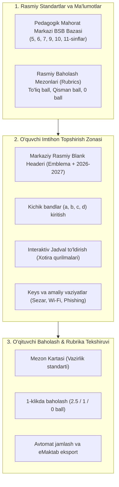

# 🏛️ CHSB Platform — "Pedagogik Mahorat va Xalqaro Baholash Ilmiy-Amaliy Markazi" Rasmiy BSB/ChSB Standartlarini Integratsiya Qilish Arxitektura Rejasi

> **Hujjat versiyasi:** 1.0.0  
> **Status:** Tasdiqlashga tayyor  
> **Asos:** O'zbekiston Respublikasi Maktabgacha va maktab ta'limi vazirligi, Pedagogik mahorat va xalqaro baholash ilmiy-amaliy markazi rasmiy BSB (Bo'lim yuzasidan summativ baholash) materiallari (2026-2027 o'quv yili).  
> **Qamrov:** 5, 6, 7, 9, 10, 11-sinflar Informatika fani I chorak 1-BSB/ChSB imtihonlari, ko'p formatli topshiriqlar, rasmiy baholash mezonlari (Rubrics), o'quvchi va o'qituvchi interfeyslari.  

---

## 1. 📋 Rasmiy Hujjatlar Tahlili va Standartlar

Foydalanuvchi taqdim etgan rasmiy imtihon hujjatlari tahlili:

| Sinf | Imtihon Nomi | Topshiriqlar Soni | Jami Ball | Topshiriq Formatlari | Baholash Mezoni Turi |
| :--- | :--- | :---: | :---: | :--- | :--- |
| **5-sinf** | I chorak 1-BSB | 5 ta | **25 ball** | Shift/Caps Lock, Matn tahrirlash (Cut/Paste), Nusxalash, Save vs Save As | 4-6 balldan, bandlar bo'yicha qat'iy rubrikalar |
| **6-sinf** | I chorak 1-BSB | 5 ta | **25 ball** | Gap ko'chirish, Shrift/O'lcham/Tekislash, Word rasm aylantirish, Paint import & rotate | 4-6 balldan, ko'nikmalar bo'yicha mezon |
| **7-sinf** | I chorak 1-BSB | 5 ta | **25 ball** | Matn stili & Wrap Text, Tasvir qirqish (Crop/Resize), Word jadval, Bullets, Header/Footer | 4-6 balldan, amaliy bosqichlar |
| **9-sinf** | I chorak 1-BSB | 5 ta | **50 ball** | Qurilmalar turlari, Shtrix kod & PIN reader keysi, Xotira jadvali, Wi-Fi vs Bluetooth, URL tahlili | 8-12 balldan, to'liq (2.5), qisman (1), 0 ball |
| **10-sinf** | I chorak 1-BSB | 5 ta | **50 ball** | Statik/dinamik axborot, Sezar shifri, Apparat ta'minoti, Dasturiy ta'minot (DBMS, Applet), Kiberxavfsizlik (Phishing) | 8-12 balldan, analitik yechimlar |
| **11-sinf** | I chorak 1-ChSB | 15 ta | **40-50 ball** | Murakkab axborot tizimlari, ma'lumotlar bazasi, tarmoq xavfsizligi testlari | 2.5 - 3 balldan test va yozma topshiriqlar |

---

## 2. 🏛️ Texnik Qatlamlar va Arxitektura Modeli

---

## 3. 🌊 Atomik Ish Bosqichlari (Waves & Tasks)

### WAVE 1: Rasmiy BSB/ChSB Ma'lumotlar Bazasi va Fixturalari
- **Fayl:** `frontend/src/entities/assessment/officialBsbData.ts`
- **Vazifasi:** 5, 6, 7, 9, 10, 11-sinflarning haqiqiy BSB topshiriqlari, bandlari, matnlari, jadvallari va baholash mezonlarini to'liq tizimlashtirish.
- **Ballar:** 5-7 sinflar = 25 ball, 8-11 sinflar = 50 ball.

### WAVE 2: Ko'p Qirrali Topshiriqlar Rendereri (Multi-type Question Engine)
- **Fayl:** `frontend/src/features/assessment/components/BsbQuestionRenderer.vue`
- **Imkoniyatlar:**
  - Ochiq bandli savollar (`a)`, `b)`, `c)`, `d)`) uchun maxsus qulay yozish maydonlari.
  - Jadval to'ldirish topshiriqlari (interaktiv inputlar bilan).
  - Keys va amaliy vaziyat topshiriqlari.
  - Variantli (A, B, C, D) an'anaviy testlar.

### WAVE 3: O'qituvchi Baholash Mezonlari (Rubric Grading UI)
- **Fayl:** `frontend/src/features/teacher/results/BsbRubricGradingModal.vue`
- O'qituvchi o'quvchi ishini tekshirayotganda vazirlikning rasmiy baholash mezoni jadvali chiqadi.
- Har bir band bo'yicha to'liq to'g'ri (2.5 ball), qisman (1 ball) yoki 0 ball tugmalari yordamida tezkor, shaffof va adolatli baholash.

### WAVE 4: Yangi Imtihon Qo'shish Modaliga Rasmiy BSB Shablonlarini Ulagich
- **Fayl:** `frontend/src/features/teacher/assessments/CreateAssessmentModal.vue`
- Sinf tanlanganda (5, 6, 7 -> 25 ball, 9, 10, 11 -> 50 ball) avtomatik rasmiy ball va vaqt o'rnatiladi.
- "🏛️ Rasmiy BSB/ChSB shablonidan yuklash" tugmasi qo'shiladi.

### WAVE 5: Vitest Testlari, TypeScript Build va GitHub Push
- Yangi BSB renderer va rubrika parseri uchun unit testlar (`bsb-curriculum.test.ts`).
- Barcha testlar 100% yashil bo'lishi.
- Git Conventional Commit bilan `main` tarmog'iga push qilish.
