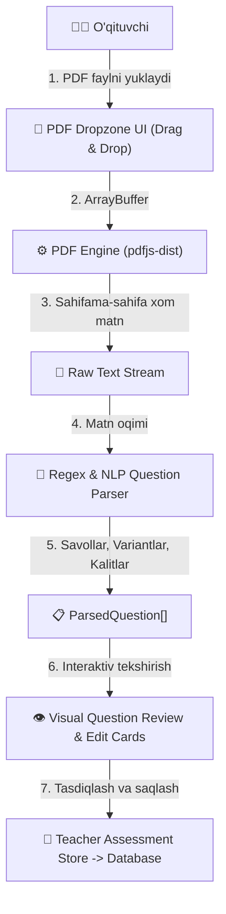

# 📄 CHSB Platform — PDF Imtihon Savollarini Yuklash va Avtomatik Parser Arxitektura Rejasi

> **Hujjat versiyasi:** 1.0.0  
> **Status:** Rejalashtirilgan va Tasdiqlashga tayyor  
> **Muallif:** Senior Full-Stack & EdTech Architect  
> **Qamrov:** Frontend (Vue 3 + Vite + pdfjs-dist), Parsers, Visual Question Preview, Assessment Store & Testing  

---

## 1. 🎯 Maqsad va Muammo Ta'rifi

Hozirgi kunda o'qituvchilar va maktab ma'muriyati CHSB (Choraklik Baholash) uchun test savollarini qo'lda kiritishi yoki matn nusxalab qo'yishi kerak. Ammo aksariyat maktablarda, Respublika ta'lim markazida va attestatsiya bazalarida barcha rasmiy testlar **PDF hujjat formatida** tarqatiladi.

### Asosiy maqsad:
1. O'qituvchi kompyuteridagi har qanday rasmiy yoki odatiy test PDF faylini (masalan: `11_sinf_informatika_chsb.pdf`) drag-and-drop orqali yuklaydi.
2. Tizim PDF faylni brauzerning o'zida mijoz tomonida (`pdfjs-dist`) xavfsiz va bir zumda matnga ajratadi.
3. Intellektual EdTech Regex & NLP parser matndan:
   - Savol raqami va matnini (`1. ...`, `1) ...`, `1-savol: ...`),
   - Variantlarni (`A) ...`, `B) ...`, `C) ...`, `D) ...`),
   - To'g'ri javoblarni (`Javob: A`, `To'g'ri javob: C`, `Kalit: D` yoki hujjat oxiridagi javoblar jadvali `1-A, 2-C...`) aniqlaydi.
4. **Professional UI/UX:** Aniqlangan savollar o'qituvchiga chiroyli interaktiv kartochkalar ko'rinishida ko'rsatiladi. O'qituvchi har bir savolni tahrirlashi, to'g'ri javobni o'zgartirishi, ball belgilashi va 1-klik bilan bazaga imtihon qilib saqlashi mumkin.

---

## 2. 🏛️ Texnik Arxitektura va Ma'lumotlar Oqimi

---

## 3. 🌊 Atomik Ish Bosqichlari (Waves & Tasks)

### WAVE 1: PDF Matn Chiqarish Servisi (`pdfExtractor.ts`)
- **Fayl:** `frontend/src/shared/utils/pdfExtractor.ts`
- **Vazifasi:** PDF faylini o'qib, barcha sahifalar matnini tartibli birlashtirish, qatorlar buzilishini bartaraf etish.
- **Unit Testlar:** `frontend/tests/pdf-extractor.test.ts` (Valid PDF arraybuffer, bo'sh fayl, ko'p sahifali hujjatlar).

### WAVE 2: O'zbek EdTech Standartidagi Savollar Parseri (`pdfQuestionParser.ts`)
- **Fayl:** `frontend/src/shared/utils/pdfQuestionParser.ts`
- **Qo'llab-quvvatlanadigan formatlar:**
  - Standard: `1. Savol... A) ... B) ... C) ... D) ... Javob: A`
  - Qavsli: `1) Savol... a. ... b. ... c. ... d. ... To'g'ri javob: B`
  - Kalitlar jadvali (oxirida): `Javoblar: 1-A, 2-B, 3-C, 4-D...`
  - Ballarni avtomatik proporsional taqsimlash (`maxScore / totalQuestions`).
- **Unit Testlar:** `frontend/tests/pdf-question-parser.test.ts` (100% boundary testing, turli maktab testlari formatlari).

### WAVE 3: Imtihon Yaratish Modaliga PDF Rejimi va Drag & Drop UI Qo'shish
- **Fayl:** `frontend/src/features/teacher/assessments/CreateAssessmentModal.vue`
- **UI Elementlar:**
  - Tab 2 da: `questionMode: 'auto' | 'custom' | 'pdf'` tugmasi.
  - Zamonaviy yuklash maydoni (SVG ikonka, fayl hajmi, dragover animatsiya, progress bar).
  - Aniqlangan savollar soni ko'rsatkichi (masalan: `15 ta savol muvaffaqiyatli aniqlandi`).
  - Har bir savol uchun tahrirlovchi interaktiv karta (savol matni, variantlar, to'g'ri variantni radiotugma orqali o'zgartirish).
- **Dark Mode va WCAG 2.1 AA:** To'liq moslashtirilgan.

### WAVE 4: Vitest To'liq Test Sinovlari va Git Commit
- Barcha mavjud 341 ta test + yangi PDF parser testlari (jami ~355+ test) 100% yashil bo'lishini ta'minlash.
- Conventional Commit bilan GitHub `main` tarmog'iga push qilish.

---

## 4. 🧪 Qabul Qilish Kriteriyalari (Acceptance Criteria)

- [ ] O'qituvchi PDF faylni yuklaganda 1 soniya ichida matn o'qiladi.
- [ ] 1-savoldan N-savolgacha variantlari bilan to'liq ajratib olinadi.
- [ ] Agar faylda javoblar ko'rsatilgan bo'lsa, to'g'ri variant avtomatik belgilanadi; ko'rsatilmagan bo'lsa, o'qituvchi UI orqali 1-klikda to'g'ri javobni tanlay oladi.
- [ ] O'qituvchi "Imtihonni yaratish" tugmasini bosganda yangi test platforma bazasida saqlanadi va o'quvchilar ushbu savollar bo'yicha imtihon topshira oladi.
