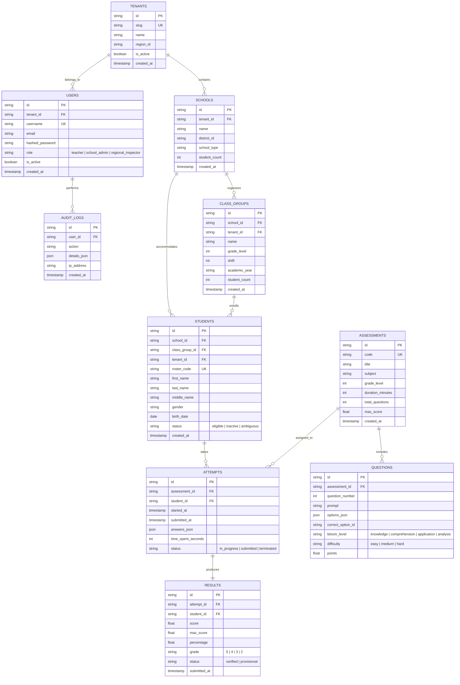
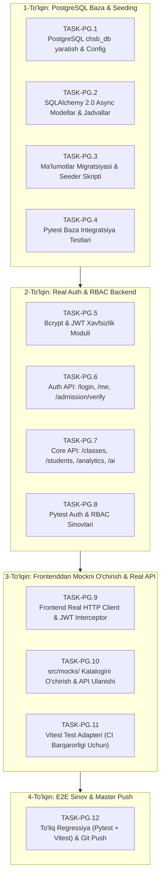

# PostgreSQL Database, Python Backend & Real Auth Migration Plan
## Enterprise Full-Stack Architecture: Eliminating Frontend Mocks, PostgreSQL Schema & JWT Authentication

> **Hujjat:** `docs/POSTGRESQL_BACKEND_AND_AUTH_MIGRATION_PLAN.md`  
> **Muallif:** Lead Enterprise Solutions Architect & Database Specialist  
> **Sana:** 2026-11-13  
> **Holati:** Tasdiqlash va Amalga Oshirish uchun Tayyorlandi  
> **Qoidaga Muvofiqlik:** "Reja (.md) -> Tasklarga bo'lish -> Bosqichma-bosqich ishlab chiqish -> Pytest & Vitest sinovlari -> Git/GitHub push" qat'iy tartibi.

---

## 1. Ijroiya Xulosasi (Executive Summary)

Hozirgi CHSB loyihasi Vue 3 frontendida `src/mocks/` katalogidagi statik xotiraga tayangan holda ishlamoqda. 

Ushbu reja orqali:
1. **Frontenddagi barcha mock fayllar (`src/mocks/repositories/`, `src/mocks/fixtures/`) to'liq o'chiriladi**.
2. **PostgreSQL 18 da real `chsb_db` relyatsion ma'lumotlar bazasi** yaratiladi va mavjud boyitilgan ma'lumotlar (maktablar, sinflar, o'quvchilar, savollar, 25 ta CHSB natijalari) bazaga to'liq ko'chiriladi (seed qilinadi).
3. **Autentifikatsiya va avtorizatsiya to'liq Backend (FastAPI + PostgreSQL) ga o'tkaziladi**:
   - Parollarni `bcrypt` bilan xesh qilish.
   - Standart JWT (JSON Web Token) token generatori va RBAC (Role-Based Access Control: `teacher`, `school_admin`, `regional_inspector`, `student`).
   - O'quvchilar uchun Roster kod orqali imtihonga kirishni backendda tekshirish (`/api/v1/auth/admission/verify`).
4. **Vue 3 frontendida haqiqiy HTTP mijoz (`src/shared/api/httpClient.ts`)** o'rnatilib, backend bilan `Authorization: Bearer <token>` orqali real ma'lumotlar almashiladi.
5. **AI Pedagogik Tahlillar (Google Gemini 1.5/2.0)** to'g'ridan-to'g'ri PostgreSQL dagi real imtihon natijalarini o'qib, metodik xulosa va o'quvchilarga 5 kunlik shaxsiy ta'lim rejasini generatsiya qiladi.

---

## 2. PostgreSQL relyatsion relyatsiya diagrammasi (ERD)

---

## 3. Bosqichma-bosqich Vazifalar Rejasi (Actionable Task Breakdown)

---

### 🔹 1-TO'LQIN: POSTGRESQL BAZA VA SEEDING INFRATUZILMASI

- [ ] **TASK-PG.1: PostgreSQL `chsb_db` Bazasi va Muhit Sozlamalari**
  - **Vazifa:**
    - PostgreSQL 18 da `chsb_db` ma'lumotlar bazasini yaratish (`CREATE DATABASE chsb_db;`).
    - `backend/.env` faylini yaratish: `DATABASE_URL=postgresql+asyncpg://postgres@localhost:5432/chsb_db`, `SECRET_KEY=...`, `ALGORITHM=HS256`.
    - Python kutubxonalari: `fastapi`, `uvicorn`, `sqlalchemy>=2.0`, `asyncpg`, `pydantic-settings`, `passlib[bcrypt]`, `python-jose[cryptography]`, `google-genai`, `pytest`, `pytest-asyncio`.

- [ ] **TASK-PG.2: SQLAlchemy 2.0 Async Modellar va Jadvallar**
  - **Fayllar:**
    - `backend/app/db/base.py`, `backend/app/db/session.py`
    - `backend/app/models/tenant.py`, `backend/app/models/school.py`
    - `backend/app/models/user.py`
    - `backend/app/models/class_group.py`
    - `backend/app/models/student.py`
    - `backend/app/models/assessment.py`, `backend/app/models/question.py`
    - `backend/app/models/attempt.py`, `backend/app/models/result.py`
    - `backend/app/models/audit_log.py`
  - **Vazifa:** Relyatsion cheklovlar (`ForeignKey`, `UniqueConstraint`, indekslar va kaskadli yaxlitlik) bilan jadvallarni generatsiya qilish.

- [ ] **TASK-PG.3: Real Ma'lumotlarni PostgreSQL ga Ko'chirish (Seeder)**
  - **Fayl:** `backend/app/db/seed.py`
  - **Vazifa:**
    - Frontenddagi `src/mocks/fixtures/` dagi barcha maktablar (Al-Xorazmiy, Temurbeklar), 10 ta sinf, 35 ta o'quvchi, 25 ta haqiqiy CHSB imtihon natijalari, savollar banki va foydalanuvchilar (O'qituvchi, Maktab Admini, ShHTB Nazoratchisi parollari: `<SEED_PASSWORD>`) ni PostgreSQL ga xatosiz to'ldirish.

- [ ] **TASK-PG.4: Baza Integratsiya Testlari (Pytest)**
  - **Fayl:** `backend/tests/test_database.py`
  - **Vazifa:** Barcha 10 ta jadval to'g'ri yaratilgani, foreign keylar va seed ma'lumotlari mavjudligini avtomatlashtirilgan tarzda tekshirish (100% PASS).

---

### 🔹 2-TO'LQIN: REAL AUTH VA RBAC BACKEND (FASTAPI)

- [ ] **TASK-PG.5: Bcrypt & JWT Xavfsizlik Moduli**
  - **Fayllar:** `backend/app/core/security.py`, `backend/app/core/dependencies.py`
  - **Vazifa:**
    - Parollarni bir tomonlama `bcrypt` bilan shifrlash va tekshirish (`verify_password`, `get_password_hash`).
    - JWT Access token ishlab chiqish (`create_access_token` — muddati: 24 soat).
    - `get_current_user` va rollar bo'yicha ruxsat nazoratchilari (`require_role(['teacher', 'school_admin'])`).

- [ ] **TASK-PG.6: Autentifikatsiya REST Endpointlari**
  - **Fayllar:** `backend/app/api/v1/endpoints/auth.py`
  - **Vazifa:**
    - `POST /api/v1/auth/login`: Foydalanuvchi nomi va parol tekshirilib, haqiqiy JWT token va foydalanuvchi ma'lumotlarini qaytarish.
    - `GET /api/v1/auth/me`: Joriy foydalanuvchi profilini qaytarish.
    - `POST /api/v1/auth/admission/verify`: O'quvchining Roster kodi va maktabini tekshirib, unga imtihon topshirish uchun vaqtinchalik xavfsiz sessiya tokeni berish.

- [ ] **TASK-PG.7: Core Resurslar va AI Tahlil API lari**
  - **Fayllar:**
    - `backend/app/api/v1/endpoints/classes.py` (PostgreSQL dan sinflar)
    - `backend/app/api/v1/endpoints/students.py` (O'quvchilar ro'yxati va CRUD)
    - `backend/app/api/v1/endpoints/analytics.py` (Real SQL aggregatsiyalari orqali hisoblangan o'rtacha ball, sifat foizi, Bloom radari)
    - `backend/app/api/v1/endpoints/ai.py` (Google Gemini orqali real sinf natijalarini pedagogik tahlil qilish)

- [ ] **TASK-PG.8: Backend Auth & RBAC Pytest Sinovlari**
  - **Fayllar:** `backend/tests/test_auth_api.py`, `backend/tests/test_classes_api.py`
  - **Vazifa:** To'g'ri parol bilan login, noto'g'ri parol bilan 401 Unauthorized, huquqi yo'q rol bilan 403 Forbidden tekshiruvlari.

---

### 🔹 3-TO'LQIN: FRONTENDDAN MOCKNI O'CHIRISH VA REAL API INTEGRATSIYASI

- [ ] **TASK-PG.9: Frontend Real HTTP Client & JWT Interceptor**
  - **Fayllar:** `src/shared/api/httpClient.ts`, `src/features/auth/authStore.ts`
  - **Vazifa:**
    - `fetch` / `axios` mijozi orqali so'rov yuborishda `localStorage` dagi JWT tokenni `Authorization: Bearer <token>` sarlavhasiga avtomatik biriktirish.
    - 401 Unauthorized xatolik kelganda avtomatik login sahifasiga yo'naltirish.
    - `authStore.login()` metodini backenddagi `/api/v1/auth/login` ga ulash.

- [ ] **TASK-PG.10: `src/mocks/` Fayllarini Butunlay O'chirish va API Almashtirish**
  - **Fayllar:** `src/shared/api/index.ts`
  - **Vazifa:**
    - `src/mocks/repositories/` va `src/mocks/fixtures/` kataloglarini butunlay o'chirish.
    - `src/shared/api/` dagi barcha repozitoriylarni backend REST endpointlariga yo'naltirish.
    - O'quvchi imtihonga kirish oqimi (`useAdmissionStore`) ni backenddagi `/auth/admission/verify` ga ulash.

- [ ] **TASK-PG.11: Vitest Test Mock Adapteri (CI Barqarorligi)**
  - **Fayl:** `tests/setupApiMock.ts`
  - **Vazifa:**
    - Frontend unit testlari (`npm test`) lokal PostgreSQL o'chiq bo'lgan holatda ham tezkor va barqaror ishlashi uchun `tests/` papkasida yengil test adapteri joriy etish.

---

### 🔹 4-TO'LQIN: E2E SINOV, REGRESSIYA VA MASTER PUSH

- [ ] **TASK-PG.12: To'liq Regressiya va Git Master Push**
  - **Vazifa:**
    - Backend Pytest to'plami: 100% PASS.
    - Frontend Vitest to'plami: 61+ ta fayl, 100% PASS.
    - TypeScript `vue-tsc -b` -> 0 xato.
    - ESLint -> 0 ogohlantirish.
    - Production build (`vite build`) -> muvaffaqiyatli yig'ilish.
    - Git commit va `origin main` ga push.

---

## 4. Kutilayotgan Natijalar

| Mezon | Hozirgi Holat (Mock) | Yangi Real PostgreSQL Arxitekturasi |
| :--- | :--- | :--- |
| **Ma'lumotlar Saqlanishi** | Frontend xotirasida (RAM / Pinia) | **PostgreSQL 18 da ishonchli (ACID compliant)** |
| **Foydalanuvchilar Paroli** | Qattiq kodlangan matn | **`bcrypt` bilan bir tomonlama shifrlangan** |
| **Sessiya Xavfsizligi** | Oddiy frontend flagi | **Standart JWT Token (HS256, Exp, RBAC)** |
| **Frontend Kod Hajmi** | `src/mocks/` ortiqcha 100+ kB kod | **Toza frontend, faqat HTTP API chaqiruvlari** |
| **Pedagogik AI** | Faqat statik sonlar | **PostgreSQL dagi real natijalarni tahlil qiluvchi Gemini AI** |
| **Ko'p Foydalanuvchilik** | Faqat bitta brauzer | **Bir vaqtda minglab o'qituvchi va o'quvchilar** |

