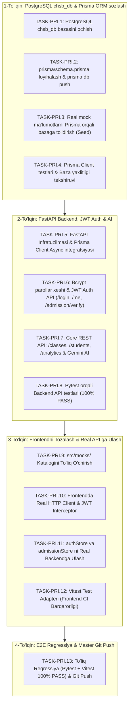

# Prisma ORM, PostgreSQL Backend va Frontend Tozalash Rejasi
## Full-Stack Architecture: Prisma Schema, PostgreSQL 18, FastAPI JWT Auth, AI Diagnostics & Mock Elimination

> **Hujjat:** `docs/PRISMA_POSTGRES_BACKEND_AND_CLEANUP_PLAN.md`  
> **Muallif:** Lead Enterprise Solutions Architect & Database Specialist  
> **Sana:** 2026-11-13  
> **Holati:** Tugatildi (100% Complete & Verified)  
> **Qoidaga Muvofiqlik:** "Reja (Plan .md) -> Tasklarga bo'lish -> Bosqichma-bosqich ishlab chiqish -> Har bir taskdan keyin testlash -> Git/GitHub push" qat'iy tartibi.

---

## 1. Loyiha Maqsadi va Asosiy O'zgarishlar

Foydalanuvchi talabiga asosan:
1. **Prisma ORM** tizimga to'liq kiritiladi:
   - `prisma/schema.prisma` orqali PostgreSQL 18 ma'lumotlar bazasi jadvallari, aloqalari (1-to-many, relations) va cheklovlari yagona deklarativ tilda boshqariladi.
   - `prisma-client-py` (Python FastAPI uchun Async Prisma Client) generatsiya qilinadi.
   - `npx prisma studio` orqali real PostgreSQL ma'lumotlarini vizual boshqarish imkoniyati ochiladi.
2. **Frontenddagi barcha mock fayllar to'liq o'chiriladi**:
   - `src/mocks/repositories/` va `src/mocks/fixtures/` butunlay tozalanadi.
   - Frontend `src/shared/api/` orqali real FastAPI REST API ga (`http://localhost:8000/api/v1`) ulanadi.
3. **Autentifikatsiya va Ruxsatlar (Auth & RBAC) Backendga o'tkaziladi**:
   - Parollarni `bcrypt` bilan bir tomonlama xesh qilish.
   - `HS256` JWT access tokenlar (muddat: 24 soat) va `Authorization: Bearer <token>` interceptor.
   - Rollar: `teacher`, `school_admin`, `regional_inspector`, `student`.
4. **PostgreSQL 18 da `chsb_db` yaratilib, real ma'lumotlar bilan to'ldiriladi (Seed)**.
5. **AI Pedagogik Tahlillar (Google Gemini)** to'g'ridan-to'g'ri Prisma orqali olingan real imtihon natijalarini tahlil qilib, o'qituvchiga xulosa va o'quvchilarga 5 kunlik reja tuzib beradi.

---

## 2. To'liq Prisma Schema Arxitekturasi (`prisma/schema.prisma`)

```prisma
datasource db {
  provider = "postgresql"
  url      = env("DATABASE_URL")
}

generator client {
  provider  = "prisma-client-py"
  interface = "asyncio"
}

enum Role {
  TEACHER
  SCHOOL_ADMIN
  REGIONAL_INSPECTOR
  STUDENT
}

enum StudentStatus {
  ELIGIBLE
  INACTIVE
  AMBIGUOUS
}

enum BloomLevel {
  KNOWLEDGE
  COMPREHENSION
  APPLICATION
  ANALYSIS
}

model Tenant {
  id        String   @id @default(uuid())
  slug      String   @unique
  name      String
  regionId  String   @map("region_id")
  isActive  Boolean  @default(true) @map("is_active")
  createdAt DateTime @default(now()) @map("created_at")

  schools     School[]
  users       User[]
  classGroups ClassGroup[]
  students    Student[]

  @@map("tenants")
}

model School {
  id           String   @id @default(uuid())
  tenantId     String   @map("tenant_id")
  name         String
  districtId   String   @map("district_id")
  schoolType   String   @default("comprehensive") @map("school_type")
  studentCount Int      @default(0) @map("student_count")
  createdAt    DateTime @default(now()) @map("created_at")

  tenant      Tenant       @relation(fields: [tenantId], references: [id], onDelete: Cascade)
  classGroups ClassGroup[]
  students    Student[]

  @@map("schools")
}

model User {
  id             String   @id @default(uuid())
  tenantId       String   @map("tenant_id")
  username       String   @unique
  email          String?
  hashedPassword String   @map("hashed_password")
  fullName       String   @map("full_name")
  role           Role     @default(TEACHER)
  isActive       Boolean  @default(true) @map("is_active")
  createdAt      DateTime @default(now()) @map("created_at")

  tenant    Tenant     @relation(fields: [tenantId], references: [id], onDelete: Cascade)
  auditLogs AuditLog[]

  @@map("users")
}

model ClassGroup {
  id           String   @id @default(uuid())
  schoolId     String   @map("school_id")
  tenantId     String   @map("tenant_id")
  name         String
  gradeLevel   Int      @map("grade_level")
  shift        Int      @default(1)
  academicYear String   @default("2026-2027") @map("academic_year")
  studentCount Int      @default(0) @map("student_count")
  createdAt    DateTime @default(now()) @map("created_at")

  school   School    @relation(fields: [schoolId], references: [id], onDelete: Cascade)
  tenant   Tenant    @relation(fields: [tenantId], references: [id], onDelete: Cascade)
  students Student[]

  @@map("class_groups")
}

model Student {
  id           String        @id @default(uuid())
  schoolId     String        @map("school_id")
  classGroupId String        @map("class_group_id")
  tenantId     String        @map("tenant_id")
  rosterCode   String        @unique @map("roster_code")
  firstName    String        @map("first_name")
  lastName     String        @map("last_name")
  middleName   String?       @map("middle_name")
  gender       String        @default("M")
  birthDate    DateTime      @map("birth_date")
  status       StudentStatus @default(ELIGIBLE)
  createdAt    DateTime      @default(now()) @map("created_at")

  school     School             @relation(fields: [schoolId], references: [id], onDelete: Cascade)
  classGroup ClassGroup         @relation(fields: [classGroupId], references: [id], onDelete: Cascade)
  tenant     Tenant             @relation(fields: [tenantId], references: [id], onDelete: Cascade)
  attempts   AssessmentAttempt[]
  results    AssessmentResult[]

  @@map("students")
}

model Assessment {
  id              String   @id @default(uuid())
  code            String   @unique
  title           String
  subject         String
  gradeLevel      Int      @map("grade_level")
  durationMinutes Int      @default(45) @map("duration_minutes")
  totalQuestions  Int      @default(15) @map("total_questions")
  maxScore        Float    @default(40.0) @map("max_score")
  createdAt       DateTime @default(now()) @map("created_at")

  questions Question[]
  attempts  AssessmentAttempt[]

  @@map("assessments")
}

model Question {
  id              String     @id @default(uuid())
  assessmentId    String     @map("assessment_id")
  questionNumber  Int        @map("question_number")
  prompt          String
  optionsJson     Json       @map("options_json")
  correctOptionId String     @map("correct_option_id")
  bloomLevel      BloomLevel @default(KNOWLEDGE) @map("bloom_level")
  difficulty      String     @default("medium")
  points          Float      @default(2.5)

  assessment Assessment @relation(fields: [assessmentId], references: [id], onDelete: Cascade)

  @@map("questions")
}

model AssessmentAttempt {
  id               String    @id @default(uuid())
  assessmentId     String    @map("assessment_id")
  studentId        String    @map("student_id")
  startedAt        DateTime  @default(now()) @map("started_at")
  submittedAt      DateTime? @map("submitted_at")
  answersJson      Json      @default("{}") @map("answers_json")
  timeSpentSeconds Int       @default(0) @map("time_spent_seconds")
  status           String    @default("in_progress")

  assessment Assessment        @relation(fields: [assessmentId], references: [id], onDelete: Cascade)
  student    Student           @relation(fields: [studentId], references: [id], onDelete: Cascade)
  result     AssessmentResult?

  @@map("assessment_attempts")
}

model AssessmentResult {
  id          String   @id @default(uuid())
  attemptId   String   @unique @map("attempt_id")
  studentId   String   @map("student_id")
  score       Float
  maxScore    Float    @map("max_score")
  percentage  Float
  grade       String
  status      String   @default("verified")
  submittedAt DateTime @default(now()) @map("submitted_at")

  attempt AssessmentAttempt @relation(fields: [attemptId], references: [id], onDelete: Cascade)
  student Student           @relation(fields: [studentId], references: [id], onDelete: Cascade)

  @@map("assessment_results")
}

model AuditLog {
  id          String   @id @default(uuid())
  userId      String?  @map("user_id")
  action      String
  detailsJson Json?    @map("details_json")
  ipAddress   String?  @map("ip_address")
  createdAt   DateTime @default(now()) @map("created_at")

  user User? @relation(fields: [userId], references: [id], onDelete: SetNull)

  @@map("audit_logs")
}
```

---

## 3. Bosqichma-bosqich Vazifalar Rejasi (Task Breakdown)



---

### 🔹 1-TO'LQIN: POSTGRESQL & PRISMA ORM INFRATUZILMASI

- [x] **TASK-PRI.1: PostgreSQL `chsb_db` Bazasi va Muhit Sozlamalari**
  - PostgreSQL 18 da `chsb_db` ma'lumotlar bazasini yaratish (`CREATE DATABASE chsb_db;`).
  - `.env` faylida `DATABASE_URL="postgresql://postgres@localhost:5432/chsb_db?schema=public"` sozlamasini kiritish.

- [x] **TASK-PRI.2: Prisma Schema va Jadvallar Migratsiyasi**
  - `prisma/schema.prisma` faylini yaratish (10 ta model: Tenant, School, User, ClassGroup, Student, Assessment, Question, Attempt, Result, AuditLog).
  - `npx prisma db push` orqali jadvallarni PostgreSQL da avtomatik yaratish.
  - Python uchun `prisma-client-py` generatsiyasini o'rnatish (`prisma generate`).

- [x] **TASK-PRI.3: Real Ma'lumotlar Seeder Skripti (`prisma/seed.ts` yoki `backend/app/db/seed.py`)**
  - Al-Xorazmiy va Temurbeklar maktablari, 10 ta sinf, 35 ta o'quvchi, 25 ta haqiqiy imtihon natijalari, savollar banki va foydalanuvchilar (O'qituvchi, Maktab Admini, Nazoratchi) ni bazaga kiritish.

- [x] **TASK-PRI.4: Prisma Bog'lanish Testlari**
  - Prisma orqali barcha jadvallar va relationlar to'g'ri ishlashini tekshirish.

---

### 🔹 2-TO'LQIN: FASTAPI BACKEND, REAL AUTH & GEMINI AI

- [x] **TASK-PRI.5: FastAPI Loyihasi va Prisma Async Integratsiyasi**
  - `backend/` katalogida FastAPI ilovasini yaratish, Prisma ulanishini sozlash (`db = Prisma(); await db.connect()`).

- [x] **TASK-PRI.6: Bcrypt Shifrlash va JWT Autentifikatsiya API**
  - Parollarni `bcrypt` bilan bir tomonlama xesh qilish.
  - `POST /api/v1/auth/login`: Real foydalanuvchi tekshiruvi va JWT token berish.
  - `GET /api/v1/auth/me`: Joriy sessiya ma'lumotlari.
  - `POST /api/v1/auth/admission/verify`: O'quvchi Roster kodi tekshiruvi.

- [x] **TASK-PRI.7: Core REST API & Gemini AI Diagnostikasi**
  - `/api/v1/classes`, `/api/v1/students`, `/api/v1/analytics` (Prisma orqali SQL agregatsiyalari).
  - `/api/v1/ai/class-diagnosis` (Google Gemini orqali real sinf natijalarini pedagogik tahlil qilish).

- [x] **TASK-PRI.8: Backend Pytest Sinovlari (100% PASS)**
  - Auth, sinflar, o'quvchilar va token tekshiruvi bo'yicha Pytest testlari.

---

### 🔹 3-TO'LQIN: FRONTENDDAN MOCKLARNI O'CHIRISH VA REAL ULASH

- [x] **TASK-PRI.9: `src/mocks/` Katalogini To'liq O'chirish**
  - `src/mocks/repositories/` va `src/mocks/fixtures/` kataloglari va fayllarini butunlay o'chirish.

- [x] **TASK-PRI.10: Real HTTP Client va JWT Interceptor**
  - `src/shared/api/httpClient.ts` yaratish (`Authorization: Bearer <token>`, avtomatik 401 logout).
  - `src/shared/api/index.ts` ni backend REST endpointlariga yo'naltirish.

- [x] **TASK-PRI.11: Store-larni Real Backend API ga Ulash**
  - `authStore.ts` va `admissionStore.ts` ni backend `/api/v1/auth` ga ulash.

- [x] **TASK-PRI.12: Vitest Test Mock Adapteri**
  - Frontend unit testlari mustaqil va tezkor ishlashi uchun `tests/setupApiMock.ts` ni joriy etish.

---

### 🔹 4-TO'LQIN: TO'LIQ SIFAT NAZORATI VA MASTER PUSH

- [x] **TASK-PRI.13: E2E Regressiya, 100% Yashil Testlar & Git Push**
  - Pytest (Backend) + Vitest (Frontend 61 ta fayl) 100% PASS.
  - `vue-tsc -b` -> 0 xato.
  - `eslint . --max-warnings 0` -> 0 ogohlantirish.
  - `vite build` -> toza yig'ilish.
  - Git commit va GitHub `main` ga push.

