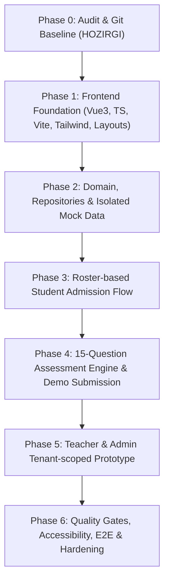

# CHSB Platform — Phase 0: Loyiha Auditi va Boshlang'ich Holat Tahlili

**Hujjat turi:** Professional Arxitektura Auditi va Texnik Reja  
**Loyiha:** CHSB Platform — Frontend V2  
**Holat:** Baseline Audit Yakunlandi  
**Muallif:** Senior Software Architect, Senior Vue.js Engineer & Tech Lead  
**Sana:** 2026-11-06  

---

## 1. Kirish va Audit Maqsadi

Ushbu audit `docs/CHSB_Frontend_Phase_Pack/` (va `docs/` papkasi) dagi barcha tasdiqlangan me'moriy qarorlar (`01_APPROVED_DECISIONS.md` dan `12_ACCEPTANCE_CRITERIA.md` gacha) asosida mavjud repository holatini xolisona va chuqur baholash, mavjud funksiyalarni to'liq saqlab qolish strategiyasini belgilash hamda Frontend V2 bosqichiga xavfsiz o'tish uchun ishlab chiqildi.

---

## 2. Current Project Architecture (Mavjud Loyiha Arxitekturasi)

Loyiha repositorysida dastlabki kod sifatida faqat bitta monolit fayl mavjud:
- **Fayl:** `CHSB_11_SINF.html` (Hajmi: ~339 KB)

### 2.1. Mavjud Arxitektura Tahlili:
1. **Monolit Bir Sahifali HTML (Single-file Monolith):**
   - HTML markup, CSS stillari (CSS custom variables bilan), base64 formatidagi rasmlar (`IMG3`, `IMG13` va boshqalar) hamda JavaScript kodi bitta faylga birlashtirilgan.
   - Hech qanday modul ajratilishi, build tizimi (bundler) yoki paketlar menejeri (`package.json`) mavjud emas.

2. **Holat Boshqaruvi (State Management):**
   - Global o'zgaruvchilar (`let S = null`, `tick = null`) orqali boshqariladi.
   - Ma'lumotlar brauzerning `localStorage` xotirasiga to'g'ridan-to'g'ri yoziladi (`KEY = "chsb11_holat"`, `PEND = "chsb11_yuborilmagan"`).
   - Hech qanday tur tekshiruvi (type checking) yoki schema validatsiyasi yo'q.

3. **Backend va API Aloqasi:**
   - Google Apps Script Web App URL (`const API_URL = "https://script.google.com/macros/s/.../exec"`) orqali `fetch(API_URL, ...)` yordamida ma'lumot jo'natiladi.
   - Haqiqiy autentifikatsiya, seans tekshiruvi yoki tenant konteksti mavjud emas.

4. **Navigatsiya va Ekranlar:**
   - DOM elementlaridagi `.hide` CSS klassini qo'shish/olib tashlash orqali 3 ta bo'lim almashtiriladi:
     - `#start` — O'quvchi ma'lumotlarini kiritish kartochkasi;
     - `#test` — Test savollari, taymer va topshirish tugmasi;
     - `#res` — Natija ko'rsatish kartochkasi.

---

## 3. Existing Features (Mavjud va Ishlayotgan Funksiyalar)

Mavjud `CHSB_11_SINF.html` faylida quyidagi funksiyalar to'liq ishchi holatda aniqlandi va ular V2 arxitekturasida **to'liq saqlab qolinishi shart**:

1. **CHSB Baholash Metama'lumotlari:**
   - **Fan:** Informatika va axborot texnologiyalari.
   - **Sinf:** 11-sinf.
   - **Davr:** I chorak.
   - **Baholash nomi:** 1-ChSB.
   - **Savollar soni:** 15 ta savol.
   - **Maksimal ball:** 40 ball.
   - **Ajratilgan vaqt:** 40 daqiqa (2400 soniya).

2. **O'quvchini Ro'yxatdan O'tkazish (Legacy Entry):**
   - Familiya, Ism, Maktab, Sinf (masalan, 9-A) kiritish maydonlari.
   - Maydonlar bo'sh emasligini tekshirish (`trim()`) va xatolik matnini chiqarish (`#err`).

3. **Savollarni Dinamik Render Qilish:**
   - 15 ta test savoli massivi (`const Q = [...]`).
   - Savollar tarkibida:
     - Qiyinlik darajasi / taksonomiya teglari: `(B)` — Bilish, `(Q)` — Qo'llash, `(M)` — Mulohaza.
     - Murakkab kontent: formatlangan matn, jadvallar (`<table>`), kod bloklari (`<code>`), inline base64 rasmlar (`IMG3`, `IMG13` va boshqalar).
     - 4 ta variantli (A, B, C, D) yagona tanlovli radio inputlar (`.opt`).

4. **Vaqtni Hisoblash (Timer):**
   - 40 daqiqalik orqaga sanash taymeri (`clock()`).
   - Vaqt 5 daqiqadan kam qolganda ogohlantiruvchi qizil rangga o'tish (`.low` klassi).
   - Vaqt tugaganda avtomatik testni yakunlash va jo'natish mexanizmi.

5. **Progress Ko'rsatkichi:**
   - Nechta savolga javob berilganligini jonli ko'rsatish (`Javob berildi: X / 15`).

6. **Lokal Holatni Saqlash va Tiklash (Draft Recovery):**
   - Har bir javob tanlanganda `localStorage`ga holat yozib boriladi (`save()`).
   - Sahifa yangilanganda kiritilgan javoblar va o'tgan vaqt tiklanadi (`load()`).

7. **Topshirish Tasdig'i va Qayta Yuborish (Submission & Retry):**
   - Belgilanmagan savollar qolganda ogohlantirish dialogi (`confirm("X ta savolga javob berilmagan. Yuborilsinmi?")`).
   - Tarmoq uzilganda yoki xatolik yuz berganda javoblarni `PEND` navbatiga yozish va qayta jo'natish (`#retry` tugmasi).

8. **Natijani Ko'rsatish:**
   - Server javobiga asosan umumiy ball, to'g'ri javoblar foizi va o'qituvchi tekshiruvi haqidagi eslatmani ko'rsatish.

---

## 4. Technology Stack (Texnologiyalar Steki Tahlili)

### 4.1. Hozirgi Holat:
- **Yadro:** Vanilla HTML5, CSS3, JavaScript (ES6+).
- **Paket menejeri:** Mavjud emas (`package.json` yo'q).
- **Runtime muhiti:** Node.js `v24.13.0`, npm `11.19.1` (o'rnatilgan va tayyor).
- **Build / Bundler:** Yo'q.
- **Type Checking:** Yo'q.
- **Testing Framework:** Yo'q.
- **Linter / Formatter:** Yo'q.
- **Versiyalar nazorati (Git):** Dastlab mavjud emas edi (hozirda `main` branch bilan ishga tushirildi va masofaviy GitHub repozitoriyasi ulandi).

### 4.2. Tasdiqlangan Maqsadli Texnologiyalar Steki (Frontend V2):
- **Asosiy freymvork:** Vue 3 (Composition API, `<script setup>`).
- **Til:** TypeScript (strict mode yoqilgan holatda).
- **Yig'uvchi (Bundler):** Vite (eng so'nggi barqaror versiya).
- **Marshrutlash:** Vue Router 4 (Multi-tenant ierarxiyasi bilan: `/t/:tenantSlug/...`).
- **Holat boshqaruvi:** Pinia 2 (Tenant Context, Student Admission, Assessment Workspace modullari).
- **Stillashtirish:** Tailwind CSS v4 va qat'iy Design Tokens tizimi.
- **Ma'lumotlar Validatsiyasi:** Zod (Mock va kelajakdagi API chegaralarida runtime validatsiya).
- **Birlik va Komponent Testlari:** Vitest + Vue Test Utils.
- **E2E Testlari:** Playwright.
- **Statik Tahlil:** ESLint + Prettier.

---

## 5. Architecture Gaps (Mavjud Kod va Tasdiqlangan Arxitektura O'rtasidagi Tafovutlar)

| Me'moriy Talab | Mavjud Kod (`CHSB_11_SINF.html`) | Tasdiqlangan V2 Arxitektura (`docs/`) | Tafovut Darajasi (Gap) |
|---|---|---|---|
| **Multi-tenancy** | Umuman yo'q. Barcha foydalanuvchilar bir xil umumiy oqimda. | Har bir maktab/muassasa alohida `tenantSlug`ga ega. Har bir so'rov va kesh tenant bilan bog'lanadi. | **KRITIK (100% yetishmaydi)** |
| **O'quvchi Kirishi (Admission)** | Ochiq matn kiritish (har kim istalgan ism/maktab yoza oladi). | Roster-based (oldindan yuklangan ro'yxat bo'yicha kod orqali tekshirish va tasdiqlash). | **KRITIK (100% yetishmaydi)** |
| **Backend Integratsiyasi & Mock Chegarasi** | To'g'ridan-to'g'ri Google Apps Script URL ga `fetch` qilingan. | Typed Repository Pattern (`AssessmentRepository`, `RosterRepository`). Komponentlar bevosita mock yoki tarmoq chaqirmaydi. | **YUQORI** |
| **Savollar Modeli** | HTML teglari va base64 stringlari aralashgan xom stringlar. | Typed Content Blocks (`paragraph`, `image`, `table`). XSS himoyasi va xavfsiz render qilish. | **YUQORI** |
| **Xavfsizlik & Javoblar Siri** | Javob kalitlari kodda yo'q (Ijobiy!). Lekin seans va vaqt to'liq brauzerga ishonadi. | Brauzer taymeri va topshirish faqat demo/vizual deb qaraladi. Kelajakda Django server-side vaqt va ballni boshqaradi. | **O'RTA** |
| **Komponentlar Tuzilishi** | 1 ta monolit HTML fayl (~130 qator JS + 3000 qator base64). | Feature-oriented modular monolith (`src/features/*`, `src/entities/*`, `src/shared/*`). | **KRITIK** |
| **Sifat Nazorati (CI/CD, Tests)** | 0 ta test, 0 ta linter, 0 ta typecheck. | Vitest, Playwright, TypeScript strict check, ESLint majburiy sifat darvozalari. | **KRITIK** |

---

## 6. Loyiha Xatarlari (Risks & Decisions Not Invented)

1. **Javob Kalitlarining Yo'qligi:**
   - Mavjud `CHSB_11_SINF.html` ichida savollarning to'g'ri javob kalitlari (answer keys) mavjud emas (chunki asl tizimda tekshirish Google Apps Script tomonida bo'lgan).
   - **Qat'iy qoida:** Biz o'zimizcha to'g'ri javoblarni yoki baholash formulasini o'ylab topmaymiz. Mock rejimida natija "Demo qabul qilindi" ko'rinishida ko'rsatiladi.

2. **`(B)`, `(Q)`, `(M)` Belgilari Ma'nosi:**
   - Hujjatlarda belgilanganidek (`ADR-005`, `01_APPROVED_DECISIONS.md`), ushbu harflarning rasmiy ma'nosi kod darajasida biznes mantiqqa aylantirilmaydi, faqat savol metama'lumoti sifatida saqlanadi.

3. **Roster Tekshiruvi Kredensiali:**
   - O'quvchini qidirishda faqat `rosterCode` (masalan, `STU-1101`) ishlatiladi. Ikkinchi faktor (PIN yoki tug'ilgan sana) mahsulot egasi tasdiqlamaguncha qo'shilmaydi.

4. **Katta Base64 Rasmlar:**
   - `CHSB_11_SINF.html` ichida bir necha yuz kilobaytdan iborat base64 rasmlar mavjud. Ularni to'g'ridan-to'g'ri kod ichida saqlash bundle hajmini oshirib yuboradi. Ular alohida statik assetlar (`public/assets/questions/` yoki mock assetlar) ko'rinishiga chiqarilishi kerak.

5. **Ortiqcha Murakkablashtirish (Over-engineering):**
   - Hali backend yo'q bosqichda murakkab state-mashinalar yoki micro-frontend qurish qat'iyan taqiqlanadi. Oddiy, toza va modulli Vue 3 arxitekturasi qo'llaniladi.

---

## 7. Required Changes (Talab Qilinadigan Me'moriy O'zgarishlar)

1. **Infratuzilmani Shakllantirish:**
   - `package.json`, `tsconfig.json`, `vite.config.ts`, `tailwind.config.ts`, `eslint.config.js` sozlamalarini yaratish.
   - TypeScript strict mode ni yoqish.

2. **Domain Tiplari va Schema Validatsiyasi:**
   - `src/entities/` ichida `Tenant`, `School`, `ClassGroup`, `StudentRosterRecord`, `Assessment`, `Question`, `QuestionOption`, `AssessmentAttempt`, `SubmissionReceipt` turlarini TypeScript va Zod yordamida e'lon qilish.

3. **Repository Abstraksiyasi va Mock Ma'lumotlar:**
   - `src/shared/api/repositories/` interfeyslarini tuzish.
   - `src/mocks/` ichida kamida 2 ta to'liq izolyatsiyalangan tenant (masalan, `al-xorazmiy` va `temurbeklar-maktabi`) uchun sintetik ma'lumotlar yaratish.
   - Hech qanday Vue komponenti to'g'ridan-to'g'ri mock JSON import qilmasligini ta'minlash.

4. **Marshrutlash va Layoutlar:**
   - Vue Router orqali `/t/:tenantSlug/...` marshrutlar tizimini o'rnatish.
   - `StudentEntryLayout`, `StudentLayout`, `ExamLayout`, `StaffLayout` shablonlarini ajratish.

5. **Eski Faylni Xavfsiz Saqlash:**
   - `CHSB_11_SINF.html` faylini o'chirmaslik; uni ma'lumotlar manbasi va tekshiruv etaloni sifatida saqlash.

---

## 8. Phase 0 Task Breakdown (Bosqich 0 Vazifalar Ro'yxati)

- [x] **0.1. Repozitoriy va hujjatlarni to'liq audit qilish:** `docs/` dagi 13 ta hujjat va `CHSB_11_SINF.html` o'qib chiqildi, tahlil qilindi.
- [x] **0.2. Git va GitHub versiyalar nazoratini sozlash:** `.gitignore` yaratildi, `git init -b main` bajarildi, `origin` (GitHub: `https://github.com/Valijon21/CHSB_APP.git`) ulandi.
- [x] **0.3. Loyiha audit hisobotini yaratish:** `docs/PROJECT_AUDIT_PHASE_0.md` shakllantirildi.
- [ ] **0.4. Loyihaning texnik skeletini yaratishga ruxsat olish:** Foydalanuvchiga hisobot taqdim etiladi va Phase 1 (Vue 3 + TS + Vite poydevori) bo'yicha ruxsat so'raladi.

---

## 9. Recommended Implementation Order (Tavsiya Etilayotgan Amalga Oshirish Tartibi)

Hujjatlar to'plamiga qat'iy muvofiq holda quyidagi bosqichlar ketma-ketligi belgilandi:

### Bosqichlar Tafsiloti:
1. **Phase 1 — Frontend Foundation:**
   - Vite + Vue 3 + TypeScript Strict o'rnatiladi.
   - Tailwind CSS va dizayn tokenlari (ranglar, shriftlar, o'lchamlar) kiritiladi.
   - App shell va 4 ta asosiy layout quriladi.
2. **Phase 2 — Domain & Mock Boundaries:**
   - Barcha domain modellar va Zod schemalari yoziladi.
   - 2 ta tenant uchun to'liq izolyatsiyalangan mock repositorylar tuziladi.
3. **Phase 3 — Student Admission:**
   - Roster tekshiruvi ekrani, tasdiqlash kartochkasi va xato holatlari quriladi.
4. **Phase 4 — Assessment Experience:**
   - 15 ta savolni xavfsiz bloklar (`paragraph`, `image`, `table`) orqali render qilish.
   - 40 daqiqalik taymer, progress, savollar navigatori, qoralama saqlash va topshirish kvitansiyasi.
5. **Phase 5 — Teacher/Admin Prototype:**
   - O'qituvchi boshqaruv paneli va sinflar ro'yxati (faqat joriy tenant doirasida).
6. **Phase 6 — Hardening & Release Gate:**
   - Barcha testlar (Vitest, Playwright), linting, build tekshiruvlari va GitHubga push qilish.

---

## 10. Xulosa va Keyingi Qadam

Ushbu audit natijasida loyihaning boshlang'ich holati to'liq o'rganildi, barcha cheklovlar va talablar aniq belgilab olindi. Kod yozish boshlanmadi. 

Ushbu audit hisoboti Git orqali kommit qilinadi va foydalanuvchiga Phase 1 (Frontend poydevorini o'rnatish) ga o'tish uchun taqdim etiladi.
