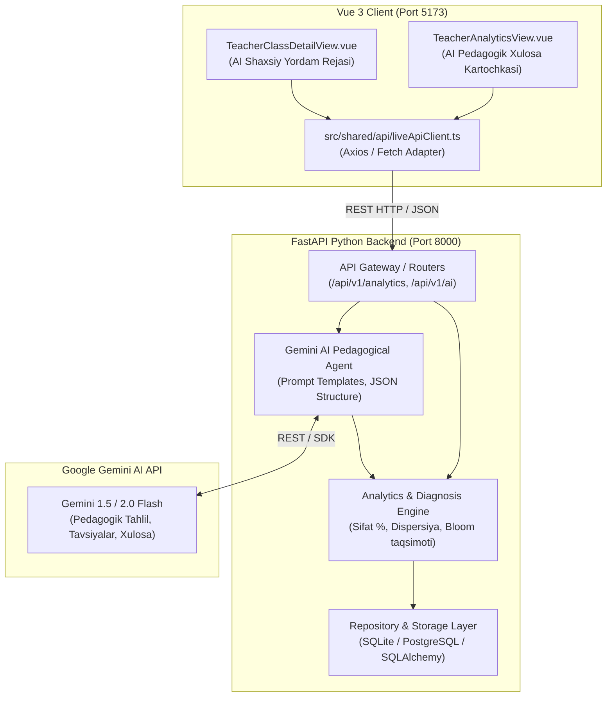
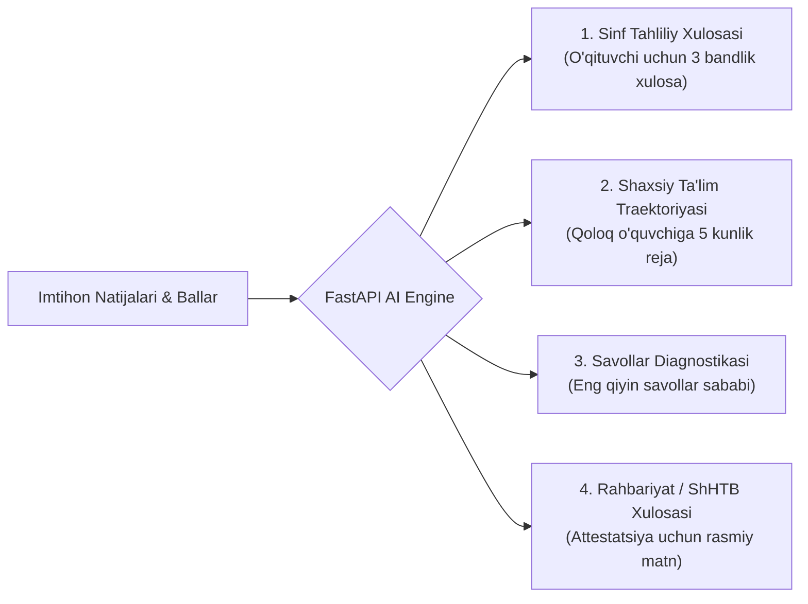
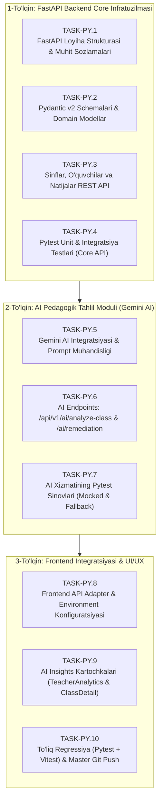

# Python Backend va AI Tahlillar Integratsiyasi Rejasi
## Enterprise FastAPI, Gemini AI Pedagogical Diagnostics & Full-Stack Integration Architecture

> **Hujjat:** `docs/PYTHON_BACKEND_AND_AI_INTEGRATION_PLAN.md`  
> **Muallif:** Lead Enterprise Solutions Architect & Senior Backend Engineer  
> **Sana:** 2026-11-13  
> **Holati:** Tasdiqlash va Amalga Oshirish uchun Rejalashtirildi  
> **Qoidaga Muvofiqlik:** "Reja (Plan.md) -> Tasklarga bo'lish -> Bosqichma-bosqich ishlab chiqish -> Pytest & Vitest sinovlari -> Git/GitHub ga push" qat'iy tartibi.

---

## 1. Loyiha Maqsadi va Arxitekturaviy Konseptsiya

Hozirgi CHSB platformasi Vue 3 frontendida boyitilgan mock data (10 ta sinf, 35+ o'quvchi, 25 ta imtihon natijalari) va mahalliy hisob-kitoblar bilan ishlamoqda. 

**Asosiy maqsad:**
1. Platformaga zamonaviy, xavfsiz va yuqori samarali **Python (FastAPI + Pydantic v2)** backend xizmatini qo'shish.
2. CHSB imtihon natijalari, sinf diagnostikasi va Bloom taksonomiyasini **Sun'iy Intellekt (Google Gemini API / LLM)** ga bog'lab, o'qituvchi va maktab rahbariga **avtomatlashtirilgan pedagogik xulosalar, tavsiyalar va shaxsiy ta'lim traektoriyalari** yaratib beruvchi aqlli modulni joriy etish.
3. Vue 3 frontendini live FastAPI backend bilan to'liq integratsiya qilish (`src/shared/api/`), bunda mock ma'lumotlar bilan ishlash qobiliyati ham saqlanib qoladi (`VITE_USE_MOCK=false`).

---

## 2. Tizim Arxitekturasi va Ma'lumotlar Oqimi

---

## 3. AI Modulining 4 ta Asosiy Pedagogik Qobiliyati

1. **📊 Sinf Tahliliy Xulosasi (Executive Class Summary):**
   - O'rtacha ball, sifat foizi va Bloom darajalari asosida o'qituvchiga dars o'tish sifati haqida professional metodik xulosa.
2. **🎯 Shaxsiy Ta'lim Traektoriyasi (Remediation Plan):**
   - Natijasi 70% dan past bo'lgan o'quvchilarga qaysi mavzularni takrorlash va qanday amaliy mashqlar bajarish bo'yicha bosqichma-bosqich reja.
3. **🔍 Savollar Diagnostikasi (Item Discrimination & Difficulty Insights):**
   - Eng ko'p xato qilingan savollarni aniqlab, nima sababdan o'quvchilar adashganini (nazariy tushunmovchilik, chalg'ituvchi variantlar yoki e'tiborsizlik) tahlil qilib berish.
4. **🏛️ Rasmiy Attestatsiya Matni (Official Inspection Note):**
   - Maktab ma'muriyati yoki ShHTB inspektori uchun bitta tugma orqali rasmiy uslubdagi pedagogik xulosa matnini shakllantirish.

---

## 4. Bosqichma-bosqich Vazifalar Rejasi (Actionable Task Breakdown)

---

### 🔹 1-TO'LQIN: FASTAPI BACKEND CORE INFRATUZILMASI

- [ ] **TASK-PY.1: FastAPI Loyiha Strukturasi va Python Muhiti**
  - **Katalog:** `backend/`
  - **Fayllar:** `backend/requirements.txt`, `backend/app/main.py`, `backend/app/core/config.py`, `backend/.env.example`
  - **Vazifalar:**
    - Python 3.11 virtual muhit sozlamalari (`fastapi`, `uvicorn[standard]`, `pydantic`, `pydantic-settings`, `httpx`, `pytest`).
    - CORS Middleware konfiguratsiyasi (`http://localhost:5173` ruxsati).
    - Strukturaviy kataloglash: `app/api/v1/`, `app/core/`, `app/schemas/`, `app/services/`, `app/models/`.

- [ ] **TASK-PY.2: Pydantic v2 Domain Schemalari**
  - **Fayllar:** `backend/app/schemas/class_group.py`, `backend/app/schemas/roster.py`, `backend/app/schemas/result.py`, `backend/app/schemas/analytics.py`
  - **Vazifalar:**
    - Frontenddagi Zod schemalarining (`src/entities/`) Python Pydantic v2 ekvivalentlarini yaratish.
    - Qat'iy tip xavfsizligi, ma'lumotlar validatsiyasi va xatoliklarni aniq formatda qaytarish.

- [ ] **TASK-PY.3: REST API Endpointlari & Ma'lumotlar Qatlami**
  - **Fayllar:** `backend/app/api/v1/endpoints/classes.py`, `backend/app/api/v1/endpoints/analytics.py`, `backend/app/services/analytics_calculator.py`
  - **Vazifalar:**
    - `GET /api/v1/classes` va `GET /api/v1/classes/{class_id}` (sinf ko'rsatkichlari).
    - `GET /api/v1/analytics/{tenant_slug}` (maktab tahlillari, Bloom taksonomiyasi, qiyosiy grafik ma'lumotlari).
    - Dastlabki mock ma'lumotlarni bazaga yoki in-memory repozitoriyga kiritish.

- [ ] **TASK-PY.4: Pytest Unit & Integratsiya Testlari**
  - **Fayllar:** `backend/tests/test_classes_api.py`, `backend/tests/test_analytics_api.py`
  - **Vazifalar:**
    - FastAPI `TestClient` orqali barcha endpointlarning 200 OK, 404 Not Found va schema to'g'riligini tekshirish (100% PASS).

---

### 🔹 2-TO'LQIN: AI PEDAGOGIK TAHLIL MODULI (GEMINI AI ENGINE)

- [ ] **TASK-PY.5: Gemini AI Integratsiyasi va Prompt Muhandisligi**
  - **Fayllar:** `backend/app/services/ai_agent.py`, `backend/app/core/prompts.py`
  - **Vazifalar:**
    - Google Gemini API mijozini sozlash (API kaliti orqali).
    - O'zbek tilidagi pedagogik prompt shablonlarini loyihalash:
      - Tizim roli: "O'zbekiston xalq ta'limi vazirligi metodist-pedagog eksperti".
      - Natija formati: Qat'iy tuzilmaviy JSON (xulosa, kuchli tomonlar, kamchiliklar, tavsiyalar).
    - Tarmoq uzilishi yoki API kvotasi tugashi holatlari uchun **avtomatik lokal evristik fallback** mexanizmi.

- [ ] **TASK-PY.6: AI REST Endpointlari**
  - **Fayllar:** `backend/app/api/v1/endpoints/ai_insights.py`
  - **Vazifalar:**
    - `POST /api/v1/ai/class-diagnosis` — Sinf imtihon natijalari yuborilganda to'liq tahliliy hisobot qaytarish.
    - `POST /api/v1/ai/student-remediation` — Balli past o'quvchi uchun shaxsiy ta'lim traektoriyasi yaratish.
    - `POST /api/v1/ai/item-analysis` — Qiyin savollar bo'yicha tushuntirish va darslik tavsiyalari.

- [ ] **TASK-PY.7: AI Modulining Pytest Sinovlari**
  - **Fayllar:** `backend/tests/test_ai_agent.py`
  - **Vazifalar:**
    - Gemini API javoblarini mock qilib, JSON parsing va xatoliklarni ushlab qolishni sinash.
    - Fallback tahliliy algoritmining to'g'ri ishlashini tekshirish.

---

### 🔹 3-TO'LQIN: FRONTEND INTEGRATSIYASI VA JONLI AI UI

- [ ] **TASK-PY.8: Frontend API Client Adapteri & Konfiguratsiya**
  - **Fayllar:** `src/shared/api/httpClient.ts`, `src/shared/api/liveTeacherApi.ts`, `.env`
  - **Vazifalar:**
    - `VITE_API_BASE_URL=http://localhost:8000/api/v1` sozlamasi.
    - `VITE_USE_MOCK=false` qilinganda bevosita FastAPI ga so'rov yuborish, server mavjud bo'lmaganda esa ogohlantirish bilan mock fallbackka o'tish.

- [ ] **TASK-PY.9: "🤖 AI Pedagogik Xulosa" UI Komponentlari**
  - **Fayllar:** 
    - `src/features/teacher/analytics/components/AiPedagogicalInsightCard.vue`
    - `src/features/teacher/classes/components/AiRemediationPlanModal.vue`
  - **Vazifalar:**
    - `TeacherAnalyticsView.vue` sahifasiga bitta bosish bilan AI tahlilini chaqiruvchi tugma ("🤖 AI Tahlilini Yaratish") va zamonaviy skeleton loader.
    - AI natijasini kartochkada chiroyli (O'zbek tilida, rangli nishonlar va tavsiyalar bilan) aks ettirish.
    - `TeacherClassDetailView.vue` dagi "Pedagogik E'tibor" guruhidagi har bir o'quvchi yoniga "AI Rejasi 🎯" tugmasini qo'yish.

- [ ] **TASK-PY.10: To'liq Sifat Nazorati, E2E va Master Git Push**
  - **Vazifalar:**
    - Frontend Vitest to'plami (barcha 61+ ta test yashil).
    - Backend Pytest to'plami (barcha yangi Python testlar yashil).
    - TypeScript `vue-tsc -b` va ESLint toza.
    - Git commit va GitHub `main` ga push qilish.

---

## 5. Kutilayotgan Natijalar

| Mezon | Hozirgi Holat | Python Backend & AI Integratsiyasidan Keyin |
| :--- | :--- | :--- |
| **Backend Arxitekturasi** | Faqat Client-side Mock | **FastAPI + Pydantic v2 Production REST API** |
| **Pedagogik Tahlillar** | Faqat statik sonlar va jadvallar | **Gemini AI orqali jonli metodik xulosalar** |
| **Qoloq O'quvchilarga Yordam** | Oddiy "Konsultatsiya kerak" yozuvi | **AI tomonidan tuzilgan 5 kunlik aniq ta'lim rejasi** |
| **Ma'lumotlar Almashinuvi** | Lokal xotira (Pinia) | **CORS qo'llab-quvvatlovchi zamonaviy JSON API** |
| **Sinovlar Qamrovi** | 61 ta Vitest fayli | **Frontend (Vitest) + Backend (Pytest) to'liq avtomatlashgan** |

---

## 6. Texnologiyalar To'plami (Recommended Tech Stack)

1. **Til:** Python 3.11+
2. **Framework:** FastAPI (High performance, async, OpenAPI / Swagger integratsiyasi)
3. **Validatsiya:** Pydantic v2
4. **AI SDK:** `google-genai` (Google Gemini 1.5 / 2.0 Flash)
5. **HTTP Server:** Uvicorn (ASGI)
6. **Testlash:** Pytest + HTTPX (`TestClient`)
7. **Frontend Klient:** Native Fetch / Axios TypeScript adapter

