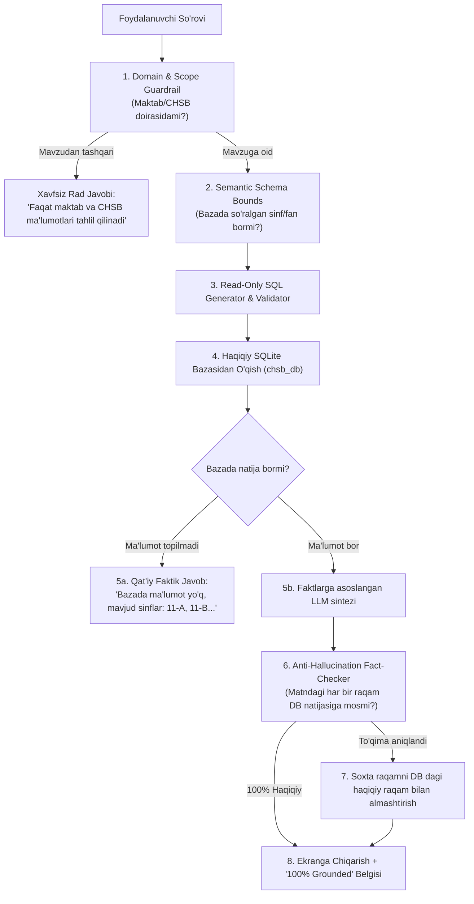

# 🛡️ CHSB v2 — RAG Anti-Hallucination & Data Grounding Guardrails Master Plan

> **Loyihaning Turi:** Enterprise Assessment Intelligence & School Data Integrity System  
> **Status:** Tasdiqlangan / Amalga oshirishga tayyor  
> **Sana:** 2026-11-21  
> **Qat'iy Standart:** Zero-Hallucination Policy, Strict Database Grounding, Provenance Tracking, 100% Test PASS, Faqat Lokal Git  

---

## 🎯 1. Muammo Tahlili va Maqsad

Ta'limiy baholash (EdTech) tizimlarida sun'iy intellektning **to'qima ma'lumot (Hallucination / Confabulation)** berishi — o'quvchiga noto'g'ri baho qo'yilishi, o'qituvchining chalg'ishi yoki MMTO/vazirlik inspeksiyasiga soxta hisobot taqdim etilishiga olib keluvchi **o'ta xavfli xatodir**.

### Qanday To'qimalar Yuz Berishi Mumkin (Tahdidlar Modeli):
1. **Raqamli to'qima (Metric Hallucination):** Bazada o'rtacha ball `84.8%` bo'lsa-da, LLM matnda `92%` yoki `75%` deb xato/to'qima foiz keltirishi.
2. **O'quvchi va Baholar to'qimasi (Entity Fabrication):** Bazada mavjud bo'lmagan o'quvchi ismini aytishi yoki 2 olgan o'quvchini 5 olgan deb to'qishi.
3. **Mavjud bo'lmagan fan/sinf bo'yicha soxta javob (Missing Data Hallucination):** Bazada 7-sinf ma'lumoti bo'lmasa-da, "7-sinf yaxshi o'zlashtirmoqda" deb umumiy safsata yozishi.
4. **Mavzudan tashqari so'rovlar (Out-of-Domain Leakage):** Maktabga aloqasi bo'lmagan so'rovlarga (ob-havo, kriptovalyuta, erkin suhbat) javob berib, resurslarni sarflashi.

---

## 🏛️ 2. RAG Xavfsizlik Arxitekturasi (Guardrails Pipeline)

---

## 🌊 3. Bosqichma-bosqich Amalga Oshirish (Atomic Waves & Tasks)

### 🌊 Wave 1: Domain & Scope Guardrail (Mavzudan Tashqari So'rovlarni Bloklash)
- [ ] **Task 1.1: Maktab doirasini tekshiruvchi Scope Checker moduli (`v2/src/lib/domain-guard.ts`)**
  - So'rov maktab, o'quvchi, fan, sinf, baho, BSB, CHSB, PISA, Bloom taksonomiyasiga tegishlimi yoki yo'qligini aniqlash.
  - Agar so'rov maktabga oid bo'lmasa, SQL bajarmasdan to'g'ridan-to'g'ri do'stona va aniq rad etish xabari qaytarish.
- [ ] **Task 1.2: Scope Checker unit testlari (`domain-guard.test.ts`)**
  - Maktabga oid va begona so'rovlar bo'yicha 100% PASS testlar.

### 🌊 Wave 2: Missing Data Fallback Protocol (Bazada Yo'q Ma'lumot To'qilishini Bloklash)
- [ ] **Task 2.1: Mavjud ma'lumotlar metadata katalogi**
  - Bazadagi mavjud sinflar (`11-A`, `11-B`, `11-Guruh-2`), fanlar va imtihonlar ro'yxatini tezkor keshda ushlab turish.
  - Foydalanuvchi yo'q sinfni (masalan, *6-B sinf*) so'raganida, AI "to'qib bermaydi", balki aniq javob beradi: *"6-B sinfi bazada mavjud emas. Hozirda faqat 11-sinflar natijalari kiritilgan."*
- [ ] **Task 2.2: Missing Data unit testlari**

### 🌊 Wave 3: Grounding Fact-Checker & Anti-Hallucination Verifier
- [ ] **Task 3.1: Raqamlar va Ismlarni o'zaro tekshiruvchi validator (`v2/src/lib/grounding-guard.ts`)**
  - AI matnidagi har bir foiz (`%`), ball va F.I.Sh larni SQL qaytargan `data` bilan solishtiradi.
  - Agar AI matnida bazada yo'q raqam topilsa, uni xavfli to'qima deb belgilaydi va haqiqiy bazadagi raqamga majburiy tuzatadi.
- [ ] **Task 3.2: Fact-Checker unit testlari (`grounding-guard.test.ts`)**

### 🌊 Wave 4: UI Provenance & "Grounded in Database" Belgisi
- [ ] **Task 4.1: Interfeysda "100% Bazaga Asoslangan (Grounded)" sertifikati**
  - Har bir javob tepasida ma'lumot qaysi jadvallardan olingani va to'qima yo'qligini tasdiqlovchi yashil xavfsizlik nishoni (`ShieldCheck`).
- [ ] **Task 4.2: To'liq testlash va Faqat Lokal Git commit**

---

## ✅ 4. Qabul Qilish Mezonlari (Acceptance Criteria)

1. **Nol To'qima (Zero Hallucination):** Matndagi barcha raqamlar `prisma/dev.db` dagi natijalarga 100% teng bo'lishi shart.
2. **Begona so'rovlar bloklanadi:** Baza bilan aloqasi yo'q so'rovlarga SQL bajarilmaydi.
3. **Mavjud bo'lmagan ma'lumotlar fosh etiladi:** Yo'q sinf/fan so'ralsa, AI buni ochiq tan oladi.
4. **100% Test qamrovi:** Barcha yangi cheklovlar unit testlar bilan qamrab olinadi.
5. **Faqat Lokal Git:** GitHub-ga hech narsa yuklanmaydi.
