# CHSB Platform — Regional Expansion Master Architecture Plan

**Hujjat kodi:** REP-2026-V1  
**Holat:** DRAFT FOR APPROVAL (Ma'qullash uchun kiritilgan reja)  
**Daraja:** Senior Software Architect & Lead Vue.js / TypeScript Engineer  
**Loyiha:** CHSB (Choraklik Baholash Tizimi) — Regional Education Platform  
**Qamrov:** 2, 3, 4 va 5-yo'nalishlar (Anti-Cheat, Offline-First, PDF Sertifikatlar, UI/UX Polishing)  
**Amal qilish hududi:** Butun viloyat miqyosi (500+ maktab, 15 000+ pedagog, 200 000+ o'quvchi)  

---

## 1. Ijroiya Xulosasi va Hududiy Kontekst (Executive Summary)

Ushbu hujjat CHSB platformasini alohida bitta maktab chegarasidan chiqarib, **viloyat darajasidagi ommaviy attestatsiya va monitoring platformasi** sifatida ishlatish uchun zarur bo'lgan me'moriy, funksional va xavfsizlik talablarini belgilaydi.

Viloyat miqyosida o'tkaziladigan imtihonlarda 4 ta asosiy chaqiriq (challenge) mavjud:
1. **Ko'chirish va akademik nohalollik xavfi:** Bir xonada o'tirgan o'quvchilarning bir-biridan ko'chirishi yoki ChatGPT/Telegram-ga o'tishi.
2. **Internet sifati va aloqa uzilishi:** Chekka tuman va qishloqlardagi maktablarda internet tezligining pastligi yoki kutilmaganda o'chib qolishi.
3. **Rag'batlantirish va rasmiylashtirish:** A'lo bahoga topshirgan o'quvchilarga rasmiy, soxtalashtirishdan himoyalangan va QR-kod bilan tekshiriladigan sertifikat berish zarurati.
4. **Ko'p tillilik va inklyuzivlik:** Viloyatda ta'lim bir necha tilda (o'zbek, rus, qoraqalpoq) olib borilishi hamda ko'rishida nuqsoni bor foydalanuvchilarning mavjudligi.

Quyidagi reja ushbu 4 ta muammoni professional darajada hal etishning aniq tasklar xaritasini taqdim etadi.

---

## 2. Me'moriy Prinsiplar va Xavfsizlik Invariantlari

1. **Mavjud arxitekturani buzmaslik (Zero Regression):** Hozirgi Phase 1–6 doirasida yozilgan barcha modullar, router va 55 ta unit/integration testlar o'zgarishsiz qoladi. Yangi funksiyalar modular qatlam sifatida kiritiladi.
2. **Yengil va kutubxonalarga qaram bo'lmagan yondashuv (Zero Bloat):** Tashqi og'ir kutubxonalar (heavy dependencies) o'rnatilmaydi. Tarjima tizimi (i18n), QR-kod generatsiyasi va Dark mode toza TypeScript + Vue 3 Composition API asosida quriladi.
3. **Deterministik xavfsizlik (Deterministic Integrity):** Savollar va variantlar tartibi o'quvchining unikal ID-si va imtihon ID-si asosida deterministik aralashtiriladi. Shunda o'quvchi sahifani qayta yuklasa ham o'zining aralashtirilgan tartibi buzilmaydi.
4. **Nol javob kaliti qoidasi (Zero Answer Key Invariant):** Qayta aralashtirish jarayonida ham to'g'ri javoblar kaliti frontendga uzatilmaydi.

---

## 3. Modullar va Vazifalar Xaritasi (Detailed Task Breakdown)

```mermaid
flowchart TD
    M2["2-Yo'nalish: Anti-Cheat & Integrity Engine"]
    M3["3-Yo'nalish: Offline-First & Network Resilience"]
    M4["4-Yo'nalish: QR-kodli Rasmiy PDF Sertifikat"]
    M5["5-Yo'nalish: Professional UI/UX Polishing"]

    M2 --> T21["TASK-AC.1: Seeded Shuffle"]
    M2 --> T22["TASK-AC.2: Tab-Switch Proctoring"]
    M2 --> T23["TASK-AC.3: Copy-Paste Blocker"]
    M2 --> T24["TASK-AC.4: Fullscreen Mode"]

    M3 --> T31["TASK-NR.1: Network Indicator"]
    M3 --> T32["TASK-NR.2: IndexedDB Adapter"]
    M3 --> T33["TASK-NR.3: Auto-Sync Queue"]
    M3 --> T34["TASK-NR.4: Emergency Offline Code"]

    M4 --> T41["TASK-CT.1: Certificate Template"]
    M4 --> T42["TASK-CT.2: SVG QR-Code Engine"]
    M4 --> T43["TASK-CT.3: Print/PDF Engine"]

    M5 --> T51["TASK-UI.1: Typesafe i18n (4 til)"]
    M5 --> T52["TASK-UI.2: Dark/Light Mode"]
    M5 --> T53["TASK-UI.3: Font Scale A11y"]
    M5 --> T54["TASK-UI.4: Interactive SVG Charts"]
```

---

### 2-YO'NALISH: 🛡️ Anti-Cheat & Integrity Engine (Ko'chirishga qarshi himoya)

Ushbu modul imtihon jarayonining tozaligini va o'quvchilar mustaqil ishlashini ta'minlaydi.

| Task ID | Vazifa Nomi | O'zgartiriladigan / Yaratiladigan Fayllar | Texnik Ijro va Qabul Qilish Mezoni |
|---|---|---|---|
| **TASK-AC.1** | **Savollar va Variantlarni Dinamik Aralashtirish (Seeded Shuffle)** | `src/shared/utils/cryptoShuffle.ts`, `src/features/assessment/assessmentStore.ts` | Har bir o'quvchi uchun `hash(rosterRecordId + assessmentId)` asosida deterministik pseudorandom seed hosil qilinadi. 15 ta savolning tartibi va har bir savolning A/B/C/D variantlari aralashtirib beriladi. Yonma-yon o'tirgan o'quvchilarda variantlar har xil bo'ladi. Javob yuborilganda asl indekslarga to'g'ri xaritalanadi. |
| **TASK-AC.2** | **Vkladkadan Chiqish Nazorati (Tab-Switch Proctoring)** | `src/shared/composables/useExamProctor.ts`, `src/features/assessment/AssessmentWorkspaceView.vue` | Brauzerning `visibilitychange` va `window.onblur` hodisalari kuzatiladi. O'quvchi boshqa vkladkaga yoki ilovaga o'tganda ekranda to'liq bloklovchi ogohlantirish chiqadi: *"Diqqat! Imtihon maydonidan chiqdingiz (Ogohlantirish: X/3)"*. Hodisa vaqti va soni audit jurnaliga yoziladi. |
| **TASK-AC.3** | **Matn Nusxalash va O'ng Tugmani Bloklash (Context Menu & Copy Blocker)** | `src/features/assessment/AssessmentWorkspaceView.vue`, `src/shared/components/QuestionBlockRenderer.vue` | Imtihon maydonida matnni belgilash (`user-select: none`), nusxalash (`copy`, `cut`, `paste`, `Ctrl+C`, `Ctrl+V`) va sichqonchaning o'ng tugmasi (`contextmenu`) bloklanadi. Savollar sun'iy intellektga yoki qidiruvga osonlikcha ko'chirilmaydi. |
| **TASK-AC.4** | **To'liq Ekran Rejimi (Fullscreen Enforcement)** | `src/shared/composables/useExamProctor.ts` | O'quvchi imtihonni boshlashida brauzer `document.documentElement.requestFullscreen()` orqali to'liq ekranga o'tkaziladi. Ekranni kichraytirish urinishlari ogohlantirishga olib keladi. |

---

### 3-YO'NALISH: ⚡ Offline-First & Network Resilience (Internet uzilishidan himoya)

Ushbu modul internet tezligi sekin yoki beqaror bo'lgan chekka hudud maktablarida o'quvchining mehnati zoe ketmasligini kafolatlaydi.

| Task ID | Vazifa Nomi | O'zgartiriladigan / Yaratiladigan Fayllar | Texnik Ijro va Qabul Qilish Mezoni |
|---|---|---|---|
| **TASK-NR.1** | **Tarmoq Holati Indikatori (Network Status Composable)** | `src/shared/composables/useNetworkStatus.ts`, `src/app/layouts/ExamLayout.vue` | `window.addEventListener('online')` va `offline` orqali internet uzilishi darhol aniqlanadi. Yuqori panelda yoqimli indikator chiqadi: 🟢 *"Internet barqaror"* yoki 🟠 *"Oflayn rejim — javoblaringiz xavfsiz saqlanmoqda"*. |
| **TASK-NR.2** | **IndexedDB Kesh Qatlami (Structured Storage)** | `src/shared/storage/indexedDbAdapter.ts`, `src/features/assessment/assessmentStore.ts` | 5MB hajmli cheklangan `localStorage` o'rniga brauzerning to'liq `IndexedDB` bazasi integratsiya qilinadi. Imtihon savollari, rasmlar, taymer soniyalari va tanlangan javoblar tranzaksiyali saqlanadi. |
| **TASK-NR.3** | **Avtomatik Sinxronlash va Qayta Yuborish (Background Sync Queue)** | `src/features/assessment/assessmentStore.ts` | O'quvchi internet yo'qligida "Topshirish" tugmasini bossa, topshirish paketi mahalliy navbatga (Queue) qo'yiladi va imtihon yakunlangan deb hisoblanadi. Internet tiklanishi bilanoq avtomatik serverga/mockga uzatiladi. |
| **TASK-NR.4** | **Favqulodda Oflayn Raqamli Kvitansiya (Emergency Proof Hash)** | `src/features/results/SubmissionReceiptView.vue` | Agar maktabda internet butunlay tiklanmasa, o'quvchi ekranida unikal shifrlangan 16 belgili tasdiq kodi va QR-kod hosil bo'ladi. O'qituvchi o'z mobil qurilmasida ushbu kodni qayd qilib oladi. |

---

## 4-YO'NALISH: 🎓 QR-kodli Rasmiy PDF Sertifikat / Faxriy Yorliq Generatori

Yuqori natija ko'rsatgan o'quvchilarni taqdirlash va natijalarni verifikatsiya qilish mexanizmi.

| Task ID | Vazifa Nomi | O'zgartiriladigan / Yaratiladigan Fayllar | Texnik Ijro va Qabul Qilish Mezoni |
|---|---|---|---|
| **TASK-CT.1** | **Rasmiy Sertifikat Shablon Komponenti** | `src/features/results/CertificateModal.vue`, `src/features/results/AssessmentResultView.vue` | A4 landscape formatidagi nafis sertifikat: O'zbekiston gerbi, viloyat xalq ta'limi boshqarmasi ramzi, o'quvchining F.I.SH., maktabi, sinfi, to'plagan bali (masalan: 38.0 / 40.0 ball, 95%), topshirilgan sana va unikal seriya raqami (`CHSB-2026-VIL-XXXX`). |
| **TASK-CT.2** | **Dinamik SVG QR-Kod Dvigateli** | `src/shared/components/QrCodeRenderer.vue` | Tashqi og'ir kutubxonalarsiz, toza matematik algoritmlar asosida sertifikat ichiga dinamik SVG QR-kod chiziladi. QR-kod skanerlanganda haqiqiylikni tasdiqlovchi verifikatsiya sahifasi ochiladi. |
| **TASK-CT.3** | **Chop Etish va PDF Saqlash (CSS Print Ready Engine)** | `src/features/results/CertificateModal.vue` | Maxsus `@media print` qoidalari orqali sertifikat brauzer sarlavhalari (URL, sana) va fon chalg'ituvchilarisiz toza A4 varag'iga moslashtiriladi. *"PDF yuklab olish"* tugmasi bir bosishda chop etish/saqlash oynasini ochadi. |

---

## 5-YO'NALISH: 🎨 Professional UI/UX Polishing (Ko'p tillilik, Dark Mode & Shrift A11y)

Viloyatning barcha toifadagi maktablari va o'qituvchilari uchun xalqaro darajadagi foydalanish qulayligi.

| Task ID | Vazifa Nomi | O'zgartiriladigan / Yaratiladigan Fayllar | Texnik Ijro va Qabul Qilish Mezoni |
|---|---|---|---|
| **TASK-UI.1** | **Typesafe Ko'p Tillilik Dvigateli (4 ta til)** | `src/shared/i18n/index.ts`, `src/shared/i18n/locales/*.ts`, `src/app/layouts/StaffLayout.vue` | Yengil, to'liq TypeScript tipizatsiyalangan til tizimi:  1. 🇺🇿 O'zbekcha (Lotin) 2. 🇺🇿 Ўзбекча (Кирилл) 3. 🇷🇺 Русский язык 4. 🇰🇿 Qaraqalpaqsha. Til almashganda sahifani qayta yuklamasdan barcha tugmalar, sarlavhalar va jadvallar bir zumda tarjima qilinadi. |
| **TASK-UI.2** | **Qorong'i Mavzu (Dark Mode / Night Theme)** | `src/shared/composables/useTheme.ts`, `src/shared/styles/main.css`, `StaffLayout.vue` | Tailwind CSS v4 `dark:` klasslari orqali professional qora/kulrang SaaS mavzusi. Kechki payt hisobotlar bilan ishlaydigan o'qituvchilar uchun ko'z toliqishini kamaytiradi. Sozlama xotirada saqlanadi. |
| **TASK-UI.3** | **Shrift Kattalashtirish (Accessibility Font Sizer)** | `src/shared/composables/useAccessibility.ts`, `src/app/layouts/ExamLayout.vue` | Ekranning yuqori burchagida `A-` / `A` / `A+` boshqaruv tugmalari. Ko'rishida nuqsoni bor o'quvchilar va keksaroq o'qituvchilar uchun matn o'lchami 100%, 125%, 150% ga mutanosib kattalashadi. |
| **TASK-UI.4** | **Interaktiv SVG Doiraviy Grafiklar va Tahlillar** | `src/features/teacher/analytics/TeacherAnalyticsView.vue` | O'qituvchi tahlillar panelida o'zlashtirish foizlari va ishtirok dinamikasini ko'rsatuvchi interaktiv, yengil SVG Donut diagrammalari. |

---

## 4. Testlash va Sifat Kafolati (Quality Assurance Strategy)

Har bir yo'nalish amalga oshirilgandan so'ng quyidagi qat'iy sinovlar o'tkaziladi:

1. **Anti-cheat testlari:** Turli o'quvchilarda savollar tartibi haqiqatan har xil ekanligi va javoblar to'g'ri bog'lanishi unit testlar orqali tekshiriladi.
2. **Offline testlari:** `navigator.onLine = false` holatida imtihon javoblari saqlanishi va tiklanishi tekshiriladi.
3. **i18n testlari:** Barcha 4 ta tildagi kalitlar to'liqligi va xato tarjimalar yo'qligi tekshiriladi.
4. **Sifat darvozalari:**
   - `npm run typecheck` — 0 xato
   - `npm run lint` — 0 ogohlantirish (`--max-warnings 0`)
   - `npm run test` — **Kamida 65+ ta test 100% PASS**
   - `npm run build` — `dist/` muvaffaqiyatli yig'ilishi

---

## 5. Bosqichma-bosqich Bajarish Tartibi

Siz ma'qullaganingizdan so'ng, ishlar quyidagi tartibda amalga oshiriladi:

1. **1-Faza:** 2-yo'nalish — Anti-Cheat & Integrity Engine (Aralashtirish, Vkladka nazorati, Fullscreen);
2. **2-Faza:** 3-yo'nalish — Offline-First & Network Resilience (IndexedDB, Tarmoq indikatori, Oflayn kvitansiya);
3. **3-Faza:** 4-yo'nalish — QR-kodli Rasmiy PDF Sertifikat Generatori;
4. **4-Faza:** 5-yo'nalish — UI/UX Polishing (Ko'p tillilik, Dark mode, Shrift A11y, SVG grafiklar);
5. **5-Faza:** Yakuniy sifat nazorati, hujjatlarni yangilash va GitHub-ga kommit.

---

## 6. Ma'qullash va Ruxsat So'rovi

Ushbu reja to'liq tayyorlandi va loyiha hujjatlari qatoriga [`docs/REGIONAL_EXPANSION_PLAN.md`](docs/REGIONAL_EXPANSION_PLAN.md) sifatida saqlandi.

**Muhandislik qoidasiga binoan, hozircha kod yozilmadi.**  
Siz ushbu rejani tasdiqlab:  
👉 **"Ma'qul, boshla"** yoki **"2-yo'nalishdan boshla"** desangiz, darhol birinchi taskni bajarishga kirishaman.

