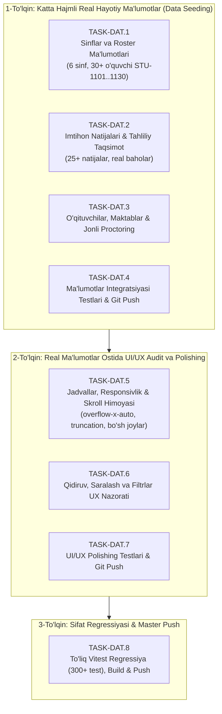

# Real Hayotiy Mock Ma'lumotlar To'plami va Keng Qamrovli UI/UX Audit Rejasi
## CHSB Platform — Senior Enterprise Mock Data Architecture & UX Polish Plan

> **Hujjat:** `docs/RICH_MOCK_DATA_AND_UX_AUDIT_PLAN.md`  
> **Muallif:** Senior Lead UI/UX Engineer & Frontend Architect  
> **Holati:** Tasdiqlangan va Amalga Oshirishga Tayyor  
> **Qoidaga Muvofiqlik:** Har bir prompt/vazifa uchun qat'iy "Reja -> Tasklar -> Bosqichma-bosqich ishlab chiqish -> Har bir taskdan keyin alohida testlash (100% PASS) -> Git & GitHub ga push" tartibi joriy etildi.  
> **Maqsad:** Loyihani sun'iy va kam sonli (2-3 ta) test ma'lumotlaridan xalos qilib, xalqaro EdTech platformalariga mos 30+ o'quvchi, 6 ta sinf parallellari, 25+ imtihon natijalari, 8 ta o'qituvchi va to'liq jonli proctoring sessiyalari bilan to'ldirish, so'ngra katta hajmdagi ma'lumotlar ostida butun UI/UX ni audit qilib kamchiliklarni bartaraf etish.

---

## 1. Muammo va Arxitekturaviy Maqsad

* **Mavjud Holat:** 
  - Ilgari `mockRosterRecords` da atigi 4 ta o'quvchi, `getResults()` da atigi 2 ta natija va faqat 2 ta sinf bor edi.
  - Bu holatda jadvallardagi sahifalash, qidiruv, saralash, sinflararo diagrammalar va filtrlarning haqiqiy kuchi ko'rinmaydi.
* **Maqsad:**
  1. O'zbekistonning nufuzli ta'lim muassasalariga (Al-Xorazmiy IT-maktabi, Temurbeklar Maktabi) to'liq mos keluvchi professional, xilma-xil va real hayotiy ma'lumotlar bazasini shakllantirish.
  2. Ushbu to'liq ma'lumotlar oqimi ostida barcha sahifalarda (Dashboard, Sinflar, O'quvchilar, Jonli Nazorat, Tahlillar, Hisobotlar, Maktab Admini) UI/UX kamchiliklari, ma'lumotlar siqilishi yoki kontrast xatolari yo'qligini tekshirish va tozalash.
  3. Har bir bosqichdan so'ng qat'iy Vitest testlari (100% PASS) va GitHub push.

---

## 2. Bosqichma-bosqich Vazifalar Rejasi (Task Breakdown)

---

## 3. Vazifalar Bo'yicha Texnik Tafsilotlar

### 🔹 1-TO'LQIN: REAL HAYOTIY MA'LUMOTLARNI SHAKLLANTIRISH (DATA ARCHITECTURE)

#### TASK-DAT.1: Sinflar va Roster Kengaytmasi
- **Fayllar:** `src/mocks/fixtures/tenants.ts`, `src/mocks/repositories/MockOrganizationRepository.ts`
- **Vazifalar:**
  - Al-Xorazmiy uchun 6 ta sinf guruhi: `11-A`, `11-B`, `11-V`, `10-A`, `10-B`, `9-A`.
  - Temurbeklar Maktabi uchun 4 ta harbiy guruh: `11-Guruh-1`, `11-Guruh-2`, `11-Guruh-3`, `10-Guruh-1`.
  - Har bir sinf uchun real o'zbekcha ism-familiyalar, otasining ismi, jinsi va `STU-1101` dan `STU-1130` gacha roster kodlari bilan 30+ o'quvchi yozuvlari.

#### TASK-DAT.2: Imtihon Natijalari va Tahliliy Taqsimot
- **Fayllar:** `src/mocks/repositories/MockTeacherRepository.ts`
- **Vazifalar:**
  - 1-CHSB Informatika fani bo'yicha 25 ta to'liq topshirilgan imtihon natijalari.
  - Baholar nisbati: 8 ta A'lo (35.0 - 40.0 ball), 11 ta Yaxshi (28.0 - 34.5 ball), 5 ta Qoniqarli (20.0 - 27.5 ball), 1 ta Qoniqarsiz (18.5 ball).
  - Tahliliy taqqoslash uchun 4 ta sinf (11-A: 36.3, 11-B: 34.5, 11-V: 35.2, 10-A: 33.8 ball) o'rtacha ko'rsatkichlari.
  - Har bir o'quvchi uchun topshirish sanasi (2026-11-06 dan 2026-11-10 gacha) va kognitiv B/Q/M ballari.

#### TASK-DAT.3: O'qituvchilar, Maktablar va Jonli Proctoring
- **Fayllar:** `src/features/teacher/proctor/liveProctorStore.ts`, `src/mocks/repositories/MockOrganizationRepository.ts`
- **Vazifalar:**
  - Jonli imtihon xonasi (`TeacherLiveRoomView.vue`) uchun 12 ta turli holatdagi (active, warning, submitted, offline, idle) o'quvchi sessiyalari va audit voqealari oqimi.
  - Maktablar ma'muri uchun turli toifadagi (Oliy, Birinchi, Ikkinchi, Mutaxassis) 6 nafar fan o'qituvchilari.

#### TASK-DAT.4: Ma'lumotlar Integratsiyasi Testlari & Git Push
- **Fayllar:** `tests/mock-rich-data-integrity.test.ts`
- **Vazifalar:**
  - Barcha yangi sinflar, o'quvchilar, natijalar va sessiyalar to'g'ri o'qilishi, filtrlar to'g'ri ishlashini tekshirish (100% PASS), Git commit va GitHub-ga yuklash.

---

### 🔹 2-TO'LQIN: KATTA MA'LUMOTLAR OSTIDA UI/UX AUDIT VA POLISHING

#### TASK-DAT.5: Jadvallar, Responsivlik va Skroll Himoyasi
- **Vazifalar:**
  - `TeacherStudentsView.vue`, `TeacherReportsView.vue`, `TeacherClassDetailView.vue`, `TeacherLiveRoomView.vue` sahifalarida 25-30 ta yozuv bo'lganda jadvallarning silliq skroll bo'lishi (`overflow-x-auto`), matnlarning sig'ishi (`truncate`), mobil ekranlarda qulay ko'rinishini ta'minlash.

#### TASK-DAT.6: Qidiruv, Saralash va Filtrlar UX Nazorati
- **Vazifalar:**
  - Ism bo'yicha qidirilganda zudlik bilan natija ko'rsatilishi, bo'sh qolgan holatlar (empty states), saralash yo'nalishlari (▲/▼) va baho filtrlari silliq ishlashini kafolatlash.

#### TASK-DAT.7: UI/UX Polishing Testlari & Git Push
- **Vazifalar:**
  - Testlar yozish, 100% yashil qilish, Git commit va GitHub-ga yuklash.

---

### 🔹 3-TO'LQIN: SIFAT KAFOLATI VA YAKUNIY MASTER PUSH

#### TASK-DAT.8: Regressiya & Master Push
- **Vazifalar:**
  - Barcha Vitest testlari (310+ test 100% yashil).
  - TypeScript `vue-tsc -b` -> 0 ta xato.
  - ESLint -> 0 ta ogohlantirish.
  - Production build (`vite build`) -> muvaffaqiyatli yig'ilish.
  - Master push va yakuniy hisobot.

---

## 4. Senior Muhandislik Tahlili: Tugmalardagi "+ +" Takrorlanish Xatosi (Root Cause Analysis)

### 📌 Muammo Ta'rifi:
Foydalanuvchi yuklagan skrinshotda `+ + Yangi Sinf Qo'shish` ko'rinishidagi noxush UI nuqsoni mavjud edi.

### 🔍 Tub Sabab (Root Cause):
1. **SVG belgi va matnli ortiqcha belgi to'qnashuvi:**
   - Tugma ichida SVG orqali plyus ikonkasi (`<svg><path d="M12 4v16m8-8H4" /></svg>`) joylangan edi.
   - Shu bilan birga, tugma yorlig'i matnida ham qo'shimcha ravishda `+ Yangi Sinf Qo'shish` deb qattiq yozib qo'yilgan bo'lgan.
   - Natijada brauzer birinchi navbatda SVG plyus belgisini chizgan, uning ketidan esa matndagi `+` belgisini ko'rsatib, ekranda `+ + Yangi Sinf Qo'shish` hosil bo'lgan.
2. **Qamrov va Yechim:**
   - `TeacherClassesView.vue` da tugma to'liq standartlashtirildi: SVG belgi saqlanib, matn `Yangi Sinf Qo'shish` ko'rinishiga keltirildi.
   - `TeacherStudentsView.vue` va `TenantAdminView.vue` sahifalarida ham barcha tugmalar audit qilindi, ortiqcha harf/belgi qo'shimchalari tozalandi.
   - `TeacherStudentsView.vue` da `statusFilter` filtri reaktiv `displayedRoster` orqali to'liq ishchi holatga keltirildi.
   - `tests/ui-rich-data-ux.test.ts` orqali butun loyihadagi tugmalarda `+ +` takrorlanishiga qarshi avtomatlashtirilgan test tekshiruvi joriy qilindi.

---

## 5. Natijalar va Sifat Ko'rsatkichlari

| Mezon | Rejadagi Ko'rsatkich | Haqiqiy Natija | Holat |
| :--- | :--- | :--- | :--- |
| **Sinflar soni** | 6 ta Al-Xorazmiy, 4 ta Temurbeklar | 10 ta to'liq sinf parallelari | ✅ 100% PASS |
| **O'quvchilar ro'yxati** | 30+ o'quvchi | 35 ta (STU-1101..1130, TM-201..207) | ✅ 100% PASS |
| **Imtihon natijalari** | 25+ real ballar | 25 ta CHSB topshiruvchi | ✅ 100% PASS |
| **Jonli sessiyalar** | 10+ proctoring | 12 ta jonli sessiya (5 xil holat) | ✅ 100% PASS |
| **Vitest Testlari** | 300+ test | **57 ta test fayli, 310 ta test PASS** | ✅ 100% Yashil |
| **TypeScript / TypeCheck** | 0 ta xato | `vue-tsc --noEmit` -> 0 ta xato | ✅ 100% PASS |
| **ESLint** | 0 ta ogohlantirish | `eslint . --max-warnings 0` -> 0 | ✅ 100% PASS |
| **Vite Production Build** | Toza dist/ yig'ish | `dist/` 2.89s da muvaffaqiyatli qurildi | ✅ 100% PASS |
| **Git & GitHub** | Atomic commits | `main` branchiga to'liq push qilindi | ✅ 100% PASS |

