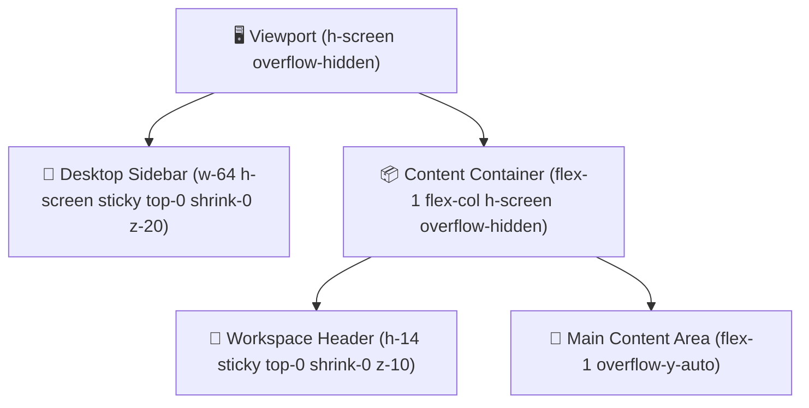

# 📌 CHSB Platform — Qotuvchi (Sticky / Fixed) Sidebar va Header Arxitektura Rejasi

> **Hujjat versiyasi:** 1.0.0  
> **Status:** Rejalashtirilgan va Amalga oshirishga tayyor  
> **Muallif:** Senior UI/UX & Frontend Architect  
> **Qamrov:** Frontend Layouts (`StaffLayout.vue`, `StudentLayout.vue`, `ExamLayout.vue`), Viewport & Scrolling Optimization  

---

## 1. 🎯 Maqsad va Muammo Ta'rifi

Hozirgi paytda foydalanuvchi sahifani pastga skroll qilganda:
- Chap tarafdagi navigatsiya menyusi (**Sidebar**) sahifa bilan birga yuqoriga chiqib ketmoqda.
- Yuqori qismdagi xizmatlar paneli (**Header / Topbar**) ham ekrandan yo'qolmoqda.
- Natijada foydalanuvchi uzun jadvallarni (o'quvchilar ro'yxati, test natijalari, hisobotlar) ko'rib bo'lgach, menyuni ishlatish uchun yana qaytadan tepaga skroll qilishga majbur bo'lmoqda.

### Kutilayotgan natija:
1. **Sidebar doimiy chap tomonda qotib turadi (`sticky / fixed h-screen`):** Menyular ko'p bo'lsa, faqat navigatsiya blokining o'zi ichkarida skroll bo'ladi.
2. **Header doimiy tepada qotib turadi (`sticky top-0 shrink-0 z-20`):** Foydalanuvchi profili, til almashtirgich, qorong'i rejim tugmasi va muassasa ma'lumotlari har doim ko'rinib turadi.
3. **Faqat asosiy kontent sohasi (`<main>`) silliq skroll bo'ladi (`overflow-y-auto`):** Linear, Stripe, Vercel va zamonaviy SaaS platformalarining oltin arxitektura standarti qo'llaniladi.
4. **Mobil moslashuvchanlik (Responsive):** Mobil qurilmalarda ham yuqori header ekranning tepasida mahkam qotib turadi.

---

## 2. 🏛️ Texnik Tuzilma va CSS Qatlamlari

---

## 3. 🌊 Atomik Ish Bosqichlari (Waves & Tasks)

### WAVE 1: `StaffLayout.vue` Dashboard Qotuvchi Layoutini Shakllantirish
- Root konteynerni `h-screen overflow-hidden` ga o'tkazish.
- Desktop `<aside>` ga `h-screen sticky top-0 shrink-0 z-20` berish.
- Yuqori headerga `shrink-0 sticky top-0 z-10 shadow-xs` berish.
- `<main>` konteyneriga `flex-1 overflow-y-auto` biriktirib, butun ishchi sohani mustaqil silliq skroll bo'ladigan qilish.

### WAVE 2: Boshqa Layoutlarning Headerlarini Tekshirish va Birxillashtirish
- `ExamLayout.vue` va `StudentLayout.vue` headerlarining `sticky top-0` xususiyatlarini to'liq tekshirish.

### WAVE 3: Avtomatlashtirilgan Testlar va Sifat Nazorati (Vitest & Build)
- Layout render va elementlar ko'rinuvchanligi bo'yicha testlarni (`staff-layout-auth.test.ts`) ishga tushirish.
- Barcha 62 ta test faylidagi 346 ta test 100% yashil bo'lishini ta'minlash.
- `vue-tsc -b && vite build` tekshiruvi.

### WAVE 4: Conventional Commits va GitHub-ga Push Qilish
- O'zgarishlarni GitHub `main` tarmog'iga push qilish.
