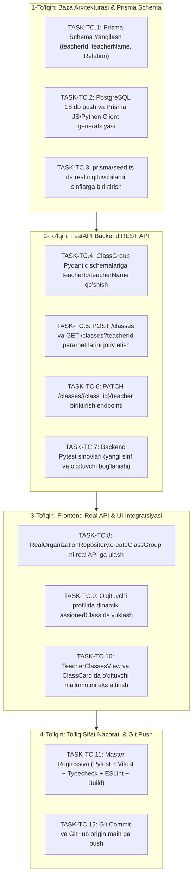

# O'qituvchilarni Sinflarga Biriktirish va Dinamik Boshqarish Rejasi
## PostgreSQL 18, Prisma ORM, FastAPI REST API va Vue 3 Frontend Bog'lanish Arxitekturasi

> **Hujjat:** `docs/TEACHER_CLASS_ASSIGNMENT_INTEGRATION_PLAN.md`  
> **Muallif:** Lead Enterprise Solution Architect & Full-Stack Specialist  
> **Sana:** 2026-11-22  
> **Holati:** Tasdiqlash uchun Rejalashtirildi  
> **Qat'iy Qoida:** "Reja (Plan .md) -> Tasklarga bo'lish -> Bosqichma-bosqich ishlab chiqish -> Har bir taskdan keyin testlash -> Git/GitHub push" tartibi.

---

## 1. Muammo Tavsifi va Arxitektura Yechimi

### 1.1 Muammo Tavsifi
Hozirgi tizimda:
1. `prisma/schema.prisma` da `ClassGroup` jadvalida o'qituvchini saqlaydigan `teacher_id` yoki `teacher_name` maydoni mavjud emas.
2. `User` (o'qituvchi) va `ClassGroup` (sinf) o'rtasida Prisma darajasida relation (aloqa) o'rnatilmagan.
3. O'qituvchi profilida unga biriktirilgan sinflar (`assignedClassIds: ['class-ax-11a', 'class-ax-11b']`) statik (hardcoded) yozilgan.
4. `CreateClassModal.vue` da o'qituvchini tanlab yangi sinf ochilsa ham, frontend `RealOrganizationRepository.createClassGroup` so'rovi backend API ga bormay, faqat mahalliy xotirada qolmoqda. Natijada sinf va o'qituvchi bog'lanishi PostgreSQL bazasida saqlanmaydi.

### 1.2 Arxitektura Yechimi
1. **Prisma Schema Kengaytmasi (PostgreSQL 18)**:
   - `model ClassGroup` ga `teacherId String? @map("teacher_id")` va `teacherName String? @map("teacher_name")` ustunlarini qo'shish.
   - `ClassGroup` va `User` o'rtasida munosabat (Foreign Key Relation) o'rnatish:
     ```prisma
     teacherId   String?     @map("teacher_id")
     teacherName String?     @map("teacher_name")
     teacher     User?       @relation(fields: [teacherId], references: [id], onDelete: SetNull)
     ```
   - `model User` ga `assignedClasses ClassGroup[]` akslantirish.
2. **FastAPI Backend REST API**:
   - `ClassGroupCreate` schemasiga `teacherId: str | None = None` va `teacherName: str | None = None` qo'shish.
   - `POST /classes`: Yangi sinf ochilganda o'qituvchini PostgreSQL bazasiga yozish.
   - `GET /classes`: Qaytadigan ro'yxatda `teacherId` va `teacherName` ni taqdim etish; `teacherId` bo'yicha filtrlash imkonini yaratish (`/classes?teacherId=usr-teacher-01`).
   - `PATCH /classes/{class_id}/teacher`: Sinfga yangi o'qituvchini biriktirish yoki almashtirish endpointi.
3. **Prisma Seed Yangilanishi (`prisma/seed.ts`)**:
   - Barcha mavjud real sinflarga haqiqiy o'qituvchilarni biriktirish:
     - `11-A sinf` $\to$ Dilmurod Rahmataliyevich Yunusov (`usr-teacher-01`)
     - `10-A sinf` $\to$ Dilmurod Rahmataliyevich Yunusov (`usr-teacher-01`)
     - `10-V sinf` $\to$ Dilmurod Rahmataliyevich Yunusov (`usr-teacher-01`)
     - `11-B sinf` $\to$ Dilrabo Turdialiyevna Sharafxonova (`usr-teacher-02`)
4. **Frontend Real API Integratsiyasi**:
   - `RealOrganizationRepository.createClassGroup` ni to'g'ridan-to'g'ri `httpClient.post('/classes', payload)` ga ulash.
   - `RealTeacherRepository.getProfile` da o'qituvchining biriktirilgan sinflarini bazadan dinamik yuklash.
   - `TeacherClassesView.vue` va `TenantAdminView.vue` da har bir sinf kartochkasida mas'ul o'qituvchi nomini ko'rsatish.

---

## 2. To'lqinlar va Granulyar Tasklar Taqsimoti



---

### 🔹 1-TO'LQIN: BAZA ARXITEKTURASI & PRISMA SCHEMA

- [x] **TASK-TC.1: Prisma Schema Kengaytirish**
  - `prisma/schema.prisma` da `ClassGroup` modeliga `teacherId`, `teacherName` maydonlari va `User` ga relation qo'shildi.
- [x] **TASK-TC.2: PostgreSQL 18 Migratsiyasi & Prisma Client**
  - `npx prisma db push` orqali bazadagi `class_groups` jadvaliga `teacher_id` va `teacher_name` ustunlari qo'shildi.
  - `python -m prisma generate` orqali Python va JS mijozlari yangilandi.
- [x] **TASK-TC.3: Baza Seederini Yangilash (`prisma/seed.ts`)**
  - 11-A, 10-A, 10-V sinflari Dilmurod Yunusovga (`usr-teacher-01`), 11-B va 11-V sinflari Dilrabo Sharafxonovaga (`usr-teacher-02`) biriktirildi.
  - `npx tsx prisma/seed.ts` muvaffaqiyatli ishga tushirildi.

---

### 🔹 2-TO'LQIN: FASTAPI BACKEND REST API

- [x] **TASK-TC.4: Pydantic Schemalarini Yangilash**
  - `backend/app/api/v1/endpoints/classes.py` da `ClassGroupCreate` ga `teacherId: str | None = None` va `teacherName: str | None = None` qo'shildi.
- [x] **TASK-TC.5: `POST /classes` va `GET /classes` ni Kengaytirish**
  - `create_class` yangi ochilgan sinfga o'qituvchini bazaga yozadi.
  - `get_classes` o'qituvchi nomi va ID sini qaytaradi, hamda `teacherId` bo'yicha filtrlashni qo'llab-quvvatlaydi.
- [x] **TASK-TC.6: `PATCH /classes/{class_id}/teacher` Yangi Endpoint**
  - Mavjud sinfga o'qituvchini biriktirish yoki boshqa o'qituvchiga o'tkazish imkoniyati qo'shildi.
- [x] **TASK-TC.7: Backend Pytest Sinovlari**
  - `backend/tests/test_api.py` da `test_get_classes_with_teacher` va `test_create_class_and_assign_teacher` sinovlari qo'shildi (16/16 testlar PASS).

---

### 🔹 3-TO'LQIN: FRONTEND REAL API & UI INTEGRATSIYASI

- [x] **TASK-TC.8: `RealOrganizationRepository.createClassGroup` ni Bog'lash**
  - `src/shared/api/realApi.ts` dagi soxta mock o'rniga real `httpClient.post('/classes', payload)` va `getClassGroupsBySchool` ulandi.
- [x] **TASK-TC.9: O'qituvchi Profilida Dinamik Sinflar**
  - `RealTeacherRepository.getProfile` da `assignedClassIds` bazadan o'qituvchiga tegishli sinflar bo'yicha dinamik shakllantirildi.
- [x] **TASK-TC.10: UI Komponentlarida O'qituvchini Ko'rsatish**
  - `TeacherClassesView.vue` va `ClassCard.vue` da har bir sinf kartochkasida sinf rahbarining F.I.SH. aks ettirildi.

---

### 🔹 4-TO'LQIN: TO'LIQ SIFAT NAZORATI & GIT PUSH

- [x] **TASK-TC.11: Barcha Sinovlar Nazorati (100% Yashil)**
  - `python -m pytest backend/tests/test_api.py -v` (16/16 testlar PASS).
  - `npx vitest run` (346/346 testlar PASS, 63 test suite).
  - `npm run typecheck` (`vue-tsc -b` 0 xato).
  - `npm run lint` (`eslint . --max-warnings 0` 0 ogohlantirish).
  - `npm run build` (Muvaffaqiyatli production bundle, 2.32s).
- [x] **TASK-TC.12: Git Commit va GitHub origin main ga Push**
  - `git commit -m "feat(classes): link teachers to class groups in postgresql 18 schema and dynamic api"`
  - `git push origin main`.

