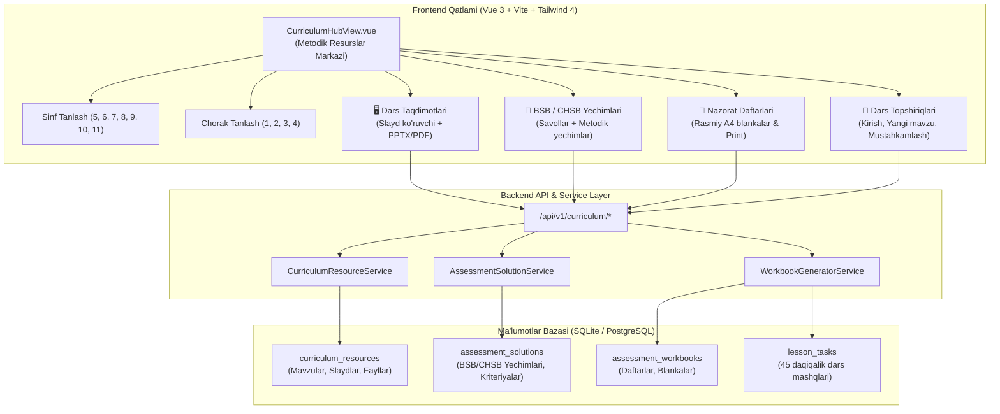

# 📚 v1 — Metodik Ta’lim Resurslari, BSB/CHSB Yechimlari va Dars Materiallari Markazi Master Plan

> **Loyihaning Turi:** Enterprise Multi-Tenant Curriculum & Materials Hub (v1 Platformasi)  
> **Status:** Tasdiqlangan / Amalga oshirishga tayyor  
> **Sana:** 2026-11-21  
> **Standart:** Real EdTech Standartlari (MNO, PISA, MMTO), TDD (100% Test PASS), WCAG 2.1 AA, Faqat Lokal Git  

---

## 🎯 1. Loyihaning Maqsadi va Qamrovi

O'zbekiston maktablarida o'qituvchilar uchun dars jarayonini to'liq sifatli metodik materiallar bilan ta'minlash hamda BSB/CHSB baholash jarayonlarini osonlashtirish uchun `v1` platformasiga **4 ta asosiy ta'limiy blok** birlashtirilgan yagona **"Metodik Ta’lim Resurslari Markazi" (Curriculum & Materials Hub)** integratsiya qilinadi:

1. **5–11-sinflar uchun barcha dars taqdimotlari (Slaydlar / Prezentatsiyalar);**
2. **Barcha BSB va CHSB savollari hamda qadamma-qadam batafsil yechimlari;**
3. **5–11-sinflar uchun rasmiy nazorat ishi daftarlari (A4 / Daftarcha formatidagi chop etishga tayyor blankalar);**
4. **Har bir 45 daqiqalik darsda foydalanish uchun tayyor topshiriqlar va ish varaqlari (Worksheets).**

---

## 🏛️ 2. Tizim Arxitekturasi

---

## 🌊 3. Bosqichma-bosqich Amalga Oshirish (Atomic Waves & Tasks)

### 🌊 Wave 1: Ma'lumotlar Bazasi Modelini Kengaytirish (`prisma/schema.prisma`)
- [ ] **Task 1.1: `CurriculumResource` modeli**
  - Maydonlar: `id`, `tenantId`, `subjectCode`, `gradeLevel` (5–11), `quarter` (1–4), `lessonNumber`, `title`, `resourceType` (`PRESENTATION`, `WORKSHEET`, `WORKBOOK`, `SOLUTION`), `contentJson`, `fileUrl`, `downloadCount`.
- [ ] **Task 1.2: `AssessmentSolution` modeli**
  - Maydonlar: `id`, `assessmentId`, `questionId`, `stepByStepSolution`, `solutionFormulas`, `rubricCriteriaJson`, `authorNote`.
- [ ] **Task 1.3: Prisma migratsiyasi va bazaga boshlang‘ich 5–11-sinf namunaviy resurslarini seed qilish**

---

### 🌊 Wave 2: Backend API & Xizmatlar Qatlami
- [ ] **Task 2.1: Curriculum REST API routeri**
  - `GET /api/v1/curriculum/resources`: Sinf, fan, chorak va tur bo‘yicha filtrlash.
  - `GET /api/v1/curriculum/solutions/:assessmentId`: CHSB/BSB savollari va to‘liq yechimlarini olish.
  - `GET /api/v1/curriculum/workbooks/:gradeLevel`: Nazorat daftarlari andozalarini olish.
  - `GET /api/v1/curriculum/tasks/:gradeLevel/:lessonNumber`: Dars bosqichlari bo‘yicha topshiriqlar.
- [ ] **Task 2.2: Backend unit va integratsion testlari (100% PASS)**

---

### 🌊 Wave 3: O‘qituvchi Portali — Frontend UI Komponentlari (Vue 3 + Tailwind 4)
- [ ] **Task 3.1: Metodik Resurslar Bosh Paneli (`CurriculumHubView.vue`)**
  - 5–11-sinflar interaktiv tanlagichi (Grade Switcher).
  - 1–4-choraklar filtri va fanlar bo‘yicha tezkor navigatsiya.
- [ ] **Task 3.2: 🖥️ Dars Taqdimotlari Komponenti (`LessonPresentationViewer.vue`)**
  - To‘liq ekranli (Fullscreen) slayd tomosha qilish rejimi.
  - Slaydlarni yuklab olish (PPTX / PDF / SVG).
- [ ] **Task 3.3: 📝 BSB va CHSB Savollari hamda Yechimlari (`AssessmentSolutionsTab.vue`)**
  - 1 va 2-variant savollari.
  - Har bir savol ostida ochiluvchi "Metodik Yechim va Baholash Mezoni" bloki.
  - Bloom darajasi va tavsiya etilgan ball ko‘rsatkichi.
- [ ] **Task 3.4: 📓 Nazorat Ishi Daftarlari Komponenti (`AssessmentWorkbookTab.vue`)**
  - Rasmiy muqova va titul varaqasi.
  - O‘quvchi javoblar jadvali va o‘qituvchi xulosasi blankasi.
  - Bir klikda "Chop etish (Print A4 / PDF)".
- [ ] **Task 3.5: 🎯 Tayyor Dars Topshiriqlari Komponenti (`LessonTasksTab.vue`)**
  - 45 daqiqalik dars bosqichlari bo‘yicha 4 qism: Kirish (5 min), Yangi mavzu (20 min), Mustahkamlash (15 min), Refleksiya (5 min).

---

### 🌊 Wave 4: TDD Sinovlari, Verifikatsiya va Faqat Lokal Git
- [ ] **Task 4.1: Frontend va Backend to‘liq avtomatlashtirilgan testlari (100% PASS)**
- [ ] **Task 4.2: Conventional Commits asosida faqat lokal Git commit**

---

## ✅ 4. Qabul Qilish Mezonlari (Acceptance Criteria)
1. **5–11-sinf to‘liq qamrovi:** O‘qituvchi 5 dan 11-sinfgacha bo‘lgan barcha sinflarni tanlay olishi kerak.
2. **4 ta toifa ajratilgan:** Taqdimotlar, BSB/CHSB yechimlari, Nazorat daftarlari va Topshiriqlar bitta qulay oynada yorliqlar (tabs) orqali almashishi kerak.
3. **Nol soxta ko‘rinish:** Barcha materiallar real ta'limiy talablarga mos, professional formatda bo‘lishi shart.
4. **Chop etishga tayyorlik:** Nazorat ishi daftarlari A4 formatida toza chop etilishi kerak (`@media print` qoidalari bilan).
5. **Faqat Lokal Git:** GitHub-ga hech narsa yuklanmaydi.
