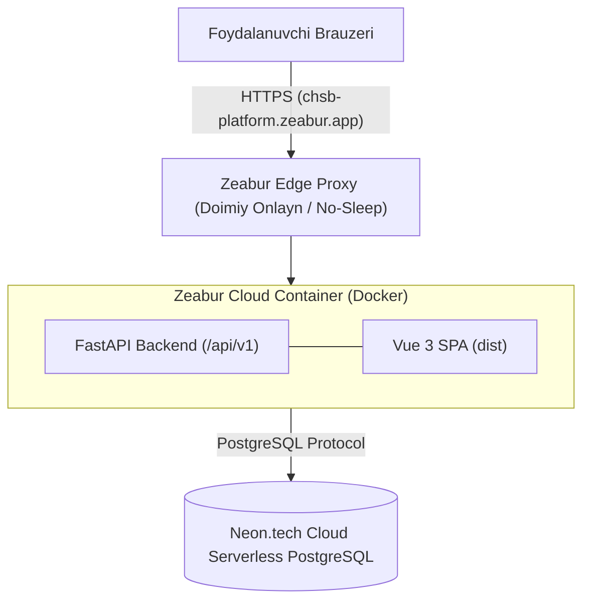

# Zeabur Cloud Deployment Architecture Plan
## Enterprise Full-Stack Deployment: Vue 3 + FastAPI + Prisma on Zeabur (All-in-One Docker)

> **Hujjat:** `docs/ZEABUR_DEPLOYMENT_PLAN.md`  
> **Muallif:** Senior DevOps Engineer & Solutions Architect  
> **Sana:** 2026-11-16  
> **Holati:** Tasdiqlangan va Amalga Oshirish Jarayonida  
> **Nega Zeabur?**  
> 1. Render kabi 15 daqiqada uxlab qolmaydi va o'chib ketmaydi.  
> 2. Hugging Face kabi bot-tekshiruv yoki 403 kvota cheklovlari yo'q.  
> 3. GitHub hisob nomlari mos kelmasligi (`Valijon21` vs `doniyorruswer-boop`) muammosini **Zeabur CLI** orqali to'g'ridan-to'g'ri lokal papkadan 1 ta buyruq bilan chetlab o'tish imkonini beradi.  
> 4. Bepul `.zeabur.app` doimiy domeni va avtomatik SSL taqdim etadi.  
> **Qoidaga Muvofiqlik:** "Reja (Plan .md) -> Tasklarga bo'lish -> Bosqichma-bosqich ishlab chiqish -> Testlash -> Git/GitHub push" qat'iy tartibi.

---

## 1. Arxitektura Yechimi

---

## 2. Rejalashtirilgan Bosqichlar (Waves & Tasks)

### Wave 1: Docker va Port Konfiguratsiyasi (Zeabur Moslashuvi)
- **Task 1.1:** `Dockerfile` ni standart konteyner portiga (`8000`) qayta sozlash va Zeabur multi-stage build optimallashuvi.
- **Task 1.2:** `docker-entrypoint.sh` da `PORT` qiymatini dinamik o'qish (Zeabur `$PORT` yoki `8000`).

### Wave 2: Zeabur Deployment Qo'llanmasi va CLI Integratsiyasi
- **Task 2.1:** `docs/ZEABUR_DEPLOYMENT_GUIDE.md` yo'riqnomasini yozish:
  - Usul A (Eng osoni): Terminal orqali `npx zeabur deploy` (GitHub muammolarisiz, to'g'ridan-to'g'ri terminaldan o'rnatish).
  - Usul B: Zeabur Dashboard orqali web-interfeysdan sozlash.
- **Task 2.2:** Environment variables (`DATABASE_URL`, `JWT_SECRET`) ni Zeabur-da kiritish yo'riqnomasi.

### Wave 3: Testlash va Tekshiruv (Comprehensive TDD / Verification)
- **Task 3.1:** `backend/tests/test_deployment_readiness.py` da Zeabur porti va production sozlamalarini testlash.
- **Task 3.2:** Barcha testlarni ishga tushirish (Frontend 341 tests, Backend 19 tests 100% PASS).

### Wave 4: Git Versiyalash va GitHub Push
- **Task 4.1:** O'zgarishlarni tekshirish, atomik Conventional Commit qilish va GitHub `main` tarmog'iga push qilish.
